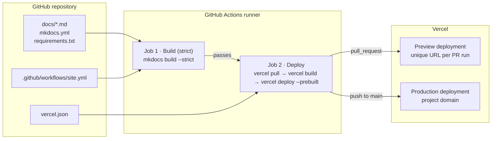
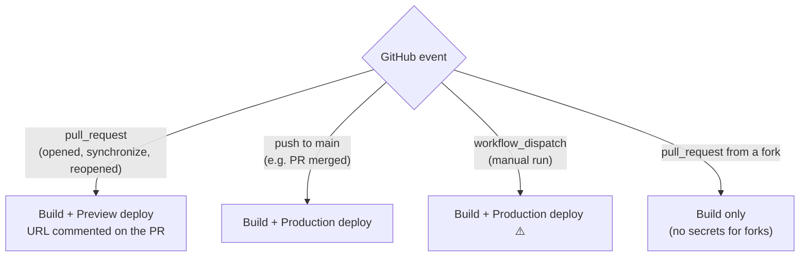
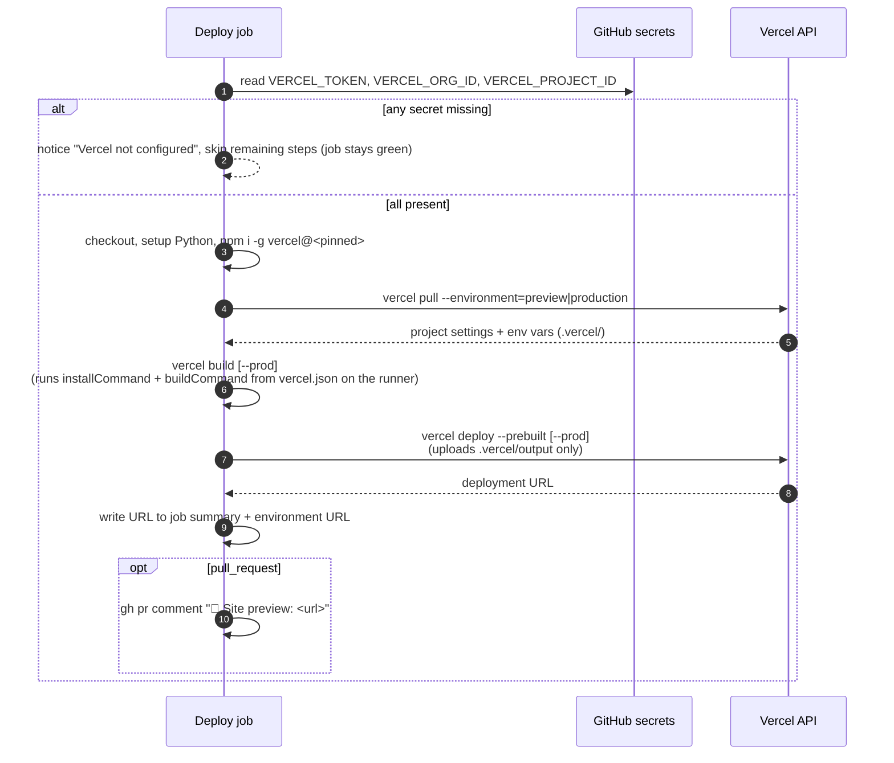

# Website CI/CD

How the documentation website is built, checked and deployed from this repository.

> This file lives in `.github/`, outside `docs/`, so it is **not published** to the website. MkDocs only builds what is under `docs/`.

---

## 1. Overview



| Layer | Technology | Defined in |
|---|---|---|
| Content | Markdown + Mermaid | `docs/` |
| Site generator | Material for MkDocs (MIT) | `mkdocs.yml`, `requirements.txt` |
| CI/CD | GitHub Actions | `.github/workflows/site.yml` |
| Hosting | Vercel (static) | `vercel.json` |
| Infra/policy checks (separate) | GitHub Actions | `.github/workflows/quality.yml` |

**Principle:** GitHub Actions is the **only** path to production. Vercel's own Git integration is disabled (`"git": {"deploymentEnabled": false}` in `vercel.json`), so a deploy always passes the strict build first, and there is never a second, unchecked deployment.

---

## 2. Triggers and environments



| Event | Build job | Deploy job | Vercel target | GitHub environment |
|---|---|---|---|---|
| `pull_request` (same repo) | ✅ | ✅ | Preview | `preview` |
| `pull_request` (fork) | ✅ | ⏭️ skipped | none | n/a |
| `push` to `main` | ✅ | ✅ | **Production** | `production` |
| `workflow_dispatch` | ✅ | ✅ | **Production** | `production` |

> ⚠️ A manual run (Actions tab → *site* → *Run workflow*, or `gh workflow run site`) is treated as **production**, because any event that isn't `pull_request` deploys with `--prod`. To get a preview, push a commit to the PR branch or re-run the PR's workflow run.

> ℹ️ **First deployment of a new Vercel project goes to production.** Vercel promotes a project's first deployment to production automatically, even when it was created as a preview (seen on this project's first PR run). After that, PR runs produce real previews.

**Concurrency:** `group: site-${{ github.ref }}` with `cancel-in-progress: true`. A newer push to the same branch cancels the older in-flight run, so only the latest commit deploys.

---

## 3. The pipeline, step by step

### Job 1: `Build (strict)`

The quality gate. It runs on every event, including fork PRs.

| Step | What it does |
|---|---|
| `actions/checkout@v4` | Checks out the commit |
| `actions/setup-python@v5` (3.12, pip cache) | Installs Python; caches pip downloads keyed on `requirements.txt` |
| `pip install -r requirements.txt` | Installs the **pinned** toolchain (`mkdocs`, `mkdocs-material`, `pymdown-extensions`) |
| `mkdocs build --strict` | Builds `site/`. **Strict mode turns warnings into failures**: broken internal links, missing anchors, pages missing from `nav`, invalid config |
| `actions/upload-artifact@v4` | Uploads `site/` as an artifact (kept 7 days) for inspection |

If this job fails, the deploy job never runs.

### Job 2: `Deploy to Vercel (preview | production)`

Runs only after the build passes, and never for fork PRs.



| Step | Notes |
|---|---|
| **Check Vercel configuration** | If any of the three secrets is empty, it prints a `::notice::` and skips the rest. The job shows ✅ even though **nothing was deployed**. Check the job's steps, or the "Vercel not configured" notice, before assuming a deploy happened |
| `vercel pull` | Fetches project settings for the target environment |
| `vercel build` | Runs `pip install -r requirements.txt` and `mkdocs build --strict` (from `vercel.json`) **on the GitHub runner** and produces `.vercel/output` |
| `vercel deploy --prebuilt` | Uploads the pre-built output. Vercel does no building, so build behaviour is identical to CI |
| PR comment | Posts the preview URL on the PR |

---

## 4. Configuration reference

### 4.1 GitHub secrets (Settings → Secrets and variables → Actions)

| Secret | Value | Sensitive? |
|---|---|---|
| `VERCEL_TOKEN` | Vercel access token, scoped to the team that owns the project, with an expiry | **Yes**. Rotate before expiry |
| `VERCEL_ORG_ID` | Team/org ID (`orgId` in `.vercel/project.json` after `vercel link`) | No |
| `VERCEL_PROJECT_ID` | Project ID (`projectId` in `.vercel/project.json`) | No |

### 4.2 Workflow permissions

```yaml
permissions:
  contents: read        # checkout only
  pull-requests: write  # post the preview URL comment
```

The `GITHUB_TOKEN` gets nothing else. No cloud credentials exist in this workflow besides the Vercel token.

### 4.3 `vercel.json`

| Key | Value | Purpose |
|---|---|---|
| `framework` | `null` | No framework auto-detection; plain static output |
| `installCommand` | `pip install -r requirements.txt` | Used by `vercel build` |
| `buildCommand` | `NO_MKDOCS_2_WARNING=1 mkdocs build --strict` | Same strict build as CI |
| `outputDirectory` | `site` | MkDocs output folder |
| `trailingSlash` | `true` | Matches MkDocs directory URLs (`/page/`) |
| `git.deploymentEnabled` | `false` | **Disables Vercel's Git auto-deploys** |
| `headers` | see below | Security headers on every response |

**Security headers:** `Content-Security-Policy` (self-hosted assets only, plus `api.github.com` for the repo widget), `Strict-Transport-Security`, `X-Frame-Options: DENY`, `X-Content-Type-Options: nosniff`, `Referrer-Policy`, `Permissions-Policy`.

### 4.4 Pinned versions

| Component | Pin | Where |
|---|---|---|
| Python | 3.12 | `site.yml` (`PYTHON_VERSION`) |
| MkDocs / Material / pymdown-extensions | exact versions | `requirements.txt` |
| Vercel CLI | exact version | `site.yml` (`VERCEL_CLI_VERSION`) |
| Mermaid | 11.x, vendored | `docs/assets/javascripts/mermaid.min.js` (+ `MERMAID_VERSION`) |
| GitHub Actions | major tags (`@v4`, `@v5`) | `site.yml` |

Pinning makes builds reproducible: the same commit produces the same site today and in six months.

---

## 5. Privacy and resilience choices

| Choice | Reason |
|---|---|
| **Vendored Mermaid** (`extra_javascript` in `mkdocs.yml`) instead of a CDN | No third-party requests from visitors; diagrams render identically on localhost, preview and production URLs. (Material's `privacy` plugin was tried, but it rewrites the asset URL to the absolute `site_url`, which breaks localhost and preview deployments.) |
| **System fonts** (`theme.font: false`) | No Google Fonts calls, so visitor IPs aren't sent to a third party |
| **Strict build in two places** (CI job + `vercel build`) | The deployed artifact is guaranteed to come from a build that passed strict checks |
| **Deploy skips without secrets** | Forks and fresh clones still get the build check without failing red |

---

## 6. Local development

```bash
python3 -m venv .venv && source .venv/bin/activate
pip install -r requirements.txt
mkdocs serve            # http://127.0.0.1:8000 with live reload
mkdocs build --strict   # exactly what CI runs
```

---

## 7. Making changes

| You want to... | Change | Pipeline effect |
|---|---|---|
| Edit or add content | `docs/**/*.md` (+ `nav` in `mkdocs.yml` for new pages) | PR → preview; merge → production |
| Change theme/navigation | `mkdocs.yml`, `docs/stylesheets/extra.css` | Same |
| Upgrade MkDocs/Material | `requirements.txt` | Strict build validates it on the PR |
| Upgrade Mermaid | Replace `docs/assets/javascripts/mermaid.min.js`, update `MERMAID_VERSION` | Check diagrams on the preview URL |
| Change security headers | `vercel.json` → `headers` | Test on the preview before merging (CSP can break rendering) |
| Upgrade the Vercel CLI | `VERCEL_CLI_VERSION` in `site.yml` | Next run uses it |
| Migrate to Zensical (Material's successor) | Swap the package in `requirements.txt` and the build command in `vercel.json` and `site.yml` | Strict build validates it |

---

## 8. Troubleshooting

| Symptom | Likely cause | Fix |
|---|---|---|
| Deploy job green, but no preview comment or URL | Secrets missing, so the job skipped | Check the job's steps for "Vercel not configured"; add the missing secret |
| `Aborted with N warnings in strict mode` | Broken link, missing anchor, or page not in `nav` | Run `mkdocs build --strict` locally; the warning names the file |
| Link works on GitHub but fails the build | Link points outside `docs/`, or the anchor slug differs | Use a full GitHub URL for files outside `docs/`; use the MkDocs anchor `id` |
| Deploy fails with 401/403 | Token expired, revoked, or scoped to the wrong team | Create a new token for the owning team; `gh secret set VERCEL_TOKEN` |
| Diagrams blank | Mermaid script not served | Confirm `extra_javascript` still lists `assets/javascripts/mermaid.min.js` |
| CSP errors in the browser console | A new external resource | Bundle it locally, or extend the CSP in `vercel.json` |
| Two deployments per push | Vercel Git integration re-enabled | Restore `"git": {"deploymentEnabled": false}` |

---

## 9. Related

- [`.github/workflows/site.yml`](workflows/site.yml): website pipeline
- [`.github/workflows/quality.yml`](workflows/quality.yml): Terraform, OPA and agent-hook checks (runs only when `iac/`, `agentic/` or `evidence/` change)
- [`vercel.json`](../vercel.json), [`mkdocs.yml`](../mkdocs.yml), [`requirements.txt`](../requirements.txt)
