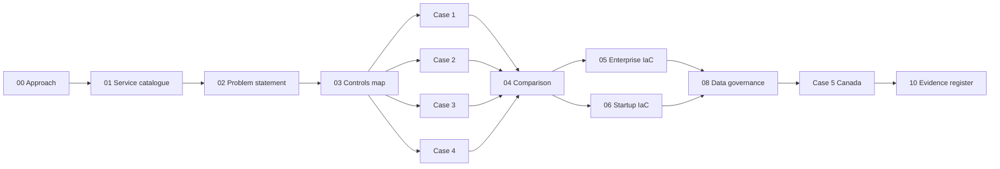
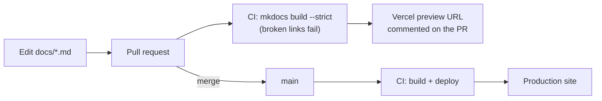

# GCP Fintech Architecture Playbook

> **Reference architectures for a regulated, real-time fraud platform on Google Cloud: one problem, five designs, two production-style Infrastructure-as-Code blueprints.**

*Architecture and IaC by **Kshitij Vengurlekar***

This playbook designs **Project Sentinel**, a GDPR-compliant payment-fraud platform for EU financial institutions. It then works through the trade-offs of building it at every point on the cloud management spectrum: fully managed, semi-managed, self-managed, and hybrid/multi-cloud. The same platform is then extended into **Canada under PIPEDA**. Every design is grounded in regulation (GDPR, PSD2, AML, DORA, PIPEDA, OSFI) and backed by Terraform, policy-as-code and an audit evidence model.

## Highlights

| Area | What is delivered |
|---|---|
| **Architecture** | 5 end-to-end designs for the same workload, with 60+ Mermaid diagrams covering topology, request flows, failure modes, operations and cost shape |
| **Regulatory engineering** | Control maps from GDPR / PSD2 / AML / DORA / PIPEDA / OSFI articles to concrete GCP controls; a resolution of the erasure-vs-retention conflict via crypto-shredding and legal-hold segregation |
| **Enterprise IaC** | Terraform landing zone (EU + Canada cells, Assured Workloads, VPC-SC, CMEK/HSM, locked audit trail), OPA policy-as-code, a CAB-gated change pipeline with ServiceNow, demand management, and a CI-enforced tech-debt register |
| **Startup IaC** | Keyless (OIDC) GitHub Actions, a reusable jurisdiction-cell module, and privacy registers (consent, disclosure, breach, DSR) built in from day one |
| **Engineering operating model** | Repository strategy for both organisations; an agentic, deliverable-per-session SDLC; a Claude Code agent platform with OpenCode and OpenHands on self-hosted GLM as an exit path ([configs](agentic/quillpay/)) |
| **Data governance** | Dataplex Universal Catalog, Sensitive Data Protection and BigQuery policy tags, plus OpenMetadata for the multi-cloud estate |
| **Audit readiness** | An evidence register mapping every control to its proof, Log Analytics queries, and a script that produces hash-sealed evidence packs |
| **Quality gates** | Terraform validated against `hashicorp/google` v8.11, Rego strict-checked, 66 diagrams parse-checked, and the site built with `--strict` in CI |

## The problem: Project Sentinel

> *Score every card and SEPA Instant payment for fraud in real time, keep a tamper-evident record of every decision, let customers see and dispute flagged payments, and let analysts improve fraud models, while meeting GDPR, PSD2, AML and DORA.*

The problem was chosen because it exercises **nearly every layer of a cloud platform** and carries a built-in **regulatory conflict**:

- **Streaming ingestion** (thousands of events/second)
- **Low-latency serving** (fraud decision in < 150 ms)
- **Strongly consistent system of record** (the decision ledger)
- **Analytics + ML** (model training on pseudonymised data)
- **Customer-facing APIs** (PSD2-style access)
- **Security and privacy** (encryption, key management, residency, perimeters)
- ⚖️ **GDPR "right to erasure" vs. AML "keep records for 5–10 years"**, resolved with *crypto-shredding plus legal-hold segregation* ([Chapter 2](docs/02-problem-statement.md))
- 🇨🇦 **A second jurisdiction.** Why PIPEDA is *not* a subset of GDPR, and how a cell-based architecture keeps both provable ([Case 5](docs/case-studies/05-canada-pipeda.md))

The designs are illustrated through two fictional organisations with opposite constraints:

| Organisation | Profile | Optimises for |
|---|---|---|
| 🏦 **Aldervane Bank** | 140-year-old EU retail bank, 9M customers, mainframe core banking, ITIL change process | Regulatory assurance, audit trails, change control, paying down technical debt |
| 🚀 **Quillpay** | 3-year-old EU payments startup, 60 engineers, Series B | Speed, unit cost, *compliance without slowing down* |

## Contents

| # | Chapter | Scope |
|---|---|---|
| 01 | [Google Cloud service catalogue](docs/01-gcp-service-catalog.md) | Every major GCP service, classified as **Managed / Semi-managed / Unmanaged** |
| 02 | [Problem statement: Project Sentinel](docs/02-problem-statement.md) | Requirements, data classification, the erasure-vs-retention conflict |
| 03 | [Compliance controls map](docs/03-compliance-controls.md) | GDPR, PSD2, AML, DORA, EBA outsourcing, mapped to technical controls |
| C1 | [Case 1: Fully managed](docs/case-studies/01-fully-managed.md) | Cloud Run, Pub/Sub, Dataflow, Spanner, BigQuery, Vertex AI, Apigee |
| C2 | [Case 2: Semi-managed](docs/case-studies/02-semi-managed.md) | GKE, Managed Kafka, AlloyDB, Memorystore, Dataproc, Composer |
| C3 | [Case 3: Least managed](docs/case-studies/03-least-managed.md) | Compute Engine, self-run Kafka, Flink, Patroni, Vault, sole-tenant nodes |
| C4 | [Case 4: Hybrid and multi-cloud](docs/case-studies/04-hybrid-multicloud.md) | Mainframe, Interconnect, Confluent, external key manager, AWS, Azure, SaaS |
| C5 | [Case 5: Canada and PIPEDA](docs/case-studies/05-canada-pipeda.md) | PIPEDA gap analysis, a Canadian data cell, evidence per principle |
| 04 | [Comparison and decision guide](docs/04-comparison.md) | Cost, effort, risk, compliance burden side by side |
| 05 | [Enterprise IaC](docs/iac/05-enterprise-iac.md) | Landing zone, change management, demand management, tech debt |
| 06 | [Startup IaC](docs/iac/06-startup-iac.md) | Lean, compliant-by-default Terraform with keyless CI |
| 11 | [Repository strategy](docs/engineering/11-repository-strategy.md) | Monorepo vs governed polyrepo, branching, CODEOWNERS, module versioning, GitOps |
| 12 | [Quillpay's agentic SDLC](docs/engineering/12-agentic-sdlc.md) | Deliverable per session, risk-tiered agent autonomy, compliance by construction |
| 13 | [Agent platform setup](docs/engineering/13-agent-platform.md) | Claude Code on Vertex AI (EU); OpenCode and OpenHands on self-hosted GLM |
| 08 | [Data governance](docs/08-data-governance.md) | Dataplex Universal Catalog, SDP, policy tags, OpenMetadata |
| 10 | [Evidence register](docs/10-evidence-register.md) | Control → implementation → evidence, with automated evidence packs |
| 07 | [Roadmap](docs/07-roadmap.md) | Implementation phases |

<details>
<summary><strong>Reader's guide</strong>: suggested reading path, conventions and glossary</summary>

New to the topic? Start with [Approach and conventions](docs/00-how-to-read.md), which defines the management spectrum and the shared-responsibility model used throughout, and keep the [glossary](docs/99-glossary.md) open. A suggested path:



</details>

---

## Repository layout

```text
.
├── docs/                       # Architecture documentation (published as the website)
│   ├── case-studies/           # Four architectures for the same problem
│   └── iac/                    # Narrative walkthroughs of the two IaC blueprints
└── iac/
    ├── enterprise/             # Aldervane Bank: landing zone, modules, policy-as-code,
    │   ├── landing-zone/       #   change management and demand intake
    │   ├── modules/
    │   ├── workloads/sentinel/
    │   ├── policies/           #   OPA/Conftest guardrails run against `terraform plan`
    │   ├── change-management/  #   CAB-gated Cloud Build pipeline
    │   ├── demand-management/  #   Demand intake template and lifecycle
    │   └── TECH_DEBT.md        #   Living tech-debt register
    └── startup/                # Quillpay: lean, opinionated, compliant-by-default
        ├── modules/platform/   #   One jurisdiction cell, incl. privacy registers
        ├── envs/{staging,prod-eu,prod-ca}/
        ├── bootstrap/          #   State bucket + keyless GitHub OIDC
        ├── policies/           #   Lean conftest guardrails
        └── ci/                 #   GitHub Actions workflow (copy into .github/)
agentic/quillpay/               # Agent platform configs: AGENTS.md, CLAUDE.md, .claude/, OpenCode, OpenHands, vLLM
evidence/                       # collect-evidence.sh: hash-sealed audit evidence packs
```

## Website and CI/CD

The `docs/` folder is published as a website with [Material for MkDocs](https://squidfunk.github.io/mkdocs-material/) (MIT), deployed to Vercel by GitHub Actions ([`.github/workflows/site.yml`](.github/workflows/site.yml)).



| Task | Command |
|---|---|
| Preview locally | `pip install -r requirements.txt && mkdocs serve` |
| Strict build (same as CI) | `mkdocs build --strict` |
| Publish | Merge a PR to `main` |

Infrastructure and policy changes are gated separately by [`.github/workflows/quality.yml`](.github/workflows/quality.yml) (Terraform fmt/validate, OPA strict check, agent-hook regression tests).

## Status

| Phase | Scope | Status |
|---|---|---|
| 1 | Architecture case studies, service catalogue, IaC blueprints | ✅ This version |
| 2 | Deployable reference implementation of Case 1 (startup track) | 🔜 Planned |
| 3 | Enterprise landing zone end-to-end, with policy tests in CI | 🔜 Planned |
| 4 | Semi-managed and hybrid implementations, chaos and DR drills | 🔜 Planned |

See the [roadmap](docs/07-roadmap.md).

## Disclaimer

- **Not advice.** This is independent reference architecture work. It is **not legal, regulatory, compliance, security or financial advice**. Regulatory content (GDPR, PIPEDA, Quebec Law 25, PSD2, AML/AMLR, FINTRAC, DORA, OSFI, RPAA, PCI DSS, EU AI Act) is paraphrased and simplified, and may be incomplete or out of date. Consult qualified legal and compliance professionals for your situation.
- **Fictional.** Aldervane Bank, Quillpay, Brightkey and every person, incident, figure and document reference (CHG, DPIA, SEC-SA numbers) are invented. Any resemblance to real organisations is coincidental.
- **Point in time.** Service names, features, regional availability and Terraform provider behaviour reflect Google Cloud and `hashicorp/google` **v8.11** as of **November 2026**. Check the official documentation before you rely on any detail.
- **Reference-quality IaC.** The Terraform passes `terraform validate` but has **not been applied to a live organisation**. Review it, run `terraform plan`, and test it in a sandbox organisation first. Some settings (retention locks) are **irreversible**.
- **No affiliation.** Not affiliated with or endorsed by Google, HashiCorp, or any vendor mentioned. Product names are trademarks of their owners.

## Licence

- **Code** (Terraform, Rego, shell, YAML): [MIT](LICENSE)
- **Documentation and diagrams**: [CC BY 4.0](LICENSE-docs.md). Please credit *"GCP Fintech Architecture Playbook" by Kshitij Vengurlekar*.
