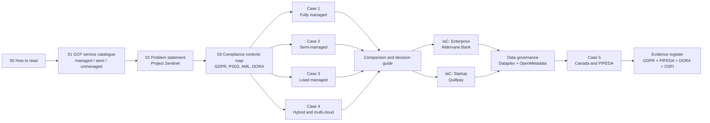

# GCP Fintech Architecture Playbook

> **One GDPR-compliant financial platform, built four different ways on Google Cloud, plus two Infrastructure-as-Code blueprints: one for a regulated enterprise, one for a fast-growing startup.**

This repository is a learning resource written as a **series of connected case studies**. Each chapter follows two fictional organisations as they solve the *same* business problem with a different philosophy about **how much of the stack they want Google to run for them**.

| Character | Who they are | What they care about |
|---|---|---|
| 🏦 **Aldervane Bank** | 140-year-old EU retail bank, 9M customers, mainframe core banking, ITIL change process | Regulators, audit trails, change control, paying down technical debt |
| 🚀 **Quillpay** | 3-year-old EU payments startup, 60 engineers, Series B | Speed, unit cost, *compliance without slowing down* |

> All companies, people and incidents in this repository are fictional. Regulatory notes are for learning only and are **not legal advice**.

---

## The problem we solve: "Project Sentinel"

> *Score every card and SEPA Instant payment for fraud in real time, keep a tamper-evident record of every decision, let customers see and dispute flagged payments, and let analysts improve fraud models, while meeting GDPR, PSD2, AML and DORA.*

Why this problem? It's a good teaching example because it touches **nearly every part of a cloud platform** and has a built-in **regulatory conflict**:

- **Streaming ingestion** (thousands of events/second)
- **Low-latency serving** (fraud decision in < 150 ms)
- **Strongly consistent system of record** (the decision ledger)
- **Analytics + ML** (model training on pseudonymised data)
- **Customer-facing APIs** (PSD2-style access)
- **Security and privacy** (encryption, key management, residency, perimeters)
- ⚖️ **GDPR "right to erasure" vs. AML "keep records for 5–10 years"**. How do you delete someone and keep them at the same time? (Answer: *crypto-shredding plus legal-hold segregation*. See [Chapter 2](docs/02-problem-statement.md).)
- 🇨🇦 **A second jurisdiction.** Expanding to Canada shows why PIPEDA is *not* a subset of GDPR, and how a cell-based architecture keeps both provable ([Case 5](docs/case-studies/05-canada-pipeda.md)).

---

## Reading path



| # | Chapter | What you'll learn |
|---|---|---|
| 00 | [How to read this repo](docs/00-how-to-read.md) | Conventions, the "management spectrum", prerequisites |
| 01 | [Google Cloud service catalogue](docs/01-gcp-service-catalog.md) | Every major GCP service, classified as **Managed / Semi-managed / Unmanaged** |
| 02 | [Problem statement: Project Sentinel](docs/02-problem-statement.md) | Functional and non-functional requirements, data classification, the erasure-vs-retention puzzle |
| 03 | [Compliance controls map](docs/03-compliance-controls.md) | GDPR articles, PSD2, AML, DORA, EBA outsourcing, mapped to technical controls |
| C1 | [Case 1: Fully managed](docs/case-studies/01-fully-managed.md) | Cloud Run, Pub/Sub, Dataflow, Spanner, BigQuery, Vertex AI, Apigee |
| C2 | [Case 2: Semi-managed](docs/case-studies/02-semi-managed.md) | GKE, Managed Kafka, AlloyDB, Memorystore, Dataproc, Composer |
| C3 | [Case 3: Least managed](docs/case-studies/03-least-managed.md) | Compute Engine, self-run Kafka, Flink, Patroni, Vault, sole-tenant nodes |
| C4 | [Case 4: Hybrid and multi-cloud](docs/case-studies/04-hybrid-multicloud.md) | On-prem mainframe, Interconnect, Confluent, external key manager, AWS, Azure, SaaS |
| 04 | [Comparison and decision guide](docs/04-comparison.md) | Cost, effort, risk, compliance burden side by side |
| 05 | [IaC for the enterprise](docs/iac/05-enterprise-iac.md) | Landing zone, change management, demand management, tech-debt handling |
| 06 | [IaC for the startup](docs/iac/06-startup-iac.md) | Lean, compliant-by-default Terraform plus GitHub Actions with keyless auth |
| 08 | [Data governance](docs/08-data-governance.md) | Google-native governance (Dataplex Universal Catalog, SDP, policy tags) and OpenMetadata for the hybrid estate |
| C5 | [Case 5: Canada and PIPEDA](docs/case-studies/05-canada-pipeda.md) | Is PIPEDA a subset of GDPR? (No.) Gap analysis, a Canadian data cell, and evidence per principle |
| 10 | [Evidence register](docs/10-evidence-register.md) | Every control → implementation → evidence artifact, plus Log Analytics queries and automated evidence packs |
| 07 | [Roadmap: implementation phases](docs/07-roadmap.md) | What gets built next, and in what order |
| 99 | [Glossary](docs/99-glossary.md) | Acronyms decoded |

---

## Repository layout

```text
.
├── docs/                       # The story: tutorials and case studies
│   ├── case-studies/           # Four architectures for the same problem
│   └── iac/                    # Narrative walkthroughs of the two IaC blueprints
└── iac/
    ├── enterprise/             # Aldervane Bank: landing zone, modules, policy-as-code,
    │   ├── landing-zone/       #   change management and demand intake
    │   ├── modules/
    │   ├── workloads/sentinel/
    │   ├── policies/           #   OPA/Conftest guardrails run against `terraform plan`
    │   ├── change-management/  #   CAB-gated Cloud Build pipeline
    │   ├── demand-management/  #   Demand intake template and lifecycle
    │   └── TECH_DEBT.md        #   Living tech-debt register
    └── startup/                # Quillpay: lean, opinionated, compliant-by-default
        ├── modules/platform/   #   One jurisdiction cell, incl. privacy registers
        ├── envs/{staging,prod-eu,prod-ca}/
        ├── bootstrap/          #   State bucket + keyless GitHub OIDC
        ├── policies/           #   Lean conftest guardrails
        └── ci/                 #   GitHub Actions workflow (copy into .github/)
evidence/                       # collect-evidence.sh: hash-sealed audit evidence packs
```

## Status

| Phase | Scope | Status |
|---|---|---|
| 1 | Architecture case studies, service catalogue, IaC blueprints | ✅ This version |
| 2 | Deployable reference implementation of Case 1 (startup track) | 🔜 Planned |
| 3 | Enterprise landing zone end-to-end, with policy tests in CI | 🔜 Planned |
| 4 | Semi-managed and hybrid implementations, chaos and DR drills | 🔜 Planned |

See the [roadmap](docs/07-roadmap.md).

## Disclaimer

- **Not advice.** Everything here is for **education and portfolio demonstration only**. It is **not legal, regulatory, compliance, security or financial advice**. Regulatory content (GDPR, PIPEDA, Quebec Law 25, PSD2, AML/AMLR, FINTRAC, DORA, OSFI, RPAA, PCI DSS, EU AI Act) is paraphrased and simplified, and may be incomplete or out of date. Consult qualified legal and compliance professionals for your situation.
- **Fictional.** Aldervane Bank, Quillpay, Brightkey and every person, incident, figure and document reference (CHG, DPIA, SEC-SA numbers) are invented. Any resemblance to real organisations is coincidental.
- **Point in time.** Service names, features, regional availability and Terraform provider behaviour reflect Google Cloud and `hashicorp/google` **v8.11** as of **November 2026**. Check the official documentation before you rely on any detail.
- **Reference-quality IaC.** The Terraform passes `terraform validate` but has **not been applied to a live organisation**. Review it, run `terraform plan`, and test it in a sandbox organisation first. Some settings (retention locks) are **irreversible**.
- **No affiliation.** Not affiliated with or endorsed by Google, HashiCorp, or any vendor mentioned. Product names are trademarks of their owners.

## Licence

- **Code** (Terraform, Rego, shell, YAML): [MIT](LICENSE)
- **Documentation and diagrams**: [CC BY 4.0](LICENSE-docs.md). Please credit *"GCP Fintech Architecture Playbook" by Kshitij Vengurlekar*.
