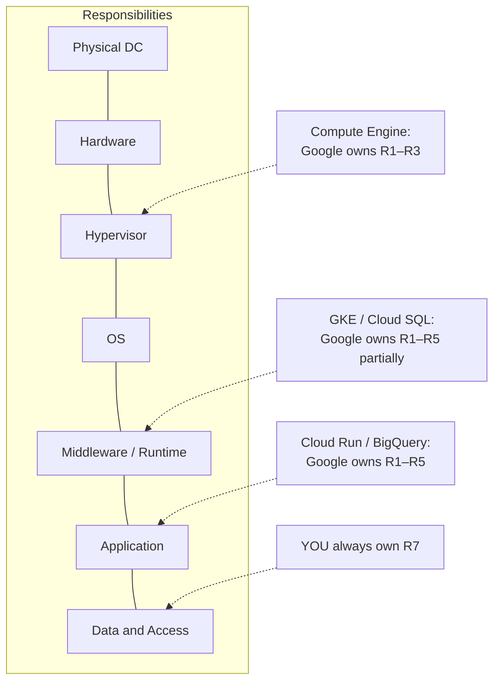

# 00 · How to Read This Repository

> ⚖️ **Disclaimer:** educational material only. This is **not legal, regulatory, compliance or financial advice**. Regulations are paraphrased and simplified; organisations, people and incidents are fictional. Consult qualified counsel before you rely on any of it. [Full disclaimer](../README.md#disclaimer)

## The one idea that ties everything together: the management spectrum

Every cloud service sits somewhere on a line between **"Google runs it all"** and **"you run it all"**. Where you sit decides your operational load, your share of compliance work, your cost profile and your exit options.

```mermaid
flowchart LR
    subgraph U["Unmanaged / IaaS"]
        U1["You patch the OS"]
        U2["You size, scale, back up"]
        U3["You own HA and DR"]
    end
    subgraph S["Semi-managed"]
        S1["Google runs the control plane"]
        S2["You choose sizes and versions"]
        S3["Shared upgrade and HA duties"]
    end
    subgraph M["Fully managed / Serverless"]
        M1["No servers to see"]
        M2["Auto-scaling, pay per use"]
        M3["You own data, IAM and config"]
    end
    U -->|"less control, less toil"| S -->|"less control, less toil"| M
```

### Working definitions used throughout

| Tier | Definition | You still own | Examples |
|---|---|---|---|
| **Fully managed** | No infrastructure to size or patch. Usually serverless, scales to zero or scales automatically, priced per request, GB or slot. | Data, IAM, configuration, code, keys (if CMEK) | Cloud Run, BigQuery, Pub/Sub, Spanner, Firestore |
| **Semi-managed** | Google runs the control plane, patching and failover, but **you** choose instance or node shapes, versions, maintenance windows, scaling policy and sometimes cluster topology. | All of the above, plus capacity planning, version upgrades, workload HA design | GKE Standard, Cloud SQL, AlloyDB, Dataproc, Memorystore, Managed Kafka |
| **Unmanaged (IaaS)** | Google provides virtual or physical hardware, network and storage primitives. Everything above the hypervisor is yours. | All of the above, plus OS, middleware, patching, clustering, backups, monitoring agents | Compute Engine, Bare Metal Solution, sole-tenant nodes |

> **Rule of thumb:** *The more managed the service, the more of the compliance evidence Google can hand you* (SOC 2, ISO 27001/27017/27018, PCI DSS attestations, C5 in Germany), and the less evidence you have to produce yourself.

### Shared responsibility moves with the tier

**Data, identities and access decisions are always yours.** No cloud tier removes your duties as a GDPR *controller*.

## How each case study is structured

Every case study in [`docs/case-studies/`](case-studies/) has the same sections, so you can compare them side by side:

1. **The story**: who decided what, and why
2. **Architecture diagram** (Mermaid)
3. **Request flow**: a sequence diagram of one payment being scored
4. **Service-by-service walkthrough**
5. **GDPR and financial compliance mapping**
6. **Operations**: who gets paged at 3 a.m.?
7. **Cost shape**
8. **What can go wrong** (failure modes and anti-patterns)
9. **Key takeaways**

## Prerequisites

| To read | To implement later |
|---|---|
| Basic cloud concepts (VPC, IAM, regions) | A GCP organisation (a free Cloud Identity is enough for a sandbox) |
| A rough idea of what GDPR is | Terraform ≥ 1.9 or OpenTofu ≥ 1.8 |
| No coding required | `gcloud` CLI, a billing account, and optionally Conftest for policy tests |

## Conventions

- **Regions:** primary `europe-west3` (Frankfurt), secondary `europe-west4` (Netherlands). Both are in the EU, which keeps residency simple.
- **Naming:** `{org}-{env}-{workload}-{component}`, e.g. `adv-prd-sentinel-ledger`.
- 🏦 marks something specific to **Aldervane Bank** (enterprise); 🚀 marks something specific to **Quillpay** (startup).
- ⚠️ marks a common mistake or compliance trap.
