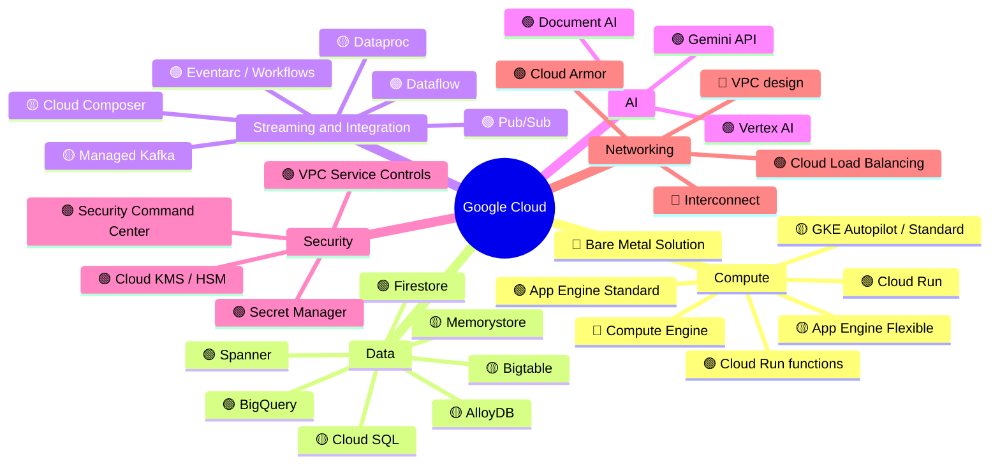
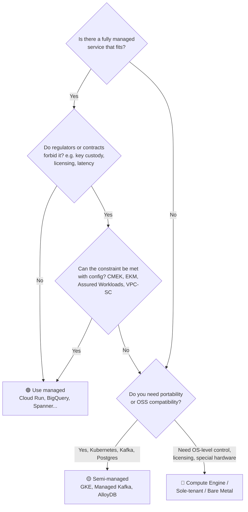

# 01 · The Google Cloud Service Catalogue: Managed, Semi-managed, Unmanaged

> ⚖️ Not legal or compliance advice. Regulations are paraphrased; organisations and people are fictional. [Disclaimer](disclaimer.md)

> **Scenario:** Priya, Aldervane Bank's new Head of Cloud Architecture, gets a simple-sounding question from the CIO on her first day: *"Which of these 200 Google services do we actually have to run ourselves?"* This chapter is her answer.

Classification uses the definitions from [Chapter 00](00-how-to-read.md):

- 🟢 **Managed**: fully managed or serverless; nothing to size or patch
- 🟡 **Semi-managed**: Google runs the control plane; you size, version and tune
- 🔴 **Unmanaged**: IaaS; you own everything above the hypervisor

Some services can run in more than one mode (for example GKE **Autopilot** is close to 🟢, while GKE **Standard** is 🟡). Where that happens, both modes are listed.

> ⚠️ Google renames and retires products regularly. This list reflects the portfolio as of late 2026. Names shown as *(formerly X)* help you match older blog posts and certifications.

---

## Overview mind map

---

## 1. Compute

| Service | Tier | What it is | You manage |
|---|---|---|---|
| **Cloud Run** (services, jobs, worker pools) | 🟢 | Serverless containers, scale to zero, request- or instance-based billing | Container image, concurrency, min/max instances, IAM |
| **Cloud Run functions** *(formerly Cloud Functions 2nd gen)* | 🟢 | Event-driven functions built on Cloud Run | Code, triggers |
| **App Engine Standard** | 🟢 | Legacy PaaS with sandboxed runtimes | Code, `app.yaml` (new projects usually pick Cloud Run) |
| **App Engine Flexible** | 🟡 | PaaS on managed VMs | Instance sizing, scaling settings |
| **GKE Autopilot** | 🟢/🟡 | Kubernetes where Google manages nodes; you pay per pod | Workloads, manifests, upgrades policy, namespaces, network policy |
| **GKE Standard** | 🟡 | Managed control plane, node pools you size | Node pools, machine types, upgrades, autoscaling, node security |
| **GKE Enterprise** *(formerly Anthos)* | 🟡 | Multi-cluster and hybrid fleet management, Config Sync, Policy Controller, service mesh | Fleet design, clusters on-prem or in other clouds |
| **Compute Engine** | 🔴 | Virtual machines (general, compute, memory, GPU/TPU, Arm/Axion families) | OS, patching, agents, scaling via MIGs, backups |
| **Managed Instance Groups (MIGs)** | 🔴/🟡 | Autoscaling, autohealing VM groups | Instance template, health checks |
| **Sole-tenant nodes** | 🔴 | Dedicated physical hosts (licensing, isolation) | Everything a VM needs, plus host placement |
| **Confidential VMs / Confidential GKE nodes** | 🔴/🟡 | Memory encryption in use (AMD SEV-SNP, Intel TDX) | As VM or GKE |
| **Spot VMs** | 🔴 | Deeply discounted, can be reclaimed at any time | Interruption handling |
| **Batch** | 🟢 | Managed batch job scheduling on Compute Engine | Job definitions |
| **Bare Metal Solution** | 🔴 | Dedicated physical servers in Google-adjacent DCs (e.g. Oracle) | Everything above the hardware |
| **Google Cloud VMware Engine** | 🟡 | Google runs the vSphere stack; you run the VMs | VMs, guest OS, vSphere configuration |
| **TPUs / GPUs (Cloud TPU, A3/A4 VMs)** | 🔴/🟡 | AI accelerators | Drivers (VMs) or use via Vertex AI (🟢) |

## 2. Storage

| Service | Tier | What it is | You manage |
|---|---|---|---|
| **Cloud Storage** | 🟢 | Object storage (Standard / Nearline / Coldline / Archive), Bucket Lock, Object Retention Lock | Bucket layout, lifecycle rules, retention policies |
| **Persistent Disk / Hyperdisk** | 🔴 | Block storage for VMs | Size, snapshots, encryption keys |
| **Local SSD** | 🔴 | Ephemeral high-IOPS disks | Data durability (it disappears with the VM) |
| **Filestore** | 🟡 | Managed NFS (Basic, Zonal, Regional, Enterprise tiers) | Capacity tier, performance tier |
| **NetApp Volumes** | 🟡 | Managed NetApp ONTAP file storage | Volumes, pools, replication |
| **Parallelstore / Managed Lustre** | 🟡 | High-performance parallel file systems for HPC and AI | Capacity, striping |
| **Backup and DR Service** | 🟢 | Centralised backup for VMs, databases, GKE; backup vaults with immutability | Policies, vault retention |
| **Storage Transfer Service** | 🟢 | Bulk transfer from S3, Azure Blob, on-prem | Transfer jobs |
| **Transfer Appliance** | 🔴 | Physical device for offline data migration | Shipping, loading |

## 3. Databases

| Service | Tier | Engine / Model | You manage |
|---|---|---|---|
| **Spanner** | 🟢 | Globally consistent relational (GoogleSQL / PostgreSQL dialect), 99.999% multi-region | Schema, compute capacity (processing units) or autoscaler |
| **Firestore** | 🟢 | Serverless document DB (Native and MongoDB-compatible modes) | Data model, indexes, security rules |
| **BigQuery** | 🟢 | Serverless data warehouse and lakehouse (BigLake, Iceberg) | Datasets, slots or on-demand, governance |
| **Cloud SQL** | 🟡 | Managed MySQL, PostgreSQL, SQL Server | Tier/size, HA config, maintenance window, flags, read replicas |
| **AlloyDB for PostgreSQL** | 🟡 | PostgreSQL-compatible, columnar engine, AI features; AlloyDB Omni runs anywhere | Instance sizing, read pools |
| **Bigtable** | 🟡 | Wide-column NoSQL, HBase API | Node count or autoscaling, schema/row-key design |
| **Memorystore** (Redis, Redis Cluster, Valkey, Memcached) | 🟡 | Managed in-memory caches | Capacity, tier, replicas |
| **Database Migration Service** | 🟢 | Online migrations to Cloud SQL, AlloyDB, Spanner | Migration jobs |
| **Datastream** | 🟢 | Serverless change data capture (Oracle, MySQL, PostgreSQL, SQL Server to BigQuery or GCS) | Streams, connection profiles |
| **Self-managed DB on Compute Engine** | 🔴 | Any engine you install | Everything |

## 4. Data analytics and integration

| Service | Tier | What it is |
|---|---|---|
| **BigQuery** (plus BI Engine, BigQuery ML, BigQuery Omni) | 🟢 | Warehouse, in-database ML, cross-cloud queries over AWS S3 / Azure Blob |
| **Dataflow** | 🟢 | Serverless Apache Beam (batch and streaming), autoscaling workers |
| **Pub/Sub** (and Pub/Sub Lite, deprecated) | 🟢 | Global messaging, exactly-once delivery option, BigQuery/GCS subscriptions |
| **Managed Service for Apache Kafka** | 🟡 | Google-run Kafka clusters; you choose vCPU/memory and topics |
| **Dataproc** (on GCE) | 🟡 | Managed Spark/Hadoop clusters you size |
| **Dataproc Serverless / Serverless for Apache Spark** | 🟢 | Spark without clusters |
| **Cloud Composer** | 🟡 | Managed Apache Airflow; you choose environment size and workers |
| **Dataform** | 🟢 | SQL pipelines (ELT) in BigQuery with Git |
| **Cloud Data Fusion** | 🟡 | Visual ETL (CDAP); you choose edition/instance |
| **Dataplex Universal Catalog** *(absorbed Data Catalog)* | 🟢 | Data governance, lineage, quality, metadata, business glossary |
| **Analytics Hub** | 🟢 | Secure data sharing exchanges |
| **Looker / Looker Studio** | 🟢 | Semantic-layer BI / free dashboards |
| **Eventarc** | 🟢 | Event routing (CloudEvents) |
| **Workflows** | 🟢 | Serverless orchestration of APIs and services |
| **Cloud Tasks / Cloud Scheduler** | 🟢 | Async task queues / cron |
| **Application Integration / Integration Connectors** | 🟢 | iPaaS with connectors to SaaS and on-prem systems |
| **Apigee** (X, hybrid) | 🟢 (X) / 🟡 (hybrid) | Full API management: products, monetisation, security |
| **API Gateway** | 🟢 | Lightweight managed gateway for serverless back ends |

## 5. AI and machine learning

| Service | Tier | What it is |
|---|---|---|
| **Vertex AI** (Training, Prediction/Endpoints, Pipelines, Feature Store, Model Registry, Experiments, Model Monitoring) | 🟢 | End-to-end MLOps platform |
| **Vertex AI Agent Builder / Agent Engine** | 🟢 | Building and hosting AI agents, RAG, search |
| **Gemini models (via Vertex AI)** | 🟢 | Foundation models with EU data residency options |
| **Model Garden** | 🟢/🟡 | Open and partner models, deployable to managed endpoints or GKE |
| **Document AI** | 🟢 | Document parsing (KYC documents, invoices) |
| **Speech-to-Text / Text-to-Speech / Translation / Vision / Natural Language** | 🟢 | Pre-trained APIs |
| **Self-hosted ML** (Kubeflow, MLflow, Ray on GKE or VMs) | 🟡/🔴 | You run the stack |

## 6. Networking

| Service | Tier | What it is |
|---|---|---|
| **VPC** (subnets, routes, firewall policies) | 🔴 *(design is yours)* | Software-defined global network |
| **Shared VPC** | 🔴 | Central host project shares subnets with service projects |
| **Cloud Load Balancing** (global/regional, L4/L7) | 🟢 | Anycast global load balancer |
| **Cloud CDN / Media CDN** | 🟢 | Edge caching |
| **Cloud Armor** | 🟢 | WAF, DDoS protection, bot management, adaptive protection |
| **Cloud NAT** | 🟢 | Managed egress NAT |
| **Cloud DNS** (public, private, DNSSEC) | 🟢 | Managed DNS |
| **Cloud VPN (HA VPN)** | 🟢 | IPsec to on-prem or other clouds |
| **Cloud Interconnect** (Dedicated, Partner, Cross-Cloud Interconnect) | 🔴/🟡 | Private physical connectivity, including direct links to AWS, Azure, OCI |
| **Network Connectivity Center** | 🟢 | Hub-and-spoke for hybrid and multi-VPC |
| **Private Service Connect** | 🟢 | Private endpoints for Google and third-party services |
| **Cloud Service Mesh** | 🟡 | Managed Istio control plane |
| **Secure Web Proxy** | 🟢 | Managed egress proxy with URL filtering |
| **Cloud NGFW** (Essentials, Standard, Enterprise) | 🟢 | Distributed firewall with IPS (Palo Alto-powered threat inspection) |

## 7. Security, identity and compliance

| Service | Tier | What it is | Why a bank cares |
|---|---|---|---|
| **Cloud IAM** (incl. IAM Deny, PAM, Conditions) | 🟢 | Identity and access, including just-in-time privileged access | Least privilege, SoD |
| **Workforce / Workload Identity Federation** | 🟢 | Federate Entra ID, Okta, GitHub, AWS without service account keys | No long-lived secrets |
| **Cloud Identity / Google Workspace** | 🟢 | Directory | Joiner/mover/leaver |
| **Identity-Aware Proxy (IAP)** | 🟢 | Zero-trust access to apps and VMs | Replaces VPN and bastions |
| **Chrome Enterprise Premium** *(formerly BeyondCorp Enterprise)* | 🟢 | Context-aware zero-trust access | Device posture checks |
| **Cloud KMS** | 🟢 | Key management (software keys) | CMEK, crypto-shredding |
| **Cloud HSM** | 🟢 | FIPS 140-2 Level 3 HSM-backed keys | Regulator expectations |
| **Cloud External Key Manager (EKM)** | 🟢 | Keys held outside Google (Thales, Fortanix, Entrust...) | Sovereignty: Google cannot decrypt without your key |
| **Single-tenant Cloud HSM** | 🟡 | Dedicated HSM partitions | Highest isolation |
| **Secret Manager** | 🟢 | Secrets with versioning and regional replication | No secrets in code |
| **Certificate Authority Service / Certificate Manager** | 🟢 | Private PKI / TLS certificates | mTLS everywhere |
| **VPC Service Controls** | 🟢 | Service perimeters against data exfiltration | Core GDPR control |
| **Access Context Manager** | 🟢 | Access levels (IP, device, identity) | Context-aware perimeters |
| **Assured Workloads** (EU Regions and Support, sovereign controls) | 🟢 | Enforced data residency, personnel access controls | EU sovereignty |
| **Access Transparency / Access Approval** | 🟢 | Logs and approval of Google staff access | Outsourcing oversight (EBA) |
| **Key Access Justifications** | 🟢 | A reason code on every EKM key request | Sovereignty proof |
| **Sensitive Data Protection** *(formerly Cloud DLP)* | 🟢 | Discovery, classification, de-identification, tokenisation | GDPR Art. 25 / 32 |
| **Security Command Center** (Standard, Premium, Enterprise) | 🟢 | CSPM, threat detection, compliance dashboards | Continuous assurance |
| **Google Security Operations** *(formerly Chronicle SIEM/SOAR)* | 🟢 | Cloud-native SIEM and SOAR | 72-hour breach detection |
| **Mandiant Threat Intelligence / Incident Response** | 🟢 (service) | Threat intel and IR retainer | DORA incident readiness |
| **Binary Authorization** | 🟢 | Only signed and attested images deploy | Supply chain security |
| **Artifact Analysis** | 🟢 | Vulnerability scanning of images and packages | |
| **Web Security Scanner** | 🟢 | DAST for App Engine, GKE, Compute | |
| **reCAPTCHA / Fraud Defense** | 🟢 | Bot and fraud signals | Account takeover |
| **Organization Policy Service** | 🟢 | Preventive guardrails (resource locations, no public IPs, ...) | Policy-as-code |
| **Policy Intelligence** (Recommender, Policy Analyzer, Policy Troubleshooter) | 🟢 | IAM right-sizing | Access reviews |

## 8. DevOps, management and observability

| Service | Tier | What it is |
|---|---|---|
| **Cloud Build** (incl. private pools) | 🟢 | CI/CD build execution |
| **Cloud Deploy** | 🟢 | Managed continuous delivery to GKE, Cloud Run |
| **Artifact Registry** *(replaces Container Registry, shut down)* | 🟢 | Containers, language packages, remote/virtual repos |
| **Infrastructure Manager** | 🟢 | Google-managed Terraform runs |
| **Config Connector / Config Controller** | 🟡/🟢 | Manage GCP resources as Kubernetes objects |
| **Cloud Workstations** | 🟢 | Managed secure developer environments |
| **Gemini Code Assist / Gemini Cloud Assist** | 🟢 | AI coding and ops assistants |
| **Cloud Logging** (log buckets, Log Analytics, bucket lock) | 🟢 | Centralised, retention-locked logs |
| **Cloud Monitoring / Managed Service for Prometheus** | 🟢 | Metrics, SLOs, alerting |
| **Cloud Trace / Profiler / Error Reporting** | 🟢 | APM |
| **Cloud Asset Inventory** | 🟢 | Point-in-time and historical inventory of all resources |
| **Active Assist / Recommender** | 🟢 | Cost, security, performance recommendations |
| **Billing, Budgets, FinOps hub, Committed Use Discounts** | 🟢 | Cost governance |
| **Service Health / Personalized Service Health** | 🟢 | Incident communications (DORA input) |

## 9. Hybrid, multicloud and migration

| Service | Tier | What it is |
|---|---|---|
| **Google Distributed Cloud** (connected / air-gapped) | 🟡 | Google Cloud services on hardware in your DC or at the edge |
| **GKE Enterprise attached clusters / GKE on AWS & Azure** | 🟡 | Manage EKS, AKS and on-prem clusters from one fleet |
| **BigQuery Omni** | 🟢 | Query data in S3 / Azure Blob in place |
| **Cross-Cloud Interconnect / Cross-Cloud Network** | 🟡 | Private links between GCP and other clouds |
| **Migration Center** | 🟢 | Discovery, TCO, migration planning |
| **Migrate to Virtual Machines / Migrate to Containers** | 🟢 | Lift-and-shift or containerise |
| **Sovereign cloud partner offerings** | 🟢/🟡 | Partner-operated sovereign controls in some EU countries (for example T-Systems in Germany, S3NS in France) |

---

## Cheat sheet: which tier should I default to?

> **Priya's takeaway:** *"Out of roughly 200 services, we only have to run the operating system ourselves for about a dozen. Everything else is a question of configuration and governance, and that's where compliance actually lives."*

➡️ Next: [02 · Problem Statement](02-problem-statement.md)
