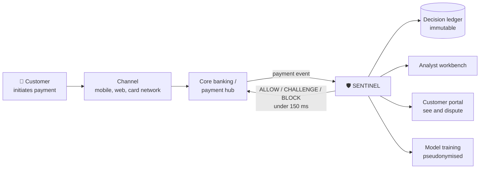
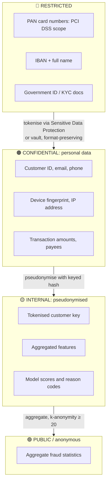
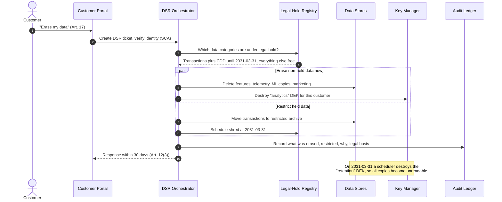
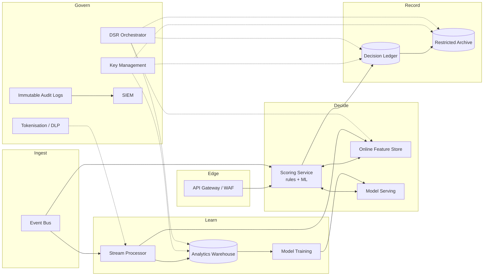

# 02 · Problem Statement: Project Sentinel

> ⚖️ **Disclaimer:** educational material only. This is **not legal, regulatory, compliance or financial advice**. Regulations are paraphrased and simplified; organisations, people and incidents are fictional. Consult qualified counsel before you rely on any of it. [Full disclaimer](../README.md#disclaimer)

> **Story hook:** In Q3, Aldervane Bank lost **€11.4M to authorised push payment (APP) fraud** after SEPA Instant became mandatory. Their nightly batch fraud engine flags fraud *the morning after*, and with instant payments the money is gone in 10 seconds. Down the road, Quillpay has the same problem at a smaller scale, and its investors want proof that it can pass a regulator's audit before the next funding round.
>
> Both start **Project Sentinel**.

---

## 1. The business goal

**Score every payment for fraud before it settles, explain every decision, and protect the customer's privacy throughout.**

## 2. Functional requirements

| ID | Requirement |
|---|---|
| F1 | Ingest payment events (card authorisations, SEPA Credit Transfer, SEPA Instant) from the core banking system |
| F2 | Enrich each event with customer profile, device fingerprint, behavioural features (velocity, typical amounts, new payee) |
| F3 | Return a fraud decision (**ALLOW / CHALLENGE / BLOCK**) synchronously within **150 ms p99** |
| F4 | Record every decision, model version, features used and reason codes in a **tamper-evident ledger** |
| F5 | Analysts review CHALLENGE and BLOCK cases, label outcomes and open SAR (Suspicious Activity Report) cases |
| F6 | Customers can view flagged payments and dispute them via API and app (PSD2 strong customer authentication) |
| F7 | Data scientists train and retrain models on **pseudonymised** historical data |
| F8 | **GDPR Data Subject Requests (DSRs)**: access/export (Art. 15/20), rectification (Art. 16), erasure (Art. 17), restriction (Art. 18), objection to automated decisions (Art. 22) |
| F9 | Regulatory reporting: fraud statistics to the national competent authority, major-incident reporting under DORA |

## 3. Non-functional requirements

| Category | Requirement |
|---|---|
| **Throughput** | 3,000 events/s steady, 15,000 events/s peak (Black Friday, salary day). 🚀 Quillpay: 300/s now, 10× within 18 months |
| **Latency** | p99 < 150 ms end to end for the synchronous score |
| **Availability** | 99.95% for scoring (fail-open rules engine if ML is down); 99.99% target for the ledger |
| **RPO / RTO** | Ledger RPO = 0, RTO < 15 min; analytics RPO < 1 h, RTO < 4 h |
| **Residency** | All personal data stored **and processed** in the EU; support access from the EU only |
| **Retention** | Transaction and decision records: **5 years after the business relationship ends** (AMLD), up to **10 years** for some national rules. Raw behavioural telemetry: **13 months** |
| **Security** | Encryption at rest with customer-managed keys (CMEK), TLS 1.2+ in transit, HSM-backed keys for the ledger, no service-account keys, MFA for all humans |
| **Auditability** | Admin and data-access logs retained ≥ 5 years, immutable |
| **Exit / resilience** | DORA: documented exit strategy and tested ICT business-continuity plans |

## 4. Data classification

> ⚠️ **Pseudonymised data is still personal data under GDPR** (Recital 26). Only properly **anonymised** data falls outside its scope. Data scientists still need a lawful basis and access controls for the 🟡 tier.

## 5. The central puzzle: erasure vs. retention ⚖️

A customer closes their account and asks Aldervane to **"delete everything you have on me"** (GDPR Art. 17). But:

- **AML Directive / AMLR:** keep transaction records and CDD data for **5 years** after the relationship ends.
- **PSD2 / national banking law:** keep payment records for several years.
- **GDPR Art. 17(3)(b)** explicitly exempts data needed *"for compliance with a legal obligation"*.

So the correct answer is **neither "delete all" nor "keep all"**. It's:

1. **Erase immediately** whatever has no legal hold: marketing preferences, device telemetry, behavioural features, ML training copies, analytics copies.
2. **Restrict** whatever is under legal hold: move it to a segregated, access-restricted archive and tag it with a retention end date.
3. **Erase automatically** when the hold expires, using **crypto-shredding**.

### Crypto-shredding pattern (used in every case study)

Each customer's personal data is encrypted with a **per-customer data encryption key (DEK)**. The DEK is wrapped by a **key encryption key (KEK)** in Cloud KMS, Cloud HSM or an external key manager. To "erase" a customer from *every* backup, replica and log, **destroy their DEK**. The ciphertext left behind is unreadable.

> **Why this is a great learning example:** every architecture in the next four chapters has to solve this *same* puzzle. How easy it is depends on how much of the stack you control, and how much the provider does for you.

## 6. Logical architecture (technology-neutral)

Every case study maps these logical components onto concrete services:

| Logical component | Case 1: Managed | Case 2: Semi-managed | Case 3: Least managed | Case 4: Hybrid |
|---|---|---|---|---|
| API gateway / WAF | Apigee X + Cloud Armor | Gateway API on GKE + Cloud Armor | Envoy/HAProxy on GCE + Cloud Armor | Apigee hybrid + on-prem F5 |
| Event bus | Pub/Sub | Managed Service for Apache Kafka | Self-run Kafka on GCE | Confluent Cloud (multi-cloud) |
| Scoring service | Cloud Run | GKE Standard | GCE MIG | GKE Enterprise (GCP + on-prem) |
| Online features | Vertex AI Feature Store (Bigtable-backed) | Memorystore for Redis Cluster | Redis on GCE | Memorystore + on-prem cache |
| Model serving | Vertex AI Endpoints | KServe on GKE | Triton/TorchServe on GCE | Vertex AI + on-prem fallback |
| Decision ledger | Spanner | AlloyDB | PostgreSQL + Patroni on GCE | Spanner + mainframe ledger |
| Stream processor | Dataflow | Dataproc (Spark Structured Streaming) | Apache Flink on GCE | Confluent Flink + Dataflow |
| Warehouse | BigQuery | BigQuery (via Dataproc connector) | ClickHouse on GCE | BigQuery + BigQuery Omni over S3 |
| Training | Vertex AI Pipelines | Kubeflow on GKE + Composer | MLflow + Airflow on GCE | Vertex AI + Databricks (AWS subsidiary) |
| Keys | Cloud KMS / Cloud HSM | Cloud HSM | HashiCorp Vault + Cloud HSM | External Key Manager (Thales) |
| Tokenisation | Sensitive Data Protection | SDP + in-app | Vault Transform | Protegrity / Thales |
| DSR orchestration | Workflows | Argo Workflows on GKE | Custom service + Airflow | OneTrust + Workflows |
| SIEM | Google SecOps | Google SecOps | Wazuh/OpenSearch on GCE | Splunk Cloud (existing contract) |

➡️ Next: [03 · Compliance Controls Map](03-compliance-controls.md)
