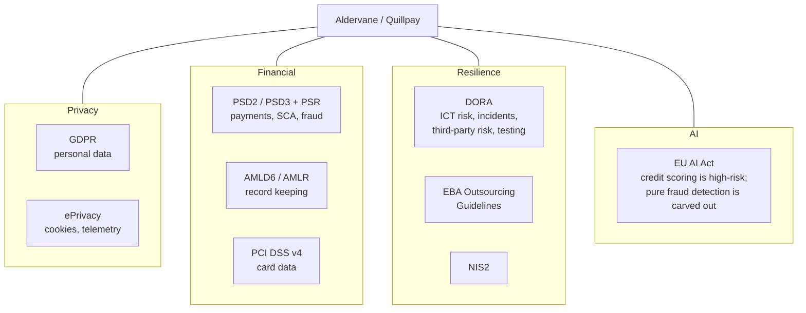
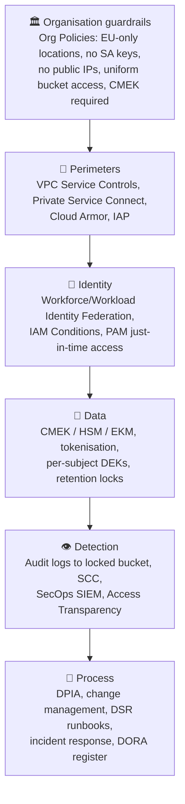

# 03 · Compliance Controls Map

> **Scenario:** Marta, Aldervane's Data Protection Officer, has one rule for the cloud team: *"Don't show me architecture diagrams. Show me which control satisfies which article, and where the evidence is."* This chapter is that table.

> ⚖️ Regulations are paraphrased for architectural purposes. **Not legal advice.**

---

## 1. The regulatory landscape for an EU financial firm

> **AI Act note:** AI systems that assess creditworthiness are high-risk under Annex III, but the Act explicitly carves out systems *used for detecting financial fraud*. Sentinel still has to meet GDPR Art. 22 (automated decisions) and good model-risk management practice, but it is not itself a high-risk AI system. If it ever feeds credit decisions, that changes.

## 2. GDPR articles → technical controls on Google Cloud

| GDPR | Obligation (paraphrased) | Technical control | GCP building blocks | Evidence |
|---|---|---|---|---|
| **Art. 5(1)(c)** | Data minimisation | Collect only the features you need; tokenise identifiers at ingestion | Sensitive Data Protection de-identification templates, Dataflow DLP transforms | Data inventory, DPIA |
| **Art. 5(1)(e)** | Storage limitation | Retention by data class; automatic deletion | GCS lifecycle rules, BigQuery table/partition expiration, Spanner TTL (row deletion policy), crypto-shredding | Retention config exported from Cloud Asset Inventory |
| **Art. 5(1)(f) / 32** | Integrity and confidentiality | Encryption at rest and in transit, CMEK/HSM, least privilege | Cloud KMS, Cloud HSM, EKM, IAM Conditions, VPC-SC, Confidential Computing | Key-usage logs, IAM recommender reports |
| **Art. 15 / 20** | Access and portability | Find all of a subject's data and export it in a machine-readable format | Dataplex catalog + lineage, BigQuery export, Workflows orchestrator | DSR ticket history |
| **Art. 17** | Erasure | Delete, or crypto-shred, with legal-hold exceptions | Per-subject DEKs, KMS key version destruction, Spanner/BigQuery DML deletes | Erasure certificate in audit ledger |
| **Art. 18** | Restriction | Segregate data under restriction | Restricted archive project inside a separate VPC-SC perimeter | Access logs showing no access |
| **Art. 22** | Automated decision-making | Human review on request; explainability | Vertex Explainable AI, reason codes stored in ledger, analyst workbench | Decision records with reason codes |
| **Art. 25** | Privacy by design and default | Defaults that protect privacy | Org Policies, pseudonymised zones, default-deny perimeters | IaC repository, policy-as-code tests |
| **Art. 28** | Processor contracts | DPA with Google and every sub-processor | Google Cloud Data Processing Addendum (CDPA), sub-processor list | Signed contracts |
| **Art. 30** | Records of processing | Maintain a RoPA | Dataplex business glossary + tags, labels on resources | RoPA register |
| **Art. 33 / 34** | Breach notification within 72 h | Detect, triage, notify | Security Command Center, Google SecOps, Cloud Logging alerts, incident runbooks | Incident timeline |
| **Art. 35** | DPIA for high-risk processing | Documented DPIA | (Process) | DPIA document |
| **Art. 44–49** | International transfers | Keep data in the EU, or use SCCs plus supplementary measures | `gcp.resourceLocations` org policy, Assured Workloads EU, EKM (Google cannot decrypt) | Org policy export, Assured Workloads report |

## 3. Financial and resilience regulations → controls

| Regulation | Requirement | Control | GCP building blocks |
|---|---|---|---|
| **PSD2 RTS on SCA** | Transaction risk analysis; fraud-rate thresholds for SCA exemptions | Real-time scoring, fraud-rate reporting | Sentinel itself, plus BigQuery reporting |
| **AMLR / AMLD** | Keep records ≥ 5 years after the relationship ends | Legal-hold registry, WORM archive | GCS Bucket Lock / Object Retention Lock, Spanner + backups |
| **PCI DSS v4** | Protect cardholder data; segment the CDE | Tokenise PANs at the edge; isolated CDE project | Separate project + VPC-SC perimeter, SDP tokenisation, Cloud HSM |
| **DORA Art. 5–16** | ICT risk-management framework | Inventory, protection, detection, BCP | Cloud Asset Inventory, SCC, Backup and DR, multi-region |
| **DORA Art. 17–23** | Major ICT-incident classification and reporting (initial report within hours) | Incident pipeline, severity matrix | SecOps SOAR playbooks, Personalized Service Health |
| **DORA Art. 24–27** | Digital operational resilience testing (TLPT every 3 years for significant entities) | Chaos and DR drills, red teaming | Fault injection on GKE, DR runbooks |
| **DORA Art. 28–30** | Third-party risk: register of information, exit strategies, concentration risk | Exit plans, portability | Open formats (Iceberg, Postgres, Kafka), multi-cloud options ([Case 4](case-studies/04-hybrid-multicloud.md)) |
| **EBA Outsourcing GL** | Audit and access rights, oversight of the CSP | Contractual audit rights; Access Transparency | Access Transparency, Access Approval, compliance reports via Compliance Reports Manager |

## 4. Control layers: defence in depth

## 5. Organisation policies every case study uses

These are enforced in the IaC (see [`iac/enterprise/modules/org-policies`](https://github.com/KshitijV97/gcp-fintech-architecture-playbook/blob/main/iac/enterprise/modules/org-policies/main.tf) and [`iac/startup/bootstrap`](https://github.com/KshitijV97/gcp-fintech-architecture-playbook/blob/main/iac/startup/bootstrap/main.tf)):

| Constraint | Effect |
|---|---|
| `gcp.resourceLocations` = `in:eu-locations` | Resources can only be created in EU regions |
| `iam.disableServiceAccountKeyCreation` | No downloadable SA keys; forces federation |
| `iam.allowedPolicyMemberDomains` | Only identities from your own Cloud Identity / Workspace customer |
| `compute.vmExternalIpAccess` (deny all) | No public IPs on VMs |
| `storage.uniformBucketLevelAccess` | No object ACLs |
| `storage.publicAccessPrevention` | No public buckets |
| `sql.restrictPublicIp` | No public Cloud SQL |
| `gcp.restrictNonCmekServices` | Listed services must use CMEK |
| `compute.requireOsLogin` | SSH via IAM identities only |
| `gcp.restrictServiceUsage` *(enterprise)* | Allow-list of approved services (demand management!) |

## 6. Beyond the EU

GDPR is the baseline for Cases 1–4. When Sentinel expands to Canada, **PIPEDA** adds requirements GDPR doesn't have (consent-centricity, 24-month breach records, named disclosure accounting, retention floors, internal complaint handling). See [Case 5](case-studies/05-canada-pipeda.md) and the cross-regime [evidence register](10-evidence-register.md). Data-governance controls (RoPA, lineage, PII discovery) are covered in [Chapter 08](08-data-governance.md).

➡️ Next: [Case 1 · Fully Managed](case-studies/01-fully-managed.md)
