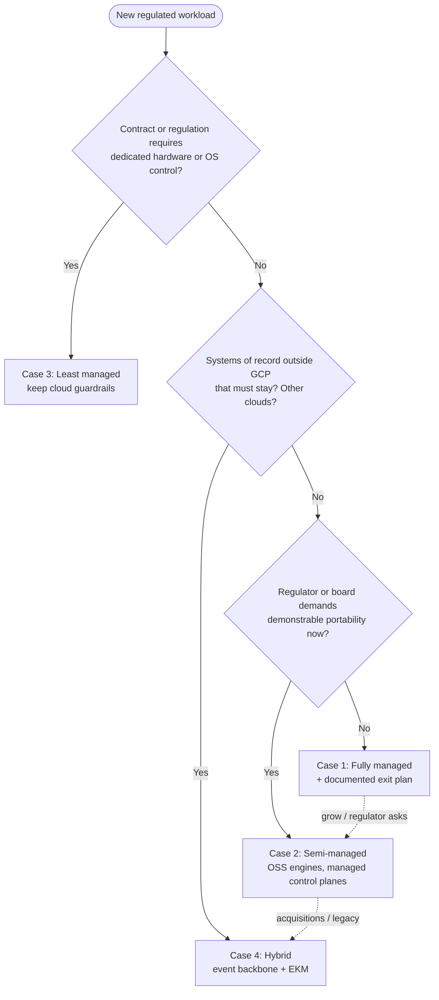
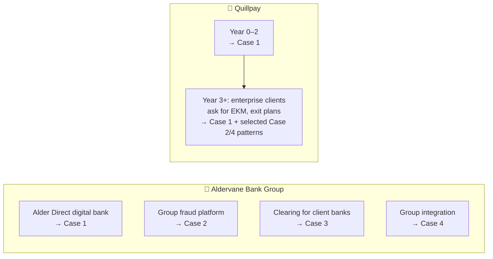

# 04 · Comparison and Decision Guide

> ⚖️ **Disclaimer:** educational material only. This is **not legal, regulatory, compliance or financial advice**. Regulations are paraphrased and simplified; organisations, people and incidents are fictional. Consult qualified counsel before you rely on any of it. [Full disclaimer](../README.md#disclaimer)

> **Story hook:** Aldervane's CIO and Quillpay's CTO end up on the same conference panel. The moderator asks: *"So which approach is right?"* Both answer: *"It depends."* This chapter explains what it depends on.

## 1. Side-by-side

| Dimension | Case 1: Managed | Case 2: Semi-managed | Case 3: Least managed | Case 4: Hybrid |
|---|---|---|---|---|
| **Time to first compliant release** | 6–10 weeks | 3–5 months | 6–12 months | 6–9 months |
| **Platform team size** | 0–2 | 6–10 | 15–25 | 10–20 + vendor management |
| **Infra cost at low volume** | Medium (fixed floors) | Medium-high | High (sole-tenant) | High |
| **Infra cost at high volume** | Medium | Medium (with CUDs) | Low-medium | Medium-high (egress) |
| **Controls you evidence yourself** | Fewest | Moderate | Most | High + third parties |
| **Latency p99 (score)** | ~90 ms | ~70 ms | ~60 ms | ~90 ms (+ EKM cache misses) |
| **Portability / DORA exit** | ⚠️ Weakest | ✅ Strong | ✅ Strongest | ✅ Strong |
| **Key sovereignty** | CMEK/HSM (EKM optional) | HSM | Vault + HSM | EKM, keys off-cloud |
| **Erasure difficulty** | Easy (managed TTLs + KMS) | Medium (Kafka, Iceberg) | Hard (Postgres vacuum, WAL, ClickHouse mutations) | Hardest (many systems) |
| **Skills needed** | Cloud-native dev | Kubernetes, Kafka, Postgres | Linux, every OSS product, crypto | All of the above + integration |
| **Best fit** | 🚀 Startups, greenfield subsidiaries | Enterprises with OSS skills and exit concerns | Contractual isolation, market infrastructure | Real enterprises with legacy and M&A |

## 2. Decision flow

## 3. Most organisations end up mixing

In practice, every serious organisation ends up with a **portfolio**:

## 4. Questions to ask in your own architecture review

1. Which data classes does this workload process? (See the [data classification](02-problem-statement.md#4-data-classification).)
2. Where is the **legal hold** registry, and how does erasure interact with it?
3. Who holds the keys, and what happens to availability if the key manager goes down?
4. What's the **exit plan**, and has it been tested (even a paper exercise)?
5. How many **stateful products** are we operating ourselves, and who is on call for each?
6. Which compliance evidence will we generate ourselves, and which will we inherit from the provider?
7. Can we roll back any infrastructure change in under 15 minutes?

> 🇨🇦 Operating in more than one jurisdiction? Combine any of these tiers with the **cell pattern** from [Case 5](case-studies/05-canada-pipeda.md).

➡️ Next: [05 · IaC for the Enterprise](iac/05-enterprise-iac.md)
