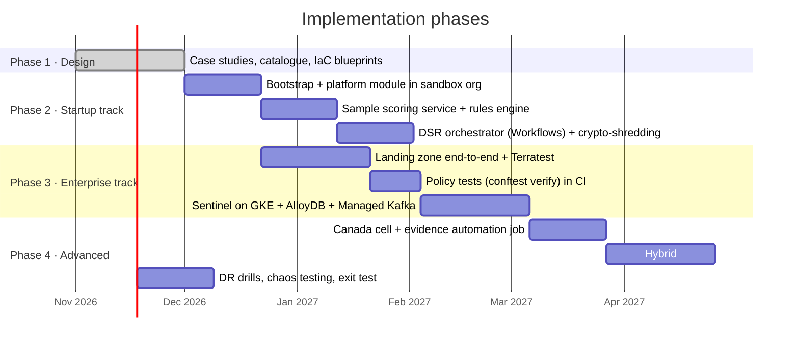

# 07 · Roadmap: Implementation Phases

> ⚖️ Not legal or compliance advice. Regulations are paraphrased; organisations and people are fictional. [Disclaimer](disclaimer.md)

This repository grows in phases. Each phase ends in something **deployable and demonstrable**.

| Phase | Deliverables | Definition of done |
|---|---|---|
| **1 · Design** ✅ | Docs, diagrams, IaC blueprints | Reviewed, `terraform fmt`-clean |
| **2 · Startup track** | Deployed EU cell, sample app, DSR workflow with crypto-shredding | Erasure demo end to end; evidence pack generated |
| **3 · Enterprise track** | Landing zone, CAB-gated pipeline (mock ServiceNow), Sentinel Case 2 | Conftest unit tests (`conftest verify`), Terratest smoke tests |
| **4 · Advanced** | Canada cell, scheduled evidence job, hybrid simulation, DR and exit test | DORA-style test report |

## Backlog ideas

- `conftest verify` unit tests for every Rego rule, with sample plans
- A synthetic payments generator (Faker + Pub/Sub/Kafka load)
- A fraud model in BigQuery ML → Vertex AI, with explainability reason codes
- Renovate (or Dependabot) PRs for Terraform provider and action version bumps
- An OpenMetadata deployment on GKE for the hybrid case
- An architecture decision record (ADR) set under `docs/adr/`
