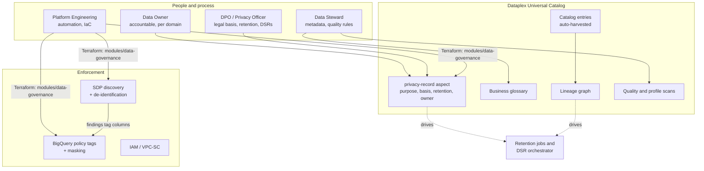
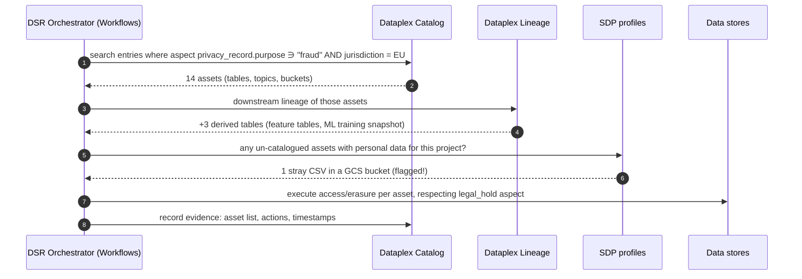
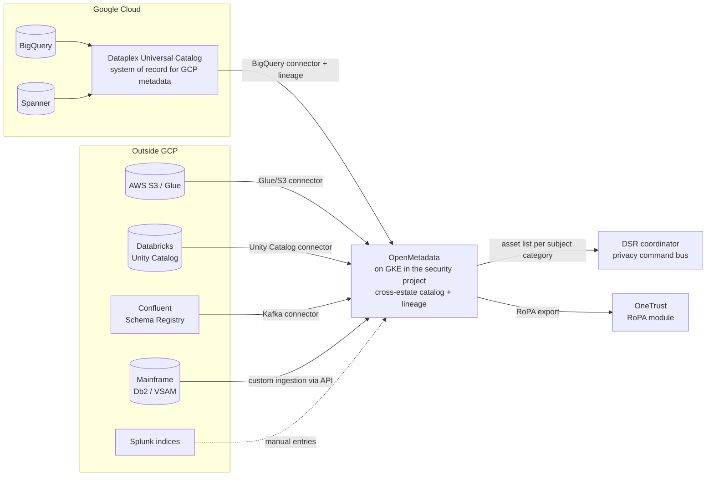

# 08 · Data Governance: Knowing Where Every Byte of Personal Data Lives

> ⚖️ **Disclaimer:** educational material only. This is **not legal, regulatory, compliance or financial advice**. Regulations are paraphrased and simplified; organisations, people and incidents are fictional. Consult qualified counsel before you rely on any of it. [Full disclaimer](../README.md#disclaimer)

> **Story hook:** Three weeks after Sentinel went live, Marta (the DPO) received a regulator's letter about a customer complaint. *"Show us every system that processed this person's data, why, under which legal basis, and for how long you'll keep it."* The answer took **11 days** and four teams. Marta's verdict: *"Erasure and access rights are impossible without a map. Build the map."*

## Does Google Cloud have native data governance?

**Yes.** The Google-native stack is **Dataplex Universal Catalog**, used together with BigQuery governance features and **Sensitive Data Protection (SDP)**:

| Capability | Google Cloud service | Regulatory use |
|---|---|---|
| **Catalog and search** of every data asset (BigQuery, GCS, Spanner, Bigtable, Pub/Sub, Cloud SQL, AlloyDB, Vertex AI and more), automatic metadata harvesting | Dataplex Universal Catalog *(absorbed the old Data Catalog)* | GDPR Art. 30 RoPA; PIPEDA Principle 4.8 openness |
| **Custom metadata** ("aspects") such as purpose, legal basis, retention, owner | Dataplex aspect types / aspects | Machine-readable records of processing |
| **Business glossary** | Dataplex business glossary | Shared vocabulary: "customer", "decision", "legal hold" |
| **Data lineage** (column-level for BigQuery, plus Dataflow, Dataproc, Composer, Vertex AI and OpenLineage API) | Dataplex data lineage | DSRs: *"where did this data flow?"* |
| **Data profiling and quality** | Dataplex data profile / data quality scans | GDPR Art. 5(1)(d) accuracy; PIPEDA 4.6 accuracy |
| **PII discovery and classification** | Sensitive Data Protection discovery (org, folder or project level) | Find personal data you didn't know you had |
| **Column-level security** | BigQuery policy tags | Least privilege |
| **Dynamic data masking** | BigQuery data policies (SHA-256, nullify, default value, custom routines) | Analysts see pseudonymised data |
| **Row-level security** | BigQuery row access policies | Jurisdiction separation within shared tables |
| **De-identification / tokenisation** | SDP de-identify (FPE, deterministic encryption, date shifting) | Pseudonymisation (GDPR Art. 4(5), 32) |
| **Secure sharing** | Analytics Hub, BigQuery data clean rooms | Share fraud signals with other banks without exposing raw data |

> 💡 You don't *need* a third-party catalog to govern data that lives on Google Cloud. You need one when your data estate goes **beyond** Google Cloud. That's the situation in [Case 4 (hybrid)](case-studies/04-hybrid-multicloud.md).

## Target operating model



## How governance powers the DSR workflow

Since the governance work, Marta's 11-day question takes **minutes**:



## The IaC

[`iac/enterprise/modules/data-governance`](../iac/enterprise/modules/data-governance/main.tf) provisions, per jurisdiction cell:

1. A **policy-tag taxonomy**: `personal-data` → `direct-identifier`, `quasi-identifier`, `government-id`, `financial`
2. **Masking policies**: SHA-256 for identifiers, always-null for government IDs (including the Canadian SIN)
3. **Fine-grained reader** grants limited to the DSR executor and investigators
4. A **`privacy-record` aspect type**: jurisdiction, purpose, legal basis or consent, retention, legal hold, owner, RoPA/PIA reference, cross-border transfer safeguard
5. An **SDP inspect template + discovery scan** that profiles every BigQuery table
6. A **Dataplex data-quality scan** on the decisions table (completeness of `customer_token` and `model_version`, decision code validity)

```hcl
module "governance_eu" {
  source                = "../../modules/data-governance"
  project_id            = "adv-prd-analytics"
  jurisdiction          = "eu"
  bq_location           = "eu"
  dataplex_location     = "europe-west3"
  sdp_location          = "europe-west3"
  analyst_group         = "group:fraud-analysts@aldervane.example"
  raw_pii_readers       = ["serviceAccount:sa-dsr-executor@adv-prd-sentinel.iam.gserviceaccount.com"]
  governance_dataset_id = "governance"
  decisions_table       = "projects/adv-prd-analytics/datasets/sentinel/tables/decisions"
}
```

## When Google-native isn't enough: OpenMetadata in the hybrid case

In [Case 4](case-studies/04-hybrid-multicloud.md), personal data lives in **GCP, AWS (S3, EKS databases), Databricks, Confluent, Splunk, OneTrust and the mainframe**. Dataplex governs the Google side well, but a DSR needs **one map across all of them**.

| Option | Type | Verdict for Aldervane |
|---|---|---|
| **Dataplex Universal Catalog only** | Google-native | ✅ Primary for GCP assets; can catalogue custom (non-GCP) entries through its API, but connectors outside GCP are limited |
| **OpenMetadata** | Open source (Apache 2.0), actively developed | ✅ **Chosen as the cross-estate "catalog of catalogs"**: connectors for BigQuery, Databricks, AWS Glue/S3, Kafka/Confluent, PostgreSQL, Airflow and more; lineage, glossary, PII auto-tagging, data contracts |
| **Apache Atlas** | Open source, Hadoop-era | ❌ Built around the Hadoop/HBase/Solr stack; heavy to run and a poor fit outside Hadoop. Mainly relevant for existing Cloudera estates |
| **DataHub** | Open source (LinkedIn origin) | ⚖️ A strong alternative to OpenMetadata; comparable features |
| **Collibra / Alation / Atlan / Informatica CDGC** | Commercial | ⚖️ Best for large governance offices with policy workflows; higher cost and another processor to contract |

### Hybrid governance architecture



**Rules of thumb:**
- Dataplex remains the place where **enforcement** happens for GCP (policy tags, masking, SDP). OpenMetadata is used for **discovery and lineage across the estate**; it does not enforce access in GCP.
- Run OpenMetadata **inside** the security perimeter and treat its metadata as *confidential*: column names and samples can themselves reveal personal data. Turn off data sampling for tagged assets.
- Keep one source of truth per fact. Purpose and legal basis are authored in Dataplex aspects (GCP) or OpenMetadata custom properties (non-GCP) and synchronised one way.

➡️ Next: [Case 5 · Canada and PIPEDA](case-studies/05-canada-pipeda.md)
