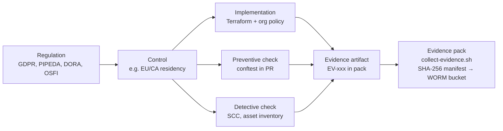
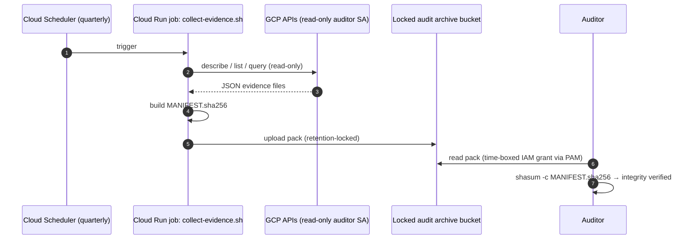

# 10 · Evidence Register: GDPR, PIPEDA, DORA, OSFI

> ⚖️ Not legal or compliance advice. Regulations are paraphrased; organisations and people are fictional. [Disclaimer](disclaimer.md)

> **Scenario:** The auditors arrive on Monday. In the past, Aldervane needed six weeks of screenshots. This year the platform team runs one script, hands over a hash-sealed evidence pack, and spends the audit answering questions instead of hunting for proof.

Every control has three things: an **implementation** (code), an **evidence artifact** (proof), and a **collection method** (how the proof is produced, ideally automatically).



## 1. Evidence types

| Type | Example | Strength |
|---|---|---|
| **Design evidence** | Terraform code, Rego policies, ADRs | Shows intent |
| **Configuration evidence** | Org-policy export, bucket retention lock, KMS key list | Shows the control **exists now** |
| **Operating evidence** | Audit-log queries, DSR SLA reports, scan history | Shows the control **worked over time**, which is what SOC 2 Type II / ISAE 3402 auditors want |
| **Process evidence** | CAB approvals in ServiceNow, PR reviews, DPIA/PIA | Shows governance |

## 2. The register

Legend: **G** = GDPR, **P** = PIPEDA, **D** = DORA, **O** = OSFI B-10/B-13, **Q** = Quebec Law 25. `EV-` IDs match the files produced by [`evidence/collect-evidence.sh`](https://github.com/KshitijV97/gcp-fintech-architecture-playbook/blob/main/evidence/collect-evidence.sh).

| Control | Regulations | Implementation | Evidence ID / artifact | Collection |
|---|---|---|---|---|
| **Data residency per jurisdiction** | G Art. 44; P 4.1.3; O B-10; Q s.17 | Org/folder `gcp.resourceLocations`; Assured Workloads EU/CA; `RESIDENCY-*` Rego | `EV-ORG-02`, `EV-ORG-04`, `EV-INV-02` (must be empty) | Script, quarterly |
| **No service-account keys** | G 32; P 4.7; D 9 | `iam.disableServiceAccountKeyCreation`; WIF for CI | `EV-ORG-02`, TECH_DEBT TD-011 exception record | Script |
| **Encryption with CMEK/HSM** | G 32; P 4.7; O B-13 | `modules/cmek`, `gcp.restrictNonCmekServices`, `CMEK` Rego | `EV-KMS-01`, `EV-CMEK-01..03` | Script, monthly |
| **Exfiltration perimeter** | G 32; P 4.7 | `modules/vpc-sc-perimeter` | `EV-PER-01/02`; violations query (§3 Q2) | Script + Log Analytics |
| **Least privilege, no public access** | G 32; P 4.7; O B-13 | Basic-role and public-member Rego; IAM Recommender | `EV-IAM-01/02` | Script, monthly |
| **Immutable audit trail** | G 5(2), 30; P 4.1, s.10.3; D 12 | `modules/audit-logging` (locked bucket, WORM archive, data-access logs) | `EV-LOG-01/02`; bucket lock status | Script |
| **Record of processing / purposes** | G 30; P 4.2, 4.8 | Dataplex `privacy-record` aspect | Catalog export | Quarterly |
| **PII discovery** | G 5(1)(c), 25; P 4.4 | SDP discovery config | SDP profiles: raw identifiers outside approved stores = 0 | Monthly |
| **Consent evidence** | P 4.3; G 7(1) | `consent_ledger` + versioned notices | `EV-REG-03` | Monthly |
| **Access requests in time** | P 4.9 (30 d); G 12(3) (1 month) | DSR orchestrator, `dsr_log` | `EV-REG-01` (on-time %, extensions with notice) | Monthly |
| **Disclosure accounting** | P 4.9.3; G 15(1)(c) | `disclosure_log` with suppression flag | Sample of access responses vs. log | Quarterly sample |
| **Erasure / crypto-shredding** | G 17; P 4.5.3 | DSR workflow, KMS key-version destruction | KMS `DestroyCryptoKeyVersion` audit events (§3 Q3) + erasure certificates | Log Analytics |
| **Retention floor and ceiling** | P 4.5.2; G 5(1)(e); AML/FINTRAC | Partition expiry, Object Retention Lock, legal-hold registry | Retention settings from `EV-INV-01`, `EV-CMEK-03` | Quarterly |
| **Breach record ≥ 24 months** | P s.10.3; G 33(5); Q | Locked `breach-records` bucket; `breach_register`; `PIPEDA-BREACH` Rego | `EV-BRC-01` (ok = true), `EV-REG-02` | Script |
| **Breach notification** | G 33/34; P s.10.1–10.2; O incident reporting; RPAA | SecOps playbooks, runbook | Breach register rows with `reported_to`, timestamps | Per incident |
| **Internal complaints** | P 4.10 | `dsr_log` type `COMPLAINT` | Complaint register report | Monthly |
| **Change control** | D 9(4)(e); O B-13; SOC 2 CC8 | CAB-gated pipeline, CODEOWNERS | ServiceNow CHG ↔ commit SHA ↔ apply log | Continuous |
| **Third-party register and exit plan** | D 28–30; O B-10; EBA GL | DORA register, ADRs, open formats | Register export; exit test report | Annual |
| **Resilience testing** | D 24–27; O E-21 | DR drills, restore tests | Drill reports; restore timings | Semi-annual |
| **Technical debt transparency** | D 6 (ICT risk framework) | `TECH_DEBT.md`, `check_tech_debt.sh` | Register + CI history | Monthly ARB |

## 3. Operating evidence: Log Analytics queries

The audit log bucket has **Log Analytics** enabled ([`modules/audit-logging`](https://github.com/KshitijV97/gcp-fintech-architecture-playbook/blob/main/iac/enterprise/modules/audit-logging/main.tf)), so evidence can be pulled with SQL. Replace the view path with your bucket's linked dataset or `PROJECT.LOCATION.BUCKET._AllLogs`.

**Q1: Who read restricted personal-data columns in the last 90 days?** *(G 32, P 4.7)*

```sql
SELECT
  timestamp,
  proto_payload.audit_log.authentication_info.principal_email AS principal,
  proto_payload.audit_log.resource_name AS resource,
  proto_payload.audit_log.method_name AS method
FROM `adv-sec-audit-logs.europe-west3.org-audit-logs._AllLogs`
WHERE log_id = 'cloudaudit.googleapis.com/data_access'
  AND proto_payload.audit_log.service_name = 'bigquery.googleapis.com'
  AND timestamp > TIMESTAMP_SUB(CURRENT_TIMESTAMP(), INTERVAL 90 DAY)
  AND JSON_VALUE(proto_payload.audit_log.metadata, '$.tableDataRead.policyTags') IS NOT NULL
ORDER BY timestamp DESC;
```

**Q2: VPC Service Controls violations (dry-run and enforced)** *(G 32)*

```sql
SELECT
  timestamp,
  JSON_VALUE(proto_payload.audit_log.metadata, '$.dryRun') AS dry_run,
  JSON_VALUE(proto_payload.audit_log.metadata, '$.violationReason') AS reason,
  proto_payload.audit_log.authentication_info.principal_email AS principal,
  proto_payload.audit_log.method_name AS method
FROM `adv-sec-audit-logs.europe-west3.org-audit-logs._AllLogs`
WHERE log_id = 'cloudaudit.googleapis.com/policy'
  AND timestamp > TIMESTAMP_SUB(CURRENT_TIMESTAMP(), INTERVAL 30 DAY)
ORDER BY timestamp DESC;
```

**Q3: Crypto-shredding evidence: key-version destruction events** *(G 17, P 4.5.3)*

```sql
SELECT
  timestamp,
  proto_payload.audit_log.authentication_info.principal_email AS principal,
  proto_payload.audit_log.resource_name AS key_version
FROM `adv-sec-audit-logs.europe-west3.org-audit-logs._AllLogs`
WHERE proto_payload.audit_log.service_name = 'cloudkms.googleapis.com'
  AND proto_payload.audit_log.method_name = 'DestroyCryptoKeyVersion'
ORDER BY timestamp DESC;
```

**Q4: Google personnel access (Access Transparency)** *(EBA outsourcing, O B-10, P 4.1.3)*

```sql
SELECT timestamp, json_payload
FROM `adv-sec-audit-logs.europe-west3.org-audit-logs._AllLogs`
WHERE log_id = 'cloudaudit.googleapis.com/access_transparency'
ORDER BY timestamp DESC;
```

**Q5: Unauthorised (non-pipeline) infrastructure changes** *(D 9, change control)*

```sql
SELECT
  timestamp,
  proto_payload.audit_log.authentication_info.principal_email AS principal,
  proto_payload.audit_log.method_name AS method,
  proto_payload.audit_log.resource_name AS resource
FROM `adv-sec-audit-logs.europe-west3.org-audit-logs._AllLogs`
WHERE log_id = 'cloudaudit.googleapis.com/activity'
  AND proto_payload.audit_log.authentication_info.principal_email NOT LIKE 'sa-tf-%'
  AND proto_payload.audit_log.method_name NOT LIKE '%.get%'
  AND proto_payload.audit_log.method_name NOT LIKE '%.list%'
  AND timestamp > TIMESTAMP_SUB(CURRENT_TIMESTAMP(), INTERVAL 7 DAY);
```

> ⚠️ Field paths in Log Analytics can vary slightly by log type and over time. Test each query against your own bucket before you rely on it as audit evidence.

## 4. Evidence pack lifecycle



➡️ Back to [README](https://github.com/KshitijV97/gcp-fintech-architecture-playbook/blob/main/README.md) · Related: [Case 5 · Canada and PIPEDA](case-studies/05-canada-pipeda.md), [03 · Compliance controls](03-compliance-controls.md)
