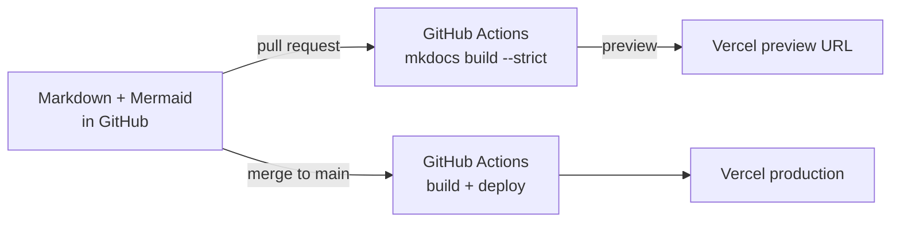

# About

**GCP Fintech Architecture Playbook** is an independent body of reference architecture work by **Kshitij Vengurlekar**. It covers cloud architecture for regulated financial services on Google Cloud.

## What it demonstrates

- **Solution architecture under regulation.** The same workload is designed at every point of the cloud management spectrum, with explicit trade-offs in cost, operations, portability and compliance burden.
- **Regulatory engineering.** GDPR, PSD2, AML, DORA, EBA outsourcing, PIPEDA, OSFI and Quebec Law 25 are translated into concrete, testable platform controls.
- **Enterprise platform engineering.** A landing zone, policy-as-code, ITIL change and demand management, and technical-debt governance, all expressed as code.
- **Startup platform engineering.** Lean, keyless, compliant-by-default delivery that scales with the company.
- **Assurance by design.** Evidence registers and automated evidence collection for auditors.

## How this site is built

The site is generated from the repository's `docs/` folder with [Material for MkDocs](https://squidfunk.github.io/mkdocs-material/) (MIT). Every change goes through a pull request: CI builds the site in strict mode, so a broken link fails the build, and publishes a preview. Merging to `main` deploys to production.

## Source and licence

- Source: [github.com/KshitijV97/gcp-fintech-architecture-playbook](https://github.com/KshitijV97/gcp-fintech-architecture-playbook)
- Documentation and diagrams: [CC BY 4.0](https://github.com/KshitijV97/gcp-fintech-architecture-playbook/blob/main/LICENSE-docs.md). Code: [MIT](https://github.com/KshitijV97/gcp-fintech-architecture-playbook/blob/main/LICENSE)
- Please read the [disclaimer](disclaimer.md).
