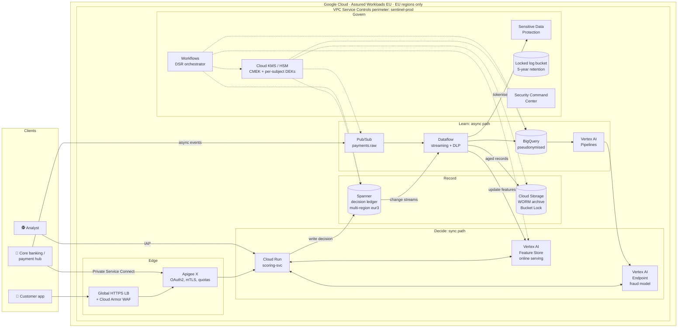
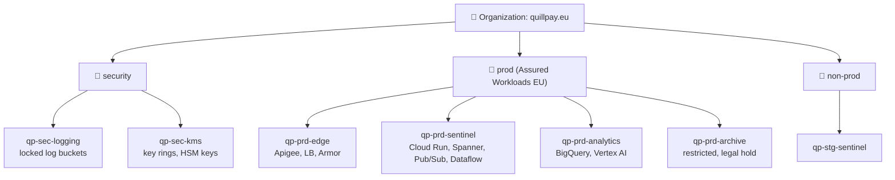
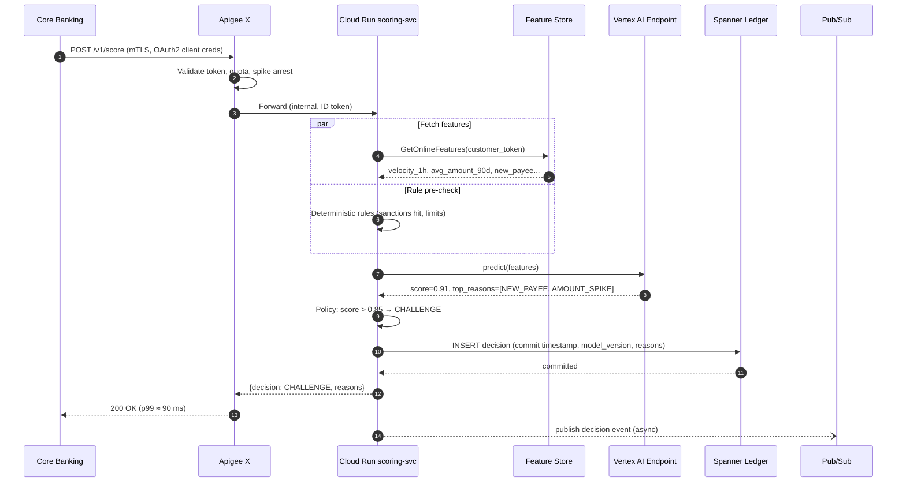
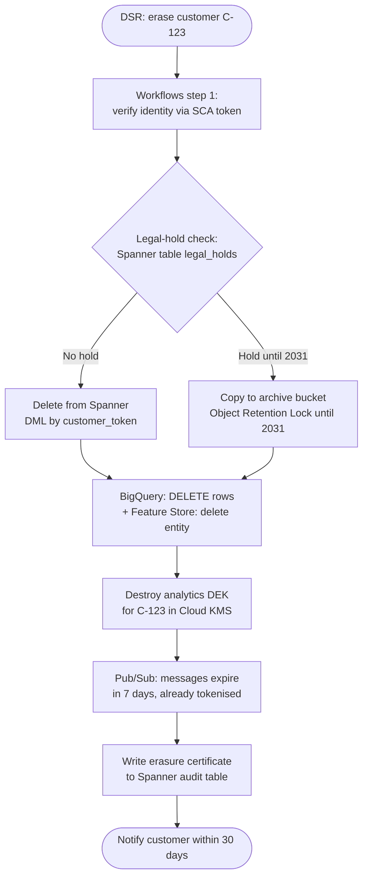
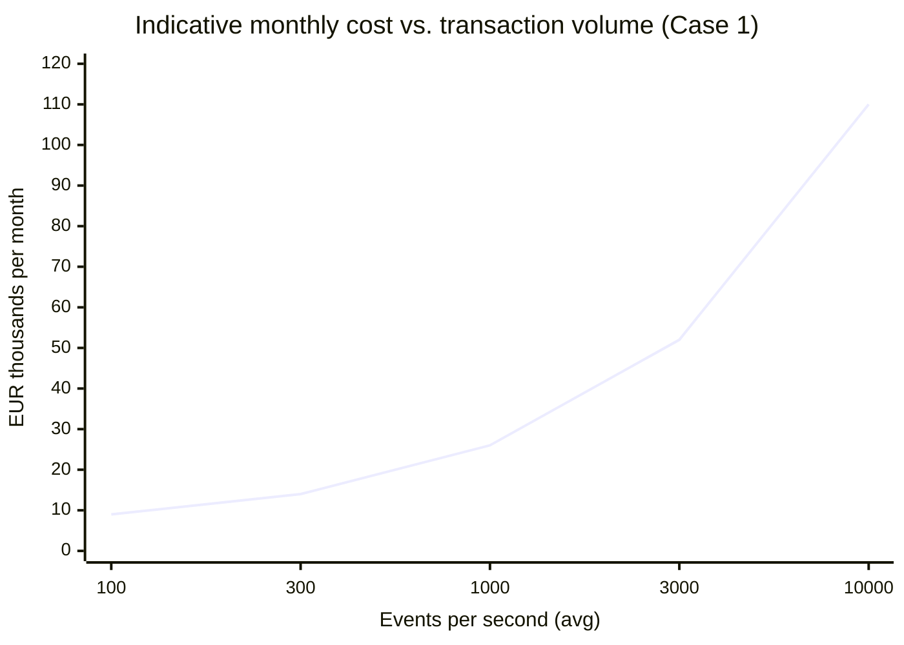

# Case 1 · Fully Managed: "Let Google Carry the Pager"

> ⚖️ Not legal or compliance advice. Regulations are paraphrased; organisations and people are fictional. [Disclaimer](../disclaimer.md)

> 🚀 **Primary protagonist: Quillpay.** With 60 engineers and no dedicated ops team, CTO Daniel says: *"Every hour we spend patching a server is an hour we don't spend beating fraudsters. If Google can run it, Google runs it."*
>
> 🏦 Aldervane uses this pattern for its **greenfield digital bank subsidiary**, "Alder Direct".

---

## 1. The story

Daniel's team has three months before their Series B due diligence. They need:

- fraud scoring live for **SEPA Instant**,
- an architecture an auditor can understand on one page,
- **no servers**, so there are no OS patches to evidence.

They agree on three design principles:

1. **Serverless first.** If a service has a "number of nodes" setting, it needs a justification.
2. **Compliance through configuration.** CMEK, VPC-SC and Org Policies are switched on *before* the first line of application code.
3. **Pay for what fraudsters make us do.** Costs scale with transaction volume.

## 2. Architecture

### Projects layout (resource hierarchy)

> 💡 **Why separate the KMS project?** **Separation of duties**: the people who administer keys must not be the people who administer data. An attacker with full control of `qp-prd-sentinel` still cannot decrypt Spanner without the key permissions held in `qp-sec-kms`.

## 3. Request flow: one SEPA Instant payment

**Fail-open design:** if the Vertex AI endpoint misses its 60 ms internal budget, `scoring-svc` returns a **rules-only** decision flagged `degraded=true`. A payment is never blocked only because ML is slow; that is itself a regulatory and customer-harm risk.

## 4. Service-by-service walkthrough

| Component | Service | Key configuration | Why this choice |
|---|---|---|---|
| WAF / DDoS | Cloud Armor (Enterprise) | OWASP CRS rules, adaptive protection, geo rules | Managed L7 protection at Google's edge |
| API management | Apigee X (EU region) | mTLS to the core, OAuth2, PSD2 consent proxy, analytics | PSD2 open-banking APIs, developer portal, monetisation later |
| Scoring | **Cloud Run** | `min-instances=5` (no cold starts), concurrency 80, CPU always allocated, CMEK, Direct VPC egress, `ingress=internal-and-cloud-load-balancing` | Serverless with predictable latency |
| Online features | Vertex AI Feature Store (Bigtable online serving) | Features synced from BigQuery and streaming updates from Dataflow | Single feature definition for training and serving, so no training/serving skew |
| Model serving | Vertex AI Endpoints | Private endpoint via PSC, autoscaling 2–20 replicas, Model Monitoring for drift | Managed rollout (traffic split for canary models) |
| Ledger | **Spanner** (multi-region `eur3`: Belgium + Netherlands, Finland witness, all EU) | CMEK (HSM), commit timestamps, change streams, row deletion policy (TTL) for non-held data, PITR 7 days, backups | 99.999%, RPO=0 across regions, strong consistency |
| Event bus | Pub/Sub | Message storage policy: EU regions only; CMEK; exactly-once on critical subscriptions | Serverless fan-out |
| Stream processing | Dataflow (Streaming Engine) | DLP transforms tokenise PII; writes to BigQuery and Feature Store | Autoscaling Beam pipelines |
| Warehouse | BigQuery | Dataset location `EU`; CMEK; column-level security with policy tags; row-level security; table expiration on raw data | Serverless analytics, BigQuery ML for quick experiments |
| Training | Vertex AI Pipelines | Pipelines run in the perimeter; Model Registry with approvals | Reproducible, auditable ML lifecycle |
| Archive | Cloud Storage | Bucket Lock retention, Object Retention Lock for legal holds, Archive class, CMEK | Cheap WORM storage for AML retention |
| Keys | Cloud KMS + Cloud HSM | HSM protection for ledger KEK; 90-day rotation; Key Access Justifications if EKM | Crypto-shredding, separation of duties |
| DSR orchestration | Workflows + Cloud Run jobs | Step functions: discover → hold check → delete/shred → certify | Serverless, auditable state machine |
| Secrets | Secret Manager | User-managed EU replication, CMEK | No secrets in env files |
| Observability | Cloud Logging, Monitoring, Trace | Org-level log sink to locked bucket; SLO on p99 latency | Evidence for auditors |
| Security posture | Security Command Center (Premium/Enterprise) | Compliance dashboards: CIS, PCI DSS, ISO 27001 | Continuous control monitoring |

## 5. Implementing the erasure puzzle in Case 1

> ⚠️ **Backups and time travel:** BigQuery keeps time-travel data (up to 7 days) and fail-safe data (7 more days); Spanner PITR keeps old versions. GDPR regulators generally accept backups that age out on a **documented, short schedule**, but **crypto-shredding is the stronger answer**: once the DEK is destroyed, the backup copies can no longer be read either. Note that Cloud KMS key versions get a scheduled-destruction period (24 hours by default, configurable) before material is actually destroyed.

## 6. Compliance mapping highlights

| Requirement | How Case 1 meets it | Who provides the evidence |
|---|---|---|
| EU residency (Art. 44) | Assured Workloads "EU Regions and Support" + `gcp.resourceLocations` | **Google** (Assured Workloads monitoring) + **you** (org policy export) |
| Encryption (Art. 32) | CMEK on every service, HSM for the ledger | Google (KMS logs) |
| OS patching (PCI DSS 6.3) | Not applicable, since there is no OS to patch | **Google** (SOC 2 / PCI AOC) |
| Breach detection (Art. 33) | SCC threat detection + log-based alerts | Google tooling, your runbooks |
| Exfiltration control | VPC-SC perimeter, restricted VIP, no public IPs | You (config) |
| DORA exit strategy | ⚠️ **Weakest point.** Spanner, Vertex AI and Apigee are proprietary; the exit plan relies on Spanner's PostgreSQL dialect and BigQuery export to Parquet/Iceberg | You |

## 7. Operations: who gets paged?

| Event | Who handles it |
|---|---|
| Zone or region outage | **Google** (Spanner multi-region, Cloud Run regional redundancy); Quillpay watches dashboards |
| Traffic spike ×5 | **Nobody**: autoscaling handles it |
| CVE in base container image | Quillpay rebuilds the image (Artifact Analysis flags it) |
| Model drift | Vertex Model Monitoring alerts the data-science on-call |
| Bad deploy | Cloud Run traffic splitting means a one-click rollback |

**On-call footprint:** about 1 rotation of application engineers; **no infrastructure on-call**.

## 8. Cost shape

*Illustrative only.* The fixed floor comes from Spanner minimum capacity, Apigee subscription, min Cloud Run instances and the Vertex endpoint. Above that, cost grows roughly linearly with volume.

| Cost driver | Optimisation |
|---|---|
| Spanner | Start with processing units (100 PU = 1/10 node), regional config in non-prod, managed autoscaler |
| Apigee | Pay-as-you-go tier until volume justifies a subscription |
| BigQuery | Editions with autoscaling slots, partitioning, clustering |
| Cloud Run | Committed use discounts once the baseline stabilises |
| Dataflow | Streaming Engine, right-fitting, FlexRS for batch backfills |

## 9. What can go wrong

| Failure mode | Mitigation |
|---|---|
| **Cold starts** blow the latency budget | `min-instances`, startup CPU boost |
| **VPC-SC breaks things** (e.g. Cloud Build cannot reach Artifact Registry) | Deploy perimeters in **dry-run mode** first, read violation logs, then enforce |
| **Quota exhaustion** at peak | Quota alerts, pre-requested quota increases |
| **Vendor lock-in** flagged by the regulator (DORA concentration risk) | Documented exit plan, open formats, Case 4 patterns |
| **Over-permissive service accounts** | One SA per service, IAM Recommender, no basic roles |
| **Hidden PII in logs** | Log exclusion filters, SDP inspection of log buckets |

## 10. Key takeaways

- ✅ **Fastest time to compliant production** (weeks rather than months).
- ✅ **The smallest share of controls you evidence yourself.** Google's certifications cover the infrastructure layers.
- ✅ Scales from 300 to 15,000 events/s with no re-architecture.
- ⚠️ **Exit strategy and concentration risk** need deliberate work under DORA.
- ⚠️ Fixed minimum costs (Spanner, Apigee) can dominate at very low volume. 🚀 Quillpay starts with Cloud SQL or Firestore and grows into Spanner (see the [startup IaC](../iac/06-startup-iac.md)).

➡️ Next: [Case 2 · Semi-managed](02-semi-managed.md)
