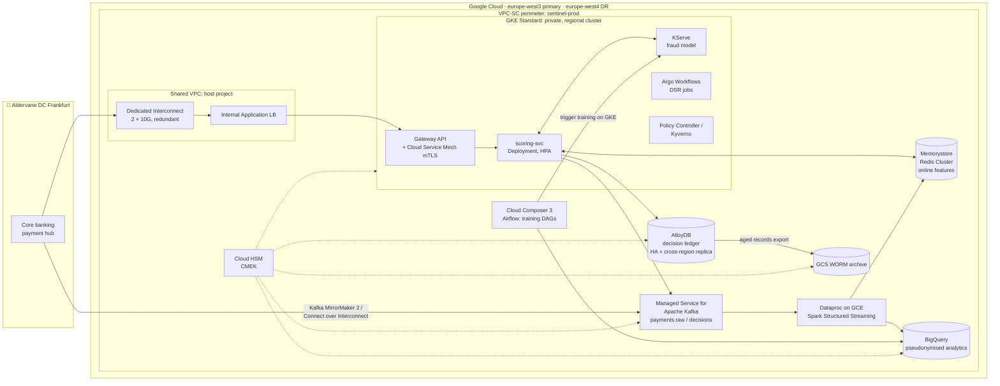
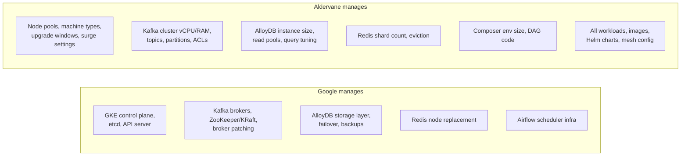
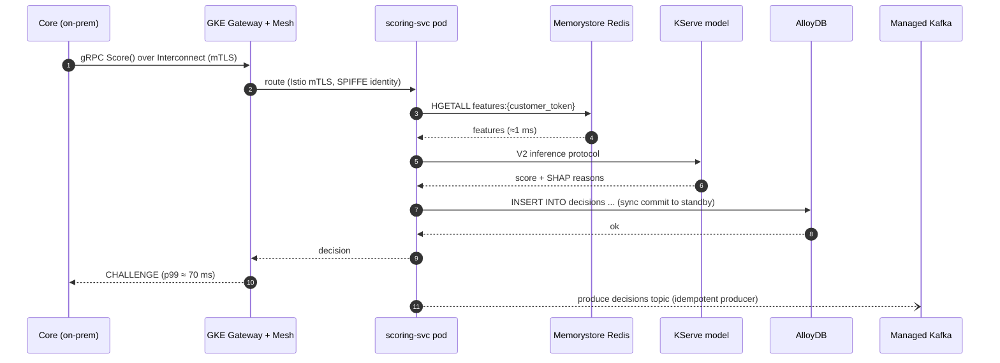
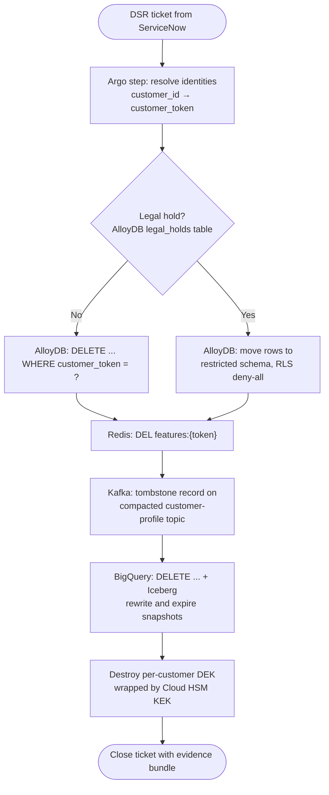
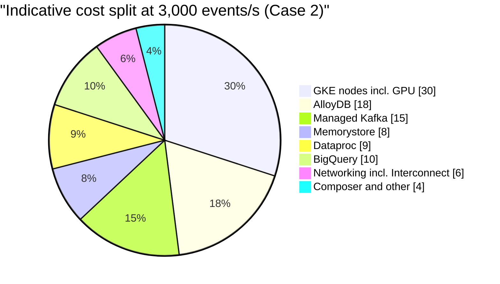

# Case 2 · Semi-managed: "Open Source Engines, Google-run Control Planes"

> ⚖️ Not legal or compliance advice. Regulations are paraphrased; organisations and people are fictional. [Disclaimer](../disclaimer.md)

> 🏦 **Primary protagonist: Aldervane Bank.** Aldervane's platform team already runs Kubernetes on-prem (OpenShift) and has 40 engineers with Kafka and PostgreSQL skills. The CISO and the DORA programme lead set a clear constraint: *"Whatever we build must be portable. If we have to leave Google in 18 months, we move workloads, not rewrite them."*

---

## 1. The story

Aldervane's Architecture Review Board (ARB) rejected the pure-serverless design from Case 1 for three reasons:

1. **DORA Art. 28 exit strategy:** the regulator asked how Aldervane would leave Spanner and Vertex AI.
2. **Skills:** 40 engineers know Kubernetes, Kafka and Postgres; nobody knows Beam or Spanner.
3. **Existing tooling:** Argo CD, Kyverno and Istio are already approved by Group Security.

The ARB's verdict is: *"Use Google-managed control planes for open-source engines. We'll accept the operational load of sizing and upgrades in exchange for portability."*

## 2. Architecture

### Who manages what in Case 2

## 3. Request flow

## 4. Service-by-service walkthrough

| Component | Service | What Aldervane configures | Portability story |
|---|---|---|---|
| Container platform | **GKE Standard** (private, regional, Dataplane V2, Workload Identity, Shielded/Confidential nodes, release channel `stable`) | Node pools per workload class (`scoring` on C3, `ml` on G2 GPUs), maintenance windows aligned with CAB windows, Binary Authorization | Kubernetes manifests run on OpenShift, EKS or AKS |
| Policy | Policy Controller (Gatekeeper) or Kyverno | Disallow privileged pods, require image signatures, require resource limits | Same policies on-prem |
| Service mesh | Cloud Service Mesh (managed Istio) | Strict mTLS, AuthorizationPolicies | Istio-compatible |
| Event bus | **Managed Service for Apache Kafka** | Cluster vCPU/memory, topics, partition counts, retention; CMEK; IAM-based auth | Plain Kafka protocol, so MirrorMaker can move it anywhere |
| Online features | **Memorystore for Redis Cluster** | Shard count, replicas per shard, AOF persistence off (features are rebuildable) | Redis protocol |
| Model serving | **KServe on GKE** | GPU node pool autoscaling, canary via InferenceService | Open source |
| Ledger | **AlloyDB for PostgreSQL** | Primary 16 vCPU with HA standby, read pool, cross-region secondary cluster in `europe-west4`, CMEK | PostgreSQL wire protocol, `pg_dump`-able |
| Streaming | **Dataproc** (Spark Structured Streaming) | Cluster size, autoscaling policy, image version, Kerberos off / Workload Identity on | Spark runs anywhere |
| Orchestration | **Cloud Composer 3** | Environment size, Airflow version, PyPI packages | Airflow DAGs are portable |
| Warehouse | BigQuery (exception: managed) | Accepted by the ARB because data can be exported to Parquet/Iceberg (BigLake) | BigLake Iceberg tables are readable by Spark or Trino |
| Keys | Cloud HSM | KEK per data domain, 90-day rotation | Keys are not exportable (by design); exit means re-encryption |
| CI/CD | Cloud Build private pool + Argo CD | GitOps from on-prem GitLab | Already in place |

> 🧭 **Design note: why still BigQuery?** Running a self-managed warehouse (Case 3) cost about 3 FTE per year in the ARB's estimate. The ARB accepted BigQuery because **BigLake Iceberg tables** keep the data in an open format on GCS, so it can be read by Spark or Trino after an exit. This kind of nuanced decision gets recorded in an **Architecture Decision Record (ADR)**.

## 5. Implementing the erasure puzzle in Case 2

The DSR workflow runs as an **Argo Workflow** in a dedicated `privacy-ops` namespace with its own Kubernetes service account, bound by Workload Identity to a GCP service account that has narrowly scoped permissions.

> ⚠️ **Kafka is append-only.** You cannot delete a single message from a non-compacted topic. Patterns: (1) never put raw PII in Kafka, only tokens; (2) use **compacted topics with tombstones** for entity data; (3) keep short retention on raw topics; (4) encrypt payload fields with per-subject DEKs (crypto-shredding again).

> ⚠️ **Iceberg snapshots remember deleted rows.** After a `DELETE`, run snapshot expiry and orphan-file cleanup, otherwise the "deleted" data stays in older snapshots.

## 6. Compliance mapping highlights

| Requirement | Case 2 approach | Extra burden vs. Case 1 |
|---|---|---|
| Patching | GKE auto-upgrades on the `stable` channel during CAB-approved windows; Aldervane patches **container images** | Evidence that node upgrades happened within SLA |
| Exfiltration | VPC-SC + GKE NetworkPolicies + mesh AuthorizationPolicies | More layers to keep consistent |
| Encryption | CMEK for GKE boot disks, AlloyDB, Kafka, Redis, BigQuery; **application-layer secrets encryption** for etcd | More CMEK integrations to verify |
| DORA exit | Open protocols everywhere except BigQuery and HSM | ✅ Strongest point |
| Capacity management (DORA Art. 9) | Aldervane owns capacity plans for Kafka, AlloyDB, Redis, GKE node pools | Quarterly capacity reviews |
| Vulnerability management | Artifact Analysis + GKE security posture dashboard | Must triage node and workload CVEs |

## 7. Operations: who gets paged?

| Event | Who handles it |
|---|---|
| Kafka broker failure | Google replaces the broker; Aldervane checks consumer lag |
| Kafka partition hot-spot | **Aldervane** (rebalance, increase partitions) |
| GKE node pool out of capacity | **Aldervane** (cluster autoscaler limits, reservations) |
| AlloyDB primary failure | Google fails over automatically (< 60 s); the app must retry |
| Region failure | **Aldervane** promotes the AlloyDB secondary cluster in `europe-west4`, fails over GKE via multi-cluster Gateway (runbook, ~15 min) |
| Kubernetes version end-of-life | **Aldervane** plans upgrades through CAB |

**On-call footprint:** a platform SRE rotation (GKE, Kafka, data) plus application on-call.

## 8. Cost shape

Costs are more **step-shaped**: you pay for provisioned capacity (nodes, vCPUs, shards) whether or not you use it. Committed use discounts (1 or 3 years) and Spot VMs for batch Spark cut the bill significantly, but someone has to manage them.

## 9. What can go wrong

| Failure mode | Mitigation |
|---|---|
| **Upgrade drift**: clusters fall behind and hit forced upgrades | Release channels, maintenance exclusions only around peak business periods, upgrade runbooks in the CAB calendar |
| **Noisy neighbours** in shared node pools | Separate node pools, PodDisruptionBudgets, priority classes |
| **Kafka under-partitioned** for peak load | Load tests at 2× peak before Black Friday |
| **Config sprawl** across mesh, NetworkPolicy, VPC-SC | Policy-as-code + Config Sync from one Git repo |
| **Skills single points of failure** | Runbooks, game days, pairing |

## 10. Key takeaways

- ✅ **Portability and DORA-friendliness**: the open-source engines are an exit strategy you can actually demonstrate.
- ✅ Reuses existing skills and tooling.
- ⚖️ More operational surface: capacity, upgrades, tuning. Expect a **platform team of 6–10 people**.
- ⚖️ More compliance evidence to produce yourself (node patch status, capacity reviews).

➡️ Next: [Case 3 · Least managed](03-least-managed.md)
