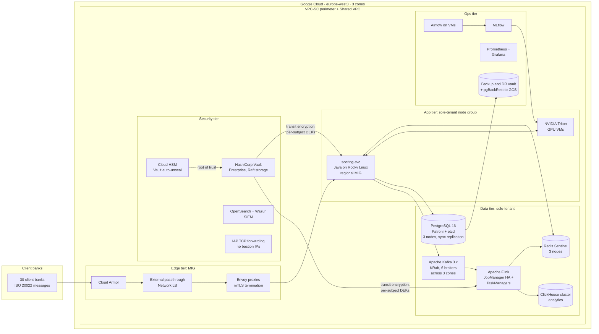
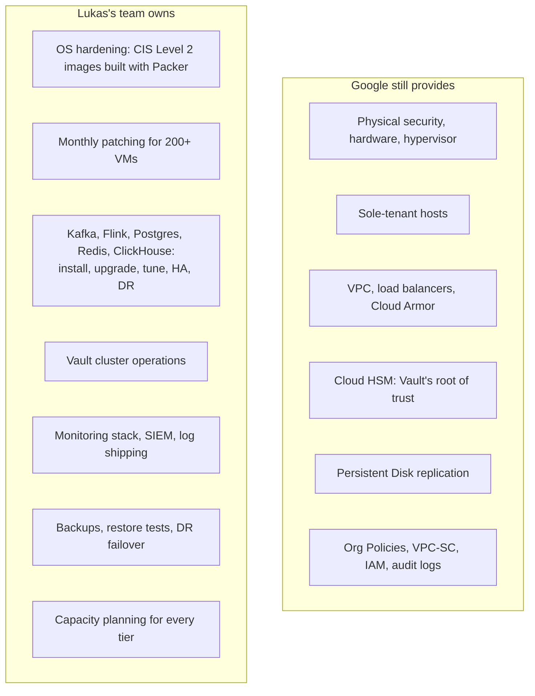
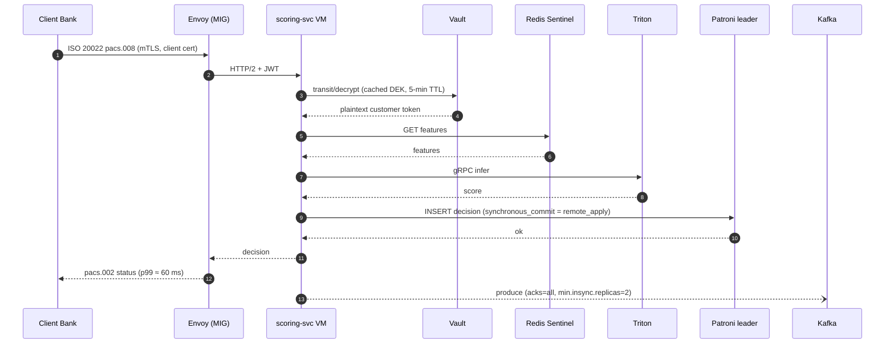
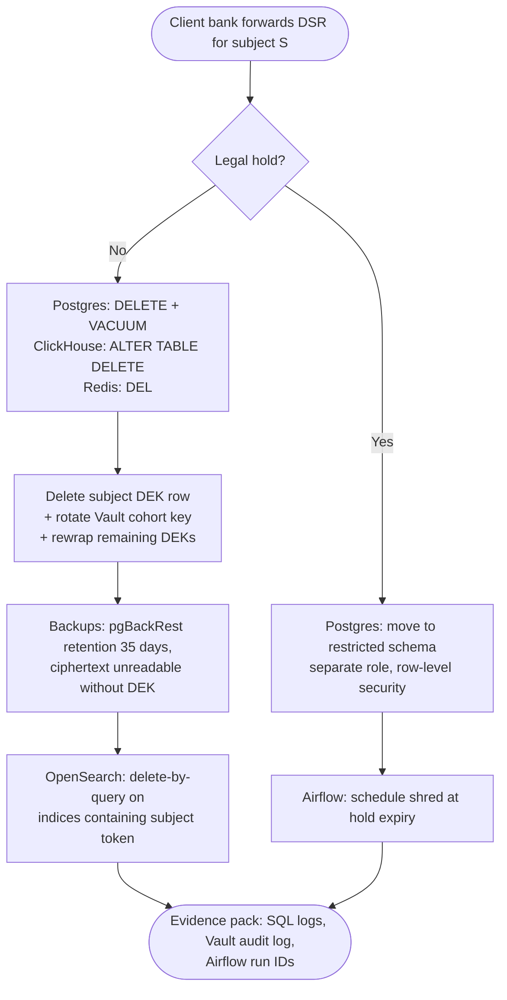
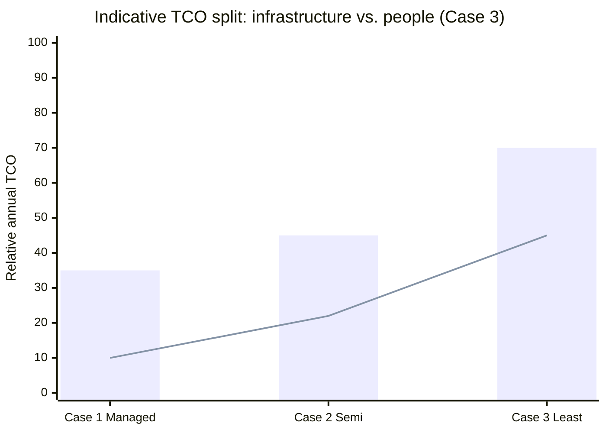

# Case 3 · Least Managed: "Google Is Our Data Centre"

> ⚖️ **Disclaimer:** educational material only. This is **not legal, regulatory, compliance or financial advice**. Regulations are paraphrased and simplified; organisations, people and incidents are fictional. Consult qualified counsel before you rely on any of it. [Full disclaimer](../../README.md#disclaimer)

> 🏦 **Protagonist: Aldervane Bank's Market Infrastructure division**, which runs payments clearing for 30 smaller banks. Their contracts with those client banks require **dedicated hardware isolation**, specific **certified software versions**, and **full control of the cryptographic stack**. Their national competent authority also demands detailed evidence about every layer of the platform.
>
> This case is deliberately extreme. It shows **what you take on** when you choose IaaS, and why most organisations shouldn't, but some must.

---

## 1. The story

Lukas, the division's chief architect, has a 120-page requirements document. Three lines drive everything:

- **REQ-ISO-04:** "Compute hosting client-bank data shall not share physical hosts with other tenants."
- **REQ-CRY-11:** "Encryption keys used for client data shall be generated and held in key management systems operated by the Division."
- **REQ-OPS-02:** "All software components shall be version-pinned and patched under the Division's change process."

Lukas's team concludes: *"We use Google Cloud as a programmable, global, highly secure data centre. Compute Engine, sole-tenant nodes, VPC, Cloud HSM as a root of trust, and nothing that hides the operating system from us."*

## 2. Architecture

### What "least managed" means in practice

> 💡 Even "unmanaged" on GCP isn't truly unmanaged. **Org Policies, VPC-SC, IAM, Cloud Audit Logs and Cloud HSM** stay in place because they're free or cheap, and no self-built alternative is better.

## 3. Request flow

## 4. Component walkthrough

| Component | Implementation | Operational duties |
|---|---|---|
| Compute | Compute Engine C3/N2 on a **sole-tenant node group**, regional MIGs, Shielded VM, OS Login, **Confidential VMs** where supported | Golden image pipeline (Packer + CIS benchmarks), monthly patch cycle, MIG rolling updates |
| Edge | Cloud Armor → passthrough NLB → Envoy MIG | Envoy upgrades, certificate rotation (from Vault PKI) |
| Kafka | Apache Kafka (KRaft) on 6 VMs with Hyperdisk Balanced, rack-awareness = zone | Broker upgrades, partition rebalancing (Cruise Control), disk expansion |
| Stream processing | Apache Flink, checkpoints to GCS | Savepoints before upgrades, state migration |
| Ledger | PostgreSQL 16 + Patroni + etcd, synchronous replication across 3 zones; pgBackRest to GCS with Bucket Lock | Failover testing, vacuum tuning, PITR restore drills |
| Cache | Redis + Sentinel | Failover testing, memory sizing |
| Analytics | ClickHouse cluster | Shard and replica management, upgrades |
| ML | MLflow + Airflow + Triton on GPU VMs | Driver updates (NVIDIA), model rollout scripts |
| Keys | **HashiCorp Vault Enterprise** (Transit, Transform, PKI), auto-unseal with **Cloud HSM** | Vault upgrades, Raft snapshots, DR replication, unseal-key ceremony |
| SIEM | Wazuh agents + OpenSearch | Index lifecycle, cluster scaling, detection-rule authoring |
| Monitoring | Prometheus, Grafana, Alertmanager | Long-term storage (Thanos), alert tuning |

## 5. Implementing the erasure puzzle in Case 3

With full control comes full responsibility. **Vault Transit** holds a named key per customer cohort, plus per-customer DEKs stored wrapped in Postgres.

> ⚠️ **ClickHouse `ALTER TABLE ... DELETE` is an asynchronous mutation** that rewrites data parts. Your evidence has to show that the mutation *completed*, not only that it was submitted. Lightweight deletes mark rows and remove them on merge, which raises the same question.

> ⚠️ **Postgres `DELETE` does not remove data from disk immediately.** Dead tuples stay until `VACUUM`, and WAL archives keep the old values. That's why crypto-shredding matters even when you control everything.

## 6. Compliance mapping highlights

| Requirement | Case 3 approach | Who provides the evidence |
|---|---|---|
| Physical isolation | Sole-tenant nodes | Google (node affinity) + Lukas (placement config) |
| Key custody | Vault (operated by the division) with Cloud HSM as root of trust; or EKM to an on-prem HSM if Google-hosted HSM is unacceptable | **Lukas's team** |
| OS patching | Monthly cycle, OS Config / VM Manager patch reports | **Lukas's team** |
| Vulnerability scanning | VM Manager + Wazuh + SCC | **Lukas's team** |
| Logging | Cloud Audit Logs (Google layer) **plus** Wazuh/OpenSearch (OS and application layer) | Both |
| HA and DR | Self-built: Patroni, Kafka replication, Flink checkpoints, DR restore drills | **Lukas's team** |
| DORA exit | ✅ Excellent: everything is open source on generic Linux VMs | |
| DORA ICT risk | ⚠️ Huge surface: 200+ VMs and 9 stateful products to evidence | **Lukas's team** |

## 7. Operations: who gets paged?

| Event | Who handles it |
|---|---|
| Kernel CVE (e.g. a container escape) | **Lukas's team**: emergency CAB, rolling patch of 200 VMs |
| Zone failure | **Lukas's team**: Patroni fails over automatically if configured correctly; Kafka ISR shrinks; Flink restarts from checkpoint |
| Disk full on a Kafka broker | **Lukas's team** (3 a.m.) |
| Vault sealed after restart | Auto-unseal via Cloud HSM; **Lukas's team** if the HSM is unreachable |
| Hardware failure | Google live-migrates the VM (sole-tenant nodes support live migration under maintenance policies) |

**On-call footprint:** 3–4 specialist rotations (Linux, data platform, security, application). Expect **15–25 FTE** in total.

## 8. Cost shape

*Bars show total relative TCO; the line shows the people/operations share.* Raw infrastructure can be **cheaper** in Case 3 (3-year CUDs, no managed-service premium), but **people costs dominate**. Sole-tenant nodes add a premium on top of VM pricing.

## 9. What can go wrong

| Failure mode | Real-world consequence | Mitigation |
|---|---|---|
| **Patch backlog** | Audit finding: "critical CVEs older than 30 days" | Immutable images, automated rolling MIG updates |
| **Split-brain in Patroni** | Two primaries, ledger divergence | etcd quorum across 3 zones, fencing, `synchronous_mode_strict` |
| **Untested restores** | Backups that cannot be restored | Monthly automated restore tests with evidence |
| **Key loss** | Permanent data loss | Vault DR replication, HSM-backed unseal, documented key ceremony |
| **Snowflake servers** | Configuration drift | Immutable infrastructure, no SSH by default (OS Login + IAP + break-glass only) |
| **Expertise attrition** | Bus factor of 1 for Kafka or Vault | Cross-training, vendor support contracts |

## 10. Key takeaways

- ✅ **Maximum control**: isolation, versions and key custody are all yours.
- ✅ **Maximum portability**: this design runs on any IaaS or on-prem.
- ❌ **Maximum toil and compliance burden.** Every layer above the hypervisor is yours to evidence.
- 💡 Choose this **only when a contract or regulation forces it**, and even then, keep using the cloud-native guardrails (Org Policies, VPC-SC, IAM, Cloud HSM, audit logs) that cost almost nothing.

➡️ Next: [Case 4 · Hybrid and multi-cloud](04-hybrid-multicloud.md)
