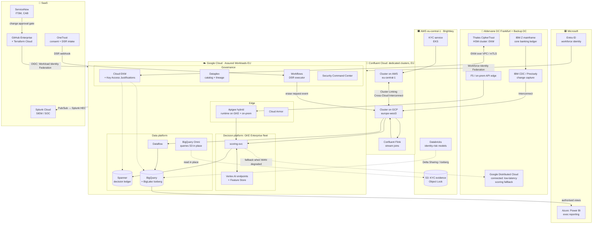
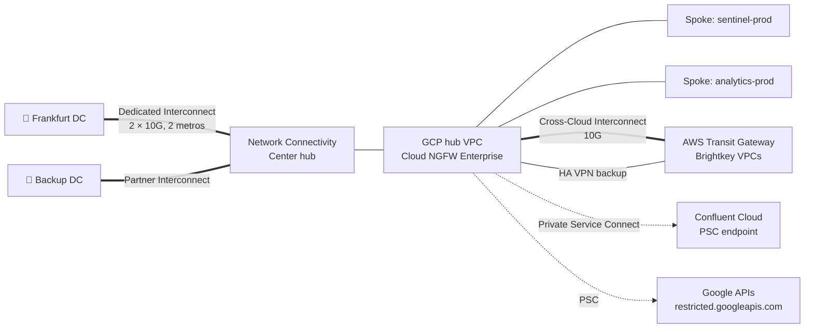
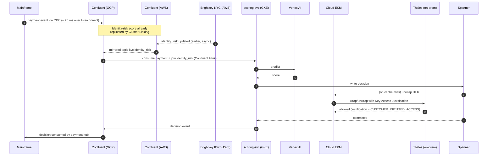
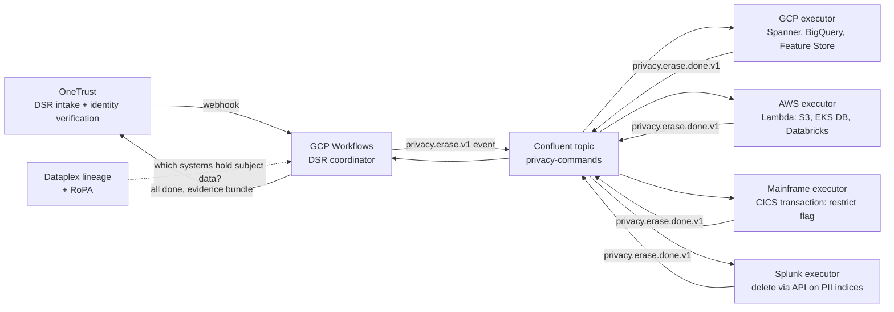
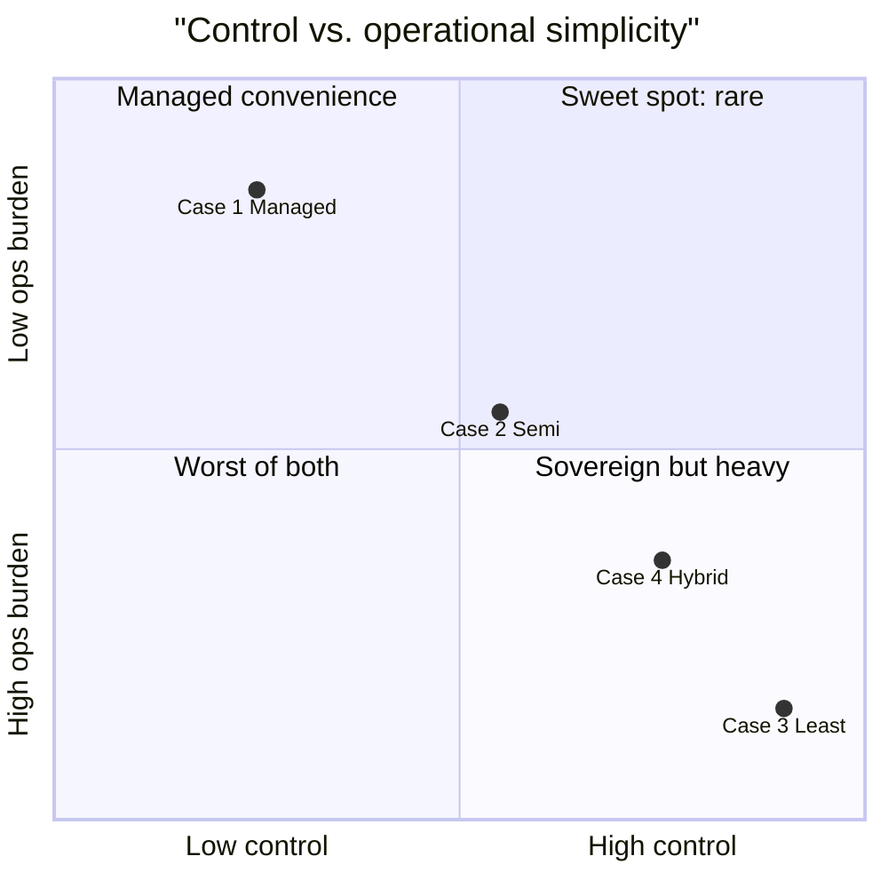

# Case 4 · Hybrid and Multi-cloud: "The Real World Is Messy"

> ⚖️ Not legal or compliance advice. Regulations are paraphrased; organisations and people are fictional. [Disclaimer](../disclaimer.md)

> 🏦 **Protagonist: Aldervane Bank Group**, the whole group this time. The real picture:
>
> - **Core banking** stays on an IBM Z mainframe in Frankfurt for at least 5 more years.
> - Aldervane recently **acquired "Brightkey"**, a KYC/identity-verification fintech that runs entirely on **AWS**.
> - Group IT has a **Microsoft Entra ID** workforce directory and an enterprise agreement with **Microsoft** (Office 365, some Azure).
> - The SOC runs on **Splunk** under a 3-year contract.
> - The privacy office has standardised on **OneTrust** for consent and DSR intake.
> - The regulator expects a credible answer to DORA's **concentration-risk** questions.
>
> Priya (Head of Cloud Architecture) has to design Sentinel to fit this landscape, not an ideal one.

---

## 1. Design principles for hybrid

1. **Google Cloud is the "decisioning and analytics" platform.** It's where Sentinel runs.
2. **Systems of record stay where they are** (mainframe ledger, AWS KYC), integrated through events.
3. **One event backbone spanning all environments**: Confluent Cloud, since it runs on GCP, AWS and Azure with cluster linking.
4. **Keys never live with the data processor.** Google Cloud **External Key Manager** connects to an on-prem **Thales CipherTrust** HSM cluster.
5. **One identity plane for humans** (Entra ID through Workforce Identity Federation) and **no static keys for machines** (Workload Identity Federation to AWS and Azure).
6. **Open formats at every boundary** (Kafka, Iceberg, Parquet, OpenTelemetry), which serves as the DORA exit strategy.

## 2. Target architecture

## 3. Network topology

> 💡 **Cross-Cloud Interconnect** gives Google-provisioned private links straight into AWS, Azure, OCI or Alibaba. With it, traffic between GCP and Brightkey's AWS environment never touches the public internet, which keeps the DPIA's transfer analysis simple.

## 4. Request flow across clouds

> 🔑 **The sovereignty lever:** if Aldervane ever has to cut Google off, for legal reasons or as part of an exit, it **disables the key in Thales**. Every Sentinel dataset encrypted under EKM becomes unreadable *immediately*, including Google's own backups. Regulators find this a convincing supplementary measure, but it is also a **self-inflicted outage switch**. EKM availability now sits directly on the critical path.

## 5. Why each third-party / competitor component?

| Component | Chosen | Why not the GCP-native option? | Trade-off accepted |
|---|---|---|---|
| Event backbone | **Confluent Cloud** | Pub/Sub is GCP-only; the bank needs one backbone across mainframe, GCP and AWS with cluster linking and Flink | Extra vendor, extra DPA, extra cost |
| Key management | **Thales CipherTrust via Cloud EKM** | Cloud KMS/HSM keys reside in Google; group policy requires keys outside the CSP | EKM latency and availability risk; two HSM teams |
| Workforce identity | **Entra ID** | Already the group directory; Workforce Identity Federation avoids duplicating identities | Federation complexity, attribute mapping |
| SIEM | **Splunk Cloud** | 3-year contract, SOC playbooks already built | Log egress cost; Google SecOps evaluated for renewal |
| Consent / DSR intake | **OneTrust** | Privacy office standard across all channels | Integration via webhooks + Workflows |
| KYC models | **Databricks on AWS** (Brightkey) | Acquired company; migration not justified yet | Cross-cloud data sharing via Iceberg / Delta Sharing |
| Exec BI | **Power BI on Azure** | Group standard | Authorised views, no raw PII leaves GCP |
| CI/CD and IaC | **GitHub Enterprise + Terraform Cloud** | Group standard; multi-cloud IaC | OIDC federation to GCP, AWS and Azure |
| ITSM | **ServiceNow** | Change and incident management of record | Pipeline integration (see [enterprise IaC](../iac/05-enterprise-iac.md)) |
| Low-latency fallback | **Google Distributed Cloud connected** | Scoring must survive a WAN outage | Hardware in the DC |

## 6. GDPR DSR across clouds and SaaS

The hardest part of hybrid is **finding every copy**. A DSR now spans GCP, AWS, Confluent, Splunk, Databricks and the mainframe.

**Pattern: event-driven "privacy command bus".** Each system has an **executor** that owns deletion in its own domain and reports back with evidence. The coordinator tracks completion against the 30-day SLA.

## 7. Compliance mapping highlights

| Concern | Hybrid-specific answer |
|---|---|
| **International transfers** | All providers contracted for EU regions; AWS `eu-central-1`, Confluent EU, Splunk EU, OneTrust EU tenant. Transfer impact assessment for US-parent providers relies on the EU–US Data Privacy Framework plus SCCs, and on EKM so that the CSP has no access to keys |
| **Processor chain (Art. 28)** | DPAs with Google, AWS, Confluent, Splunk, OneTrust, Databricks, Microsoft; all listed in the RoPA |
| **DORA register of information** | Every ICT third party recorded with criticality, exit plan and substitutability |
| **DORA concentration risk** | Decisioning on GCP, KYC on AWS, ledger on-prem; no single CSP failure stops payments (rules-only fallback on GDC) |
| **Logging and SIEM** | GCP logs → Pub/Sub → Splunk HEC; AWS CloudTrail → Splunk; single SOC view |
| **Identity** | Entra ID conditional access + Workforce Identity Federation; GCP IAM PAM for just-in-time elevation |
| **Key custody** | EKM with Key Access Justifications: every Google access to a key carries a reason code that the Thales policy can deny |

## 8. Operations: who gets paged?

| Event | Who handles it |
|---|---|
| Interconnect link down | Network team; traffic fails over to the second metro or HA VPN |
| Thales EKM cluster unavailable | 🔥 **Sev-1.** Sentinel data becomes unreadable; HSM team and cloud team on a bridge call |
| Confluent cluster-link lag | Streaming platform team + Confluent support |
| AWS region issue | Brightkey team; Sentinel degrades to "identity risk unknown", scoring continues |
| GCP region issue | Spanner multi-region keeps going; GKE fleet fails over; GDC fallback scoring |

## 9. Cost and complexity

Hybrid is rarely the cheapest option. It's the option that **fits the constraints you already have**. The biggest hidden costs:

- **Egress and interconnect** (cross-cloud data movement)
- **Integration engineering** (executors, schema registry, identity mapping)
- **Vendor management** (seven DPAs, seven sets of audit reports, seven exit plans)

## 10. Key takeaways

- ✅ Matches reality: legacy systems of record, acquisitions, existing contracts.
- ✅ Strong sovereignty (EKM) and a DORA concentration-risk story.
- ⚠️ **Complexity is the main risk.** Invest in a **privacy command bus**, **a single catalog and lineage view** (Dataplex for GCP, plus OpenMetadata across clouds; see [Chapter 08](../08-data-governance.md#when-google-native-isnt-enough-openmetadata-in-the-hybrid-case)), and **open formats**.
- ⚠️ Every external dependency on the critical path (EKM, Confluent, Interconnect) needs its own SLO, runbook and DR test.

➡️ Next: [04 · Comparison and Decision Guide](../04-comparison.md)
