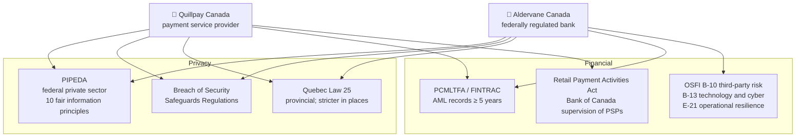
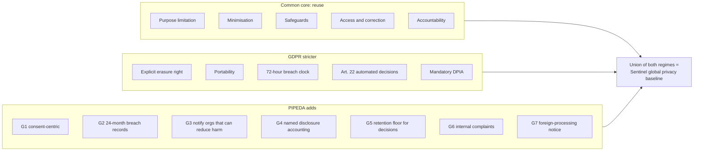
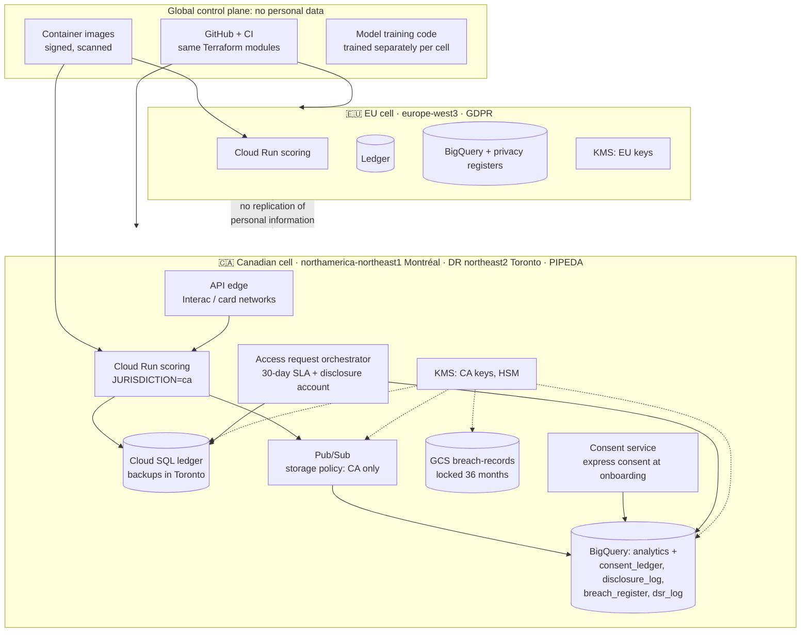
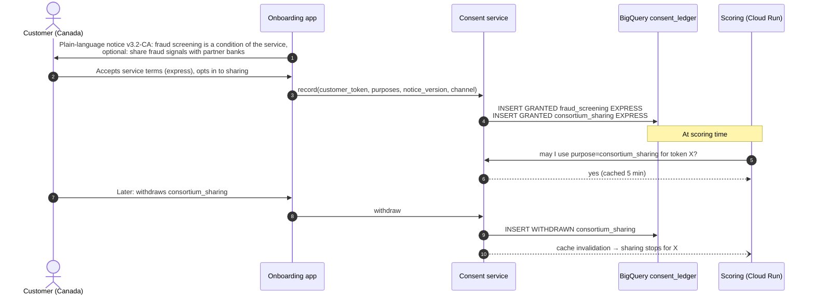
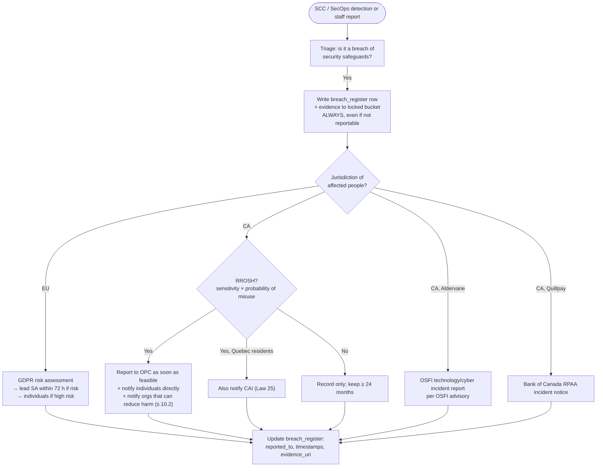
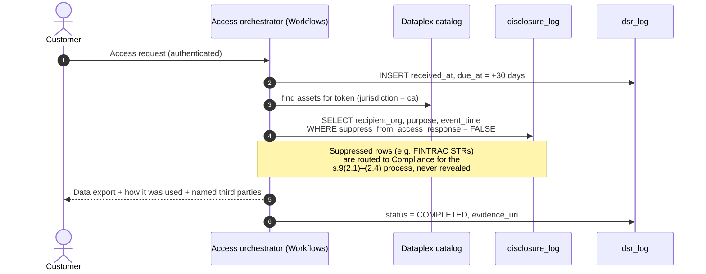

# Case 5 · Crossing the Atlantic: Sentinel Goes to Canada (PIPEDA)

> 🚀 **Primary protagonist: Quillpay**, which is launching instant payments for Canadian small businesses. 🏦 **Aldervane Bank** is opening "Aldervane Canada" at the same time, as a federally regulated bank. Both reuse Sentinel and both ask the same question:
>
> *"We're GDPR-compliant. Isn't that automatically PIPEDA-compliant?"*
>
> Short answer: **no**. PIPEDA overlaps heavily with GDPR but it is **not a subset**. This chapter finds the gaps, closes them, and shows the evidence for each.

> ⚖️ Summary for architectural purposes, **not legal advice**. PIPEDA is the *Personal Information Protection and Electronic Documents Act* (Canada's federal private-sector privacy law). Bill C-27 (the proposed Consumer Privacy Protection Act) died when Parliament was prorogued in January 2025. Watch for a successor bill, which could change the details below.

---

## 1. Who regulates what in Canada?

| Entity | Privacy | Prudential / conduct | AML |
|---|---|---|---|
| 🚀 Quillpay (payment service provider) | PIPEDA (+ Quebec Law 25 for Quebec customers) | **RPAA**: register with the Bank of Canada; operational-risk and incident-response framework; notify incidents | FINTRAC (MSB registration) |
| 🏦 Aldervane Canada (bank) | PIPEDA (+ Quebec Law 25) | **OSFI B-10, B-13, E-21**; technology and cyber incident reporting to OSFI (within 24 h per OSFI's advisory) | FINTRAC |

## 2. Is PIPEDA a subset of GDPR? The gap analysis

### 2.1 Where GDPR already covers PIPEDA (reuse it)

| PIPEDA principle (Schedule 1) | Covered by existing GDPR control | Reuse |
|---|---|---|
| 4.1 Accountability | DPO, RoPA, processor contracts | ✅ but a named **Privacy Officer** is needed for Canada |
| 4.2 Identifying purposes | Art. 13/14 notices, purpose limitation | ✅ |
| 4.4 Limiting collection | Art. 5(1)(c) minimisation, tokenisation at ingestion | ✅ |
| 4.5 Limiting use, disclosure, retention | Art. 5(1)(b),(e), retention engine, crypto-shredding | ⚠️ partly (see gaps 3 and 4) |
| 4.6 Accuracy | Art. 5(1)(d), Art. 16 rectification, Dataplex quality scans | ✅ |
| 4.7 Safeguards | Art. 32: CMEK, VPC-SC, IAM, logging | ✅ |
| 4.8 Openness | Art. 12–14 transparency | ✅ |
| 4.9 Individual access | Art. 15 access | ⚠️ partly (gap 4) |
| 4.10 Challenging compliance | DPO contact, right to complain to the supervisory authority | ⚠️ partly (gap 6) |

### 2.2 Where PIPEDA asks for something GDPR doesn't (close the gaps)

| # | PIPEDA requirement | What GDPR says | The gap |
|---|---|---|---|
| **G1** | **Consent is the default basis** (Principle 4.3). Meaningful consent, and **express** consent for sensitive information (financial data is generally sensitive). No general "legitimate interest" basis; only the specific exceptions in s.7 | Six lawful bases; fraud prevention can rest on **legitimate interest** (Recital 47) or legal obligation | Sentinel's EU design used legitimate interest. In Canada it needs **consent captured and evidenced**, or a documented s.7 exception |
| **G2** | **Record EVERY breach** of security safeguards and keep the record for **≥ 24 months** after determining the breach occurred (s.10.3 + Regulations). Fines for failing to record | Art. 33(5): document all breaches, **no fixed retention period** | Need a **24-month, tamper-evident breach register** |
| **G3** | Breach notification goes to the OPC **and** affected individuals when there is a **real risk of significant harm (RROSH)**, **and to any other organisation or government institution that can reduce the harm** (s.10.2), e.g. card issuers | Art. 33/34: supervisory authority within 72 h and individuals if high risk; no explicit duty to notify third parties | Add **third-party notification** step + RROSH assessment to the runbook. (GDPR's 72 h is stricter on timing, so keep it as the global SLA.) |
| **G4** | Access response must include an **account of how the information was used and the third parties it was disclosed to**, as specifically as possible (4.9.1, 4.9.3) | Art. 15(1)(c): recipients **or categories** of recipients | Need a **per-disclosure log** with named recipients, while **suppressing** disclosures that must not be revealed (FINTRAC reports: no tipping off; PIPEDA s.9(2.1)–(2.4)) |
| **G5** | Information **used to make a decision** about an individual must be **retained long enough for them to access it** (4.5.2). There is no general "right to erasure" | Art. 17 erasure; storage limitation pushes toward early deletion | **Minimum** retention floor for decision records, even after a withdrawal or deletion request |
| **G6** | Organisations must have **internal complaint-handling procedures**, investigate all complaints, and fix practices if a complaint is justified (4.10) | Complaint goes to the supervisory authority; internal process not mandated | Need an **internal complaint workflow** with evidence |
| **G7** | **Transfers outside Canada** are a "use" (OPC guidance): allowed without consent, but the organisation stays accountable and must **tell individuals** their data may be processed abroad and accessed by foreign authorities | Chapter V transfer mechanisms (adequacy, SCCs) | Notice + contracts for any EU access to Canadian data (e.g. Quillpay's EU-based support team) |
| **G8** | *(Quebec Law 25, for Quebec residents)*: a PIA **before** communicating data outside Quebec; notice when a decision is based **exclusively on automated processing**; a confidentiality-incident register; privacy by default | Similar ideas in GDPR Art. 22, 25, 35 | PIA for transfers outside Quebec; Art. 22-style notices reused; the incident register is already covered by G2 |

> **And the reverse:** GDPR has things PIPEDA lacks (an explicit right to erasure and to portability, Art. 22 rights, the 72-hour deadline, mandatory DPIAs, fines up to 4%). The Canadian cell keeps **all** the GDPR controls. Operating to the **union** of both regimes is simpler than maintaining two rulebooks.

## 3. Architecture: the Canadian data cell

Sentinel moves from "one platform" to a **cell-based** design: shared code, pipelines and container images, but **separate data planes per jurisdiction**.

**Why a separate cell when PIPEDA allows cross-border transfers?**
1. **Customer and partner expectations:** Canadian banks and Interac participants expect Canadian residency.
2. **OSFI B-10 / B-13 (Aldervane):** simpler third-party risk and concentration analysis.
3. **Quebec Law 25:** a PIA is required before data leaves Quebec. Keeping data in Montréal and Toronto still means leaving Quebec for Toronto backups, so the PIA covers Toronto explicitly.
4. **Blast radius:** an incident in one cell doesn't become a multi-jurisdiction breach.

### Implemented in IaC

| Cell | Enterprise (Aldervane) | Startup (Quillpay) |
|---|---|---|
| Folder + residency guardrail | `fldr-ca-prod` with `gcp.resourceLocations` = Montréal + Toronto ([landing-zone/main.tf](https://github.com/KshitijV97/gcp-fintech-architecture-playbook/blob/main/iac/enterprise/landing-zone/main.tf)) | `prod-ca` folder ([bootstrap/main.tf](https://github.com/KshitijV97/gcp-fintech-architecture-playbook/blob/main/iac/startup/bootstrap/main.tf)) |
| Assured Workloads | `CA_REGIONS_AND_SUPPORT` (data location + support personnel) | Optional |
| Separate keys | `kms_ca` project | `qp-prod-ca-kms` project |
| Shift-left residency check | `RESIDENCY-CA` rule ([policies/residency.rego](https://github.com/KshitijV97/gcp-fintech-architecture-playbook/blob/main/iac/enterprise/policies/residency.rego)) | `[RESIDENCY]` rule ([policies/guardrails.rego](https://github.com/KshitijV97/gcp-fintech-architecture-playbook/blob/main/iac/startup/policies/guardrails.rego)) |
| Platform | Sentinel workload with `jurisdiction = "ca"` | [envs/prod-ca/main.tf](https://github.com/KshitijV97/gcp-fintech-architecture-playbook/blob/main/iac/startup/envs/prod-ca/main.tf) |
| Privacy registers | Data-governance module + registers | [modules/platform/privacy_tables.tf](https://github.com/KshitijV97/gcp-fintech-architecture-playbook/blob/main/iac/startup/modules/platform/privacy_tables.tf) |
| Breach records ≥ 24 months | Locked log bucket | Locked `breach-records` bucket (36 months), policy `[PIPEDA-BREACH]` |
| Demand | [dmd-0057](https://github.com/KshitijV97/gcp-fintech-architecture-playbook/blob/main/iac/enterprise/demand-management/demands/dmd-0057-sentinel-canada.yaml) | n/a |

## 4. Closing each gap

### G1: consent-centric design

- **Fraud screening** is **reasonable and necessary** for a payment service, so it may be a *condition of service* (Principle 4.3.3) but must be stated clearly. For **sharing with other institutions** to prevent fraud, PIPEDA s.7(3)(d.2) permits disclosure without consent; Quillpay still asks for opt-in for consortium sharing as a trust choice.
- **Evidence:** the `consent_ledger` row with `notice_version`, plus the notice text versioned in Git.

### G2 + G3: breach register and notifications

- **Evidence:** `breach_register` table, the locked `*-breach-records` bucket (`retention_policy.is_locked = true`, 1096 days), and the conftest rule `[PIPEDA-BREACH]` that rejects any plan shortening it below 24 months.

### G4: access requests with a disclosure account

### G5: retention floor vs. erasure ceiling

| Data | Floor (keep at least) | Ceiling (delete by) | Mechanism |
|---|---|---|---|
| Fraud decision records (CA) | Long enough for access after the decision. Policy: 2 years after the decision, or FINTRAC 5 years if the record is part of a transaction record | 5 years after the relationship ends, unless under legal hold | Retention engine + Object Retention Lock |
| Behavioural features | n/a | 13 months | BigQuery partition expiration |
| Consent ledger | Life of relationship + 2 years (proof of consent) | + 7 years | Partition expiration |
| Breach register | **24 months** (PIPEDA) | 36 months (policy) | Locked bucket |

> The erasure workflow from [Chapter 02](../02-problem-statement.md#5-the-central-puzzle-erasure-vs-retention) now checks **two** constraints: legal holds (AML) **and** the PIPEDA decision-access floor.

### G6: internal complaints

The DSR orchestrator accepts `request_type = COMPLAINT`. Each complaint goes to the **Privacy Officer** queue and must have an investigation outcome and, where justified, a linked remediation (a Jira or ServiceNow change). Monthly reporting on complaints goes to the Board risk committee.

### G7: foreign-processing notice

Quillpay's EU support engineers sometimes need read access to Canadian data during incidents. Controls:
1. The privacy notice states that information may be processed in the EU and may be accessible to authorities there.
2. Access goes through **IAM PAM** (just-in-time, time-boxed, justification required), and each grant is logged.
3. The intra-group data-transfer agreement is listed in the RoPA (`cross_border_transfer` field in the Dataplex `privacy-record` aspect).

## 5. Evidence pack: PIPEDA principle by principle

| Principle / provision | Control | Implementation | Evidence artifact | Frequency |
|---|---|---|---|---|
| 4.1 Accountability | Named Privacy Officer; processor contracts (Google, Interac partners) | Governance | Board appointment minute; Google Cloud DPA; vendor register | Annual |
| 4.1.3 Third-party processing | Contracts + residency + Assured Workloads | `CA_REGIONS_AND_SUPPORT`, folder location policy | Org-policy export, Assured Workloads compliance status | Quarterly via `collect-evidence.sh` |
| 4.2 Identifying purposes | Purpose catalogue in Dataplex aspect | `privacy-record` aspect `purpose` | Catalog export | Quarterly |
| 4.3 Consent | Consent service + ledger | `consent_ledger` table | Ledger sample + notice version in Git | Continuous / sampled monthly |
| 4.4 Limiting collection | Tokenisation at ingestion; SDP discovery | SDP discovery config | SDP profile findings = 0 raw identifiers in analytics | Monthly |
| 4.5 Retention (floor + ceiling) | Retention engine, partition expiry, object retention | `default_partition_expiration_ms`, `enable_object_retention` | Asset Inventory export of retention settings | Quarterly |
| 4.6 Accuracy | Dataplex data-quality scan | `dq-decisions-ca` | Scan results history | Daily |
| 4.7 Safeguards | CMEK (HSM), VPC-SC, IAM, no public IPs, audit logs | Platform module, org policies | KMS key inventory; perimeter config; SCC findings report | Monthly |
| 4.8 Openness | Public privacy policy (EN/FR) | Website | Archived policy versions | On change |
| 4.9 Access (30 days, disclosure account) | Access orchestrator | `dsr_log`, `disclosure_log` | SLA report: % within 30 days, extensions with notices | Monthly |
| 4.10 Challenging compliance | Complaint workflow | `dsr_log` `COMPLAINT` | Complaint register + outcomes | Monthly |
| s.10.1 Report RROSH breaches | Breach runbook | SecOps playbook | OPC report copies in breach-records bucket | Per incident |
| s.10.2 Notify orgs that can reduce harm | Runbook step | `third_parties_notified` | Breach register rows | Per incident |
| s.10.3 Record all breaches, 24 months | Locked register | `breach_records` bucket (locked, 1096 d) | `gcloud storage buckets describe` showing locked retention | Quarterly |
| Transfers (OPC guidance) | Notice + PAM + contracts | IAM PAM, aspect `cross_border_transfer` | PAM grant logs; transfer agreement | Quarterly |
| Quebec Law 25 | PIA, automated-decision notice, CAI notification | PIA-CA-2026-002 | PIA document; notice text | On change |

All automatable rows are collected by [`evidence/collect-evidence.sh`](https://github.com/KshitijV97/gcp-fintech-architecture-playbook/blob/main/evidence/collect-evidence.sh). See the full cross-regime register in [Chapter 10](../10-evidence-register.md).

## 6. Key takeaways

- ❌ **PIPEDA is not a subset of GDPR.** There is about 80% overlap, but the 20% (consent-centricity, 24-month breach records, named disclosure accounting, retention floors, internal complaints) is exactly what auditors test.
- ✅ **Design to the union** of regimes. One global privacy baseline, plus jurisdiction parameters (`jurisdiction = "ca"`) in the same Terraform modules.
- ✅ **Cells beat conditionals.** A separate Canadian data plane makes residency, keys, incidents and evidence clean and provable.
- ✅ **Evidence is a product feature.** Registers (consent, disclosure, breach, DSR) are tables with schemas, owners and retention, not spreadsheets.

➡️ Next: [10 · Evidence Register](../10-evidence-register.md)
