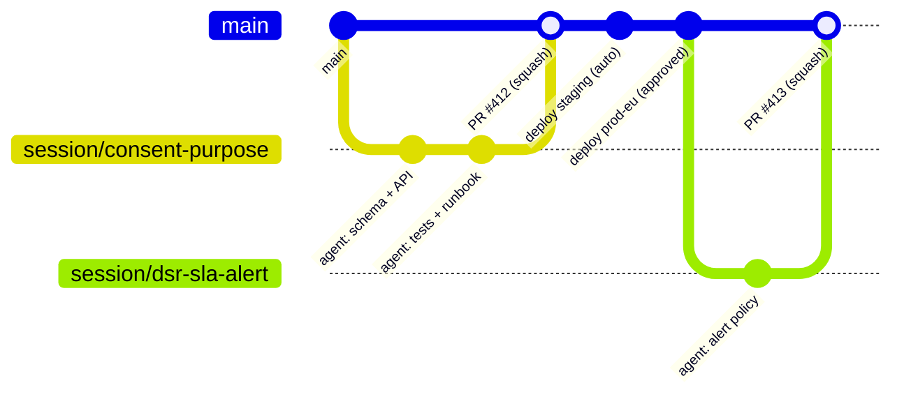
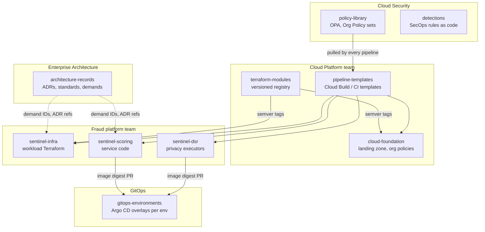
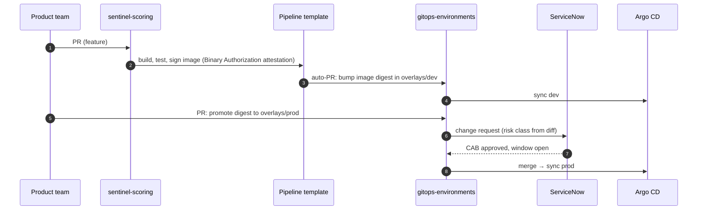
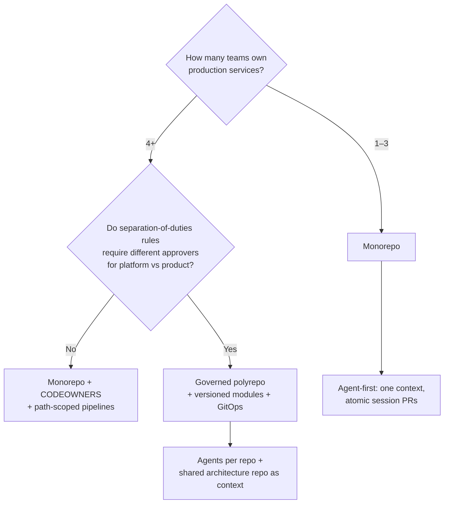

# 11 · Repository Strategy: How Code, Infrastructure and Policy Are Organised

> ⚖️ Not legal or compliance advice. Regulations are paraphrased; organisations and people are fictional. [Disclaimer](../disclaimer.md)

> **Scenario:** An auditor asks Aldervane one question: *"Show me everything that changed in the fraud platform last quarter, who approved it, and how it reached production."* Aldervane has to collect answers from 14 repositories, three ticketing queues and a wiki. Quillpay answers the same question with one link to a Git history. Repository structure is not a matter of taste. It decides how fast you ship, how you prove control, and how well agents and humans can work in the codebase.

Repository topology tends to mirror organisational structure (Conway's law). The two organisations in this playbook make opposite, deliberate choices.

## 1. The two topologies at a glance

| Dimension | 🚀 Quillpay: **monorepo** | 🏦 Aldervane: **governed polyrepo** |
|---|---|---|
| Repositories | 1 product monorepo (+ 1 small bootstrap repo) | ~15 repos, each with a clear owning team |
| Branching | Trunk-based; one short-lived branch per agent session | Trunk-based for code; release tags aligned to CAB windows |
| Change unit | **One session deliverable = one PR** (code + infra + docs + tests) | One PR per repo, linked by change request (CHG) |
| Infra/app coupling | Infra lives beside the service that needs it | Infra separated into platform, module and workload repos |
| Module reuse | Local modules, versioned with the code | Versioned Terraform module registry (semantic version tags) |
| Policy | `policies/` folder evaluated in the same CI run | Central `policy-library` repo consumed by all pipelines |
| Agent context | One `CLAUDE.md`/`AGENTS.md` sees the whole system | Per-repo context files plus a shared architecture repo |
| Audit question "what changed?" | `git log` + PR history | CHG ↔ commit SHA ↔ apply log traceability ([change management](../iac/05-enterprise-iac.md#5-change-management)) |

## 2. 🚀 Quillpay: the product monorepo

A lean team of agent-assisted engineers needs **one place where the whole system is visible**. That applies to humans, and above all to coding agents, which do their best work when the service code, its infrastructure, its tests and its runbook sit side by side.

```text
quillpay-platform/
├── AGENTS.md                    # tool-neutral agent instructions (OpenCode, OpenHands, others)
├── CLAUDE.md                    # Claude Code memory: imports AGENTS.md + Claude-specific notes
├── .claude/
│   ├── settings.json            # permissions (allow/deny), hooks; committed and reviewed
│   ├── agents/                  # subagents: reviewer, compliance-checker, test-writer
│   └── commands/                # repeatable session playbooks (/deliverable, /dsr-change)
├── .mcp.json                    # MCP servers the agents may use (read-only by default)
├── .github/
│   ├── workflows/               # ci.yml, deploy.yml, agent-review.yml
│   ├── CODEOWNERS
│   └── pull_request_template.md # session record: intent, scope, evidence, rollback
├── apps/
│   ├── scoring-service/         # Cloud Run service (rules + ML client)
│   ├── consent-service/         # consent ledger API (PIPEDA 4.3)
│   └── dsr-orchestrator/        # Workflows definitions + executor jobs
├── packages/
│   ├── crypto-shredding/        # per-subject DEK library (shared)
│   └── telemetry/               # OpenTelemetry setup, PII-scrubbing log filter
├── infra/
│   ├── bootstrap/               # run once (see iac/startup/bootstrap)
│   ├── modules/platform/        # jurisdiction cell module
│   └── envs/{staging,prod-eu,prod-ca}/
├── policies/                    # conftest/OPA guardrails
├── docs/
│   ├── adr/                     # architecture decision records
│   ├── runbooks/                # incident, breach, DSR runbooks
│   └── sessions/                # optional: long-running session plans
└── evals/                       # agent evaluation tasks (golden PRs, regression prompts)
```

### Why a monorepo works here

- **Atomic change.** A session that adds a consent purpose changes the API, the BigQuery schema, the Terraform and the runbook in **one reviewable PR**.
- **Agent effectiveness.** Agents can follow a call from `scoring-service` into `packages/crypto-shredding` and down to the KMS key in `infra/`, without cross-repo blind spots.
- **One pipeline, one evidence trail.** SOC 2 change evidence is the PR itself: description, reviews, checks, deployment record.
- **Selective builds.** CI uses path filters (and later Bazel, Nx or Turborepo if build times grow), so a docs-only change doesn't redeploy services.

### Branching and promotion



- `main` is always deployable. Branches live **hours, not weeks**: one per agent session ([Chapter 12](12-agentic-sdlc.md)).
- Merges are squashed, so **one commit equals one deliverable**, which keeps the audit trail readable.
- Staging deploys automatically; `prod-eu` and `prod-ca` deploy through GitHub Environments with required reviewers.
- Unfinished features hide behind **feature flags**, never long-lived branches.

### CODEOWNERS for a lean team

```text
*                       @quillpay/engineers
/infra/                 @quillpay/platform-leads
/policies/              @quillpay/platform-leads @quillpay/compliance
/apps/consent-service/  @quillpay/engineers @quillpay/compliance
/.claude/  /AGENTS.md  /CLAUDE.md  /.mcp.json   @quillpay/platform-leads
```

> 💡 **Agent configuration is code.** Changes to permissions, hooks, MCP servers or agent instructions change what an autonomous tool is allowed to do, so they need the same review as an IAM change.

## 3. 🏦 Aldervane: the governed polyrepo

A 3,000-person IT organisation with separation-of-duties obligations needs **clear ownership boundaries** that match its operating model: platform, security, product teams and enterprise architecture.



### Rules that make polyrepo governable

| Rule | Why |
|---|---|
| **Modules are released, not referenced by branch.** `source = "git::...//cmek?ref=v3.4.1"` | Workload teams upgrade deliberately; platform can ship breaking changes safely |
| **One pipeline template, many repos.** Repos include `pipeline-templates@v2` | Change control is identical everywhere; auditors review one template |
| **Policies are pulled, not copied.** CI fetches `policy-library` at a pinned tag | Security updates guardrails once, and every repo is covered on its next run |
| **Deployments are PRs to `gitops-environments`.** | Production state is declared in Git; promotion = reviewed PR; rollback = revert |
| **Every repo carries a `catalog-info.yaml`.** (owner, demand ID, data classification) | Feeds the developer portal (e.g. Backstage) and the DORA ICT asset register |
| **Archived, not deleted.** | Retention of change history for audit |

### Promotion across environments



## 4. How this playbook repository is organised

This repository is a **documentation monorepo**. It deliberately holds both blueprints side by side so they can be compared. In real use, each blueprint would be split as described above.

| This repo | Quillpay reality | Aldervane reality |
|---|---|---|
| `iac/startup/` | `quillpay-platform/infra/` | n/a |
| `iac/enterprise/landing-zone/`, `modules/` | n/a | `cloud-foundation`, `terraform-modules` |
| `iac/enterprise/policies/` | `quillpay-platform/policies/` | `policy-library` |
| `iac/enterprise/change-management/` | GitHub Environments | `pipeline-templates` |
| `iac/enterprise/demand-management/` | n/a | `architecture-records` |
| `docs/` | `docs/adr`, `docs/runbooks` | `architecture-records` |
| `agentic/quillpay/` | repo root (`CLAUDE.md`, `.claude/`, `AGENTS.md`) | per-repo context files |

## 5. Decision guide



➡️ Next: [12 · Quillpay's Agentic SDLC](12-agentic-sdlc.md)
