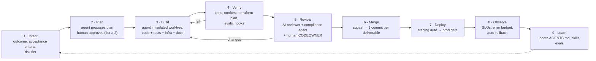
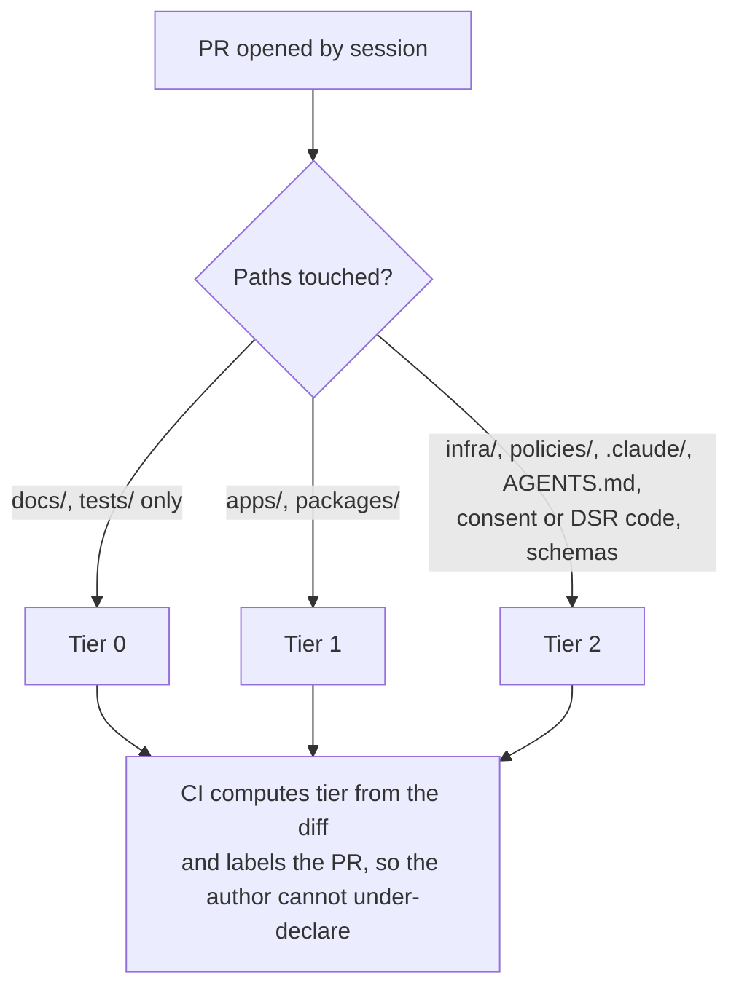

# 12 · Quillpay's Agentic SDLC: A Deliverable per Session, Not a Release per Sprint

> ⚖️ Not legal or compliance advice. Regulations are paraphrased; organisations and people are fictional. [Disclaimer](../disclaimer.md)

> **Scenario:** Quillpay has eight engineers, two jurisdictions, a SOC 2 Type II audit window, and a backlog that would keep a 40-person team busy. Daniel (CTO) retires the sprint: *"Two-week sprints were designed for humans typing every line. Our engineers now direct agents. The unit of work is a session that ends in a merged, deployed, evidenced deliverable."*

## 1. From sprints to sessions

| | Classic Scrum | Quillpay agentic loop |
|---|---|---|
| Unit of planning | Sprint (2 weeks) | **Intent** (one outcome, a few hours) |
| Unit of delivery | Release at sprint end | **Session deliverable**: one PR, merged and deployed the same day |
| Who writes the code | Engineers | Agents, directed and reviewed by engineers |
| Engineer's role | Implementer | **Intent owner, reviewer, architect** |
| Ceremonies | Planning, stand-up, review, retro | 30-min weekly steering + async intent queue + continuous retro via evals |
| Throughput driver | Team velocity (story points) | Parallel sessions × first-pass quality |
| Compliance evidence | Assembled before audits | **Produced by every session** (PR record, checks, hook logs) |

> **Definition.** A **session** is a bounded working run of an engineer and one or more coding agents against a single intent, in an isolated branch or worktree. It ends in exactly one of three states: **merged and deployed**, **parked with a written handoff**, or **abandoned with a reason**.

## 2. The session loop



### What happens in each step

| Step | Human does | Agent does | Exit criterion |
|---|---|---|---|
| **1 · Intent** | Writes a 5–10 line intent in the issue tracker: outcome, acceptance criteria, risk tier, data classes touched | Can draft intents from incidents, alerts or customer tickets | Intent has acceptance criteria and a risk tier |
| **2 · Plan** | Approves the plan for tier ≥ 2 (infra, IAM, crypto, personal-data flows) | Reads code and ADRs, proposes a plan with files, tests and rollback | Plan approved or auto-approved (tier 0–1) |
| **3 · Build** | Steers, answers questions | Implements in a git worktree; writes tests first where possible | Builds locally |
| **4 · Verify** | n/a | Runs unit and integration tests, `conftest`, `terraform plan`, evals; hooks block forbidden actions | All checks green |
| **5 · Review** | CODEOWNER reviews the diff and the session record | `reviewer` and `compliance-checker` subagents comment on the PR | Required approvals present |
| **6 · Merge** | Merges (agents never merge their own work to protected branches) | n/a | Squash commit on `main` |
| **7 · Deploy** | Approves the prod environment gate (tier ≥ 1) | Watches the rollout, posts the deployment summary | Healthy in prod |
| **8 · Observe** | On-call if alerts fire | Correlates logs and metrics, proposes a rollback or fix | SLO unchanged |
| **9 · Learn** | Accepts improvements to instructions and evals | Proposes updates to `AGENTS.md`, skills, eval cases | Learning captured in the repo |

## 3. Risk tiers: autonomy proportional to blast radius

A regulated fintech cannot give agents uniform autonomy. Tiers are declared in the intent and **enforced by CODEOWNERS, branch protection and CI**, not by trust.

| Tier | Examples | Plan approval | Reviews | Prod deploy |
|---|---|---|---|---|
| **0 · Trivial** | Docs, tests, lint, dependency patch bumps | Not required | AI review + 1 human (may be lightweight) | Automatic after staging |
| **1 · Standard** | Application logic, new endpoint behind a flag | Not required | AI review + 1 human CODEOWNER | Environment gate (1 approver) |
| **2 · Sensitive** | Terraform, IAM, KMS, VPC-SC, personal-data schemas, consent/DSR logic, agent configuration | **Required** | AI review + compliance agent + **2 humans** incl. platform lead | Environment gate (2 approvers) |
| **3 · Restricted** | Production data access, incident remediation, key destruction | Human-driven; agents read-only | 2 humans + documented justification | Break-glass via IAM PAM, time-boxed |



## 4. A lean team's day

```mermaid
gantt
    title One engineer, one day (parallel sessions)
    dateFormat HH:mm
    axisFormat %H:%M
    section Session A (tier 1)
    Intent and plan             :a1, 09:00, 15m
    Agent builds and verifies   :a2, after a1, 70m
    Review and merge            :a3, after a2, 20m
    section Session B (tier 2)
    Intent, plan approval       :b1, 09:20, 25m
    Agent builds infra change   :b2, after b1, 90m
    Second reviewer and merge   :b3, after b2, 30m
    section Session C (tier 0)
    Agent updates runbook docs  :c1, 11:00, 30m
    section Reviews for teammates
    Review two PRs              :r1, 13:30, 45m
    section Steering
    Customer call, ADR          :s1, 14:30, 60m
```



**WIP limit:** at most **3 concurrent sessions per engineer**. Review capacity, not generation capacity, is the bottleneck. Measure it and protect it.

### A week of deliverables (illustrative)

| Day | Session deliverables merged and deployed |
|---|---|
| Mon | Consent purpose `consortium_sharing` (API + schema + runbook); DSR SLA alert; dependency patch |
| Tue | Canadian cell: Pub/Sub storage policy fix (tier 2); scoring latency regression fix; evals for consent edge cases |
| Wed | Disclosure-log suppression flag (tier 2); feature-flag cleanup; ADR-019 Spanner trigger metrics |
| Thu | Breach-register export for auditors; Cloud Run min-instances tuning; onboarding-notice copy (EN/FR) |
| Fri | Steering + planning the intent queue; agent-instruction improvements from the week's review comments |

## 5. Compliance by construction

The agentic loop produces **better change-management evidence than sprints did**, because every step leaves a machine-readable trace.

| Control (SOC 2 / ISO 27001 / DORA) | How the loop satisfies it | Evidence |
|---|---|---|
| Change authorisation (SOC 2 CC8.1) | Branch protection, CODEOWNERS, environment gates | PR approvals, deployment records |
| Segregation of duties | Agents run under a **bot identity** (GitHub App) that cannot approve or merge; the human approver ≠ the session owner for tier 2 | Branch protection settings export |
| Traceability | Intent → session branch → squash commit → deployment | Issue links, `Co-Authored-By` trailers naming the agent |
| Secure development (ISO 8.25–8.28) | Hooks block secrets, forbidden commands and prod access; CI runs SAST and conftest | Hook audit log, CI results |
| Data protection (GDPR Art. 25/32, PIPEDA 4.7) | Agents only see synthetic data; models run in the **EU region** (Vertex AI) or are self-hosted; DLP hook scans prompts and outputs | Vertex AI region config, hook logs |
| ICT third-party risk (DORA Art. 28) | Model providers in the third-party register; a self-hosted fallback ([Chapter 13](13-agent-platform.md)) avoids single-vendor dependency | Register entry, fallback runbook |

### The PR is the session record

```markdown
## Session record
**Intent:** #412 Add consent purpose `consortium_sharing` (CA cell)
**Risk tier:** 2 (personal-data flow, schema)  · **Plan approved by:** @lead-a
**Agent(s):** Claude Code (Vertex AI, eu) · subagents: test-writer, compliance-checker
**What changed:** API, BigQuery schema, Terraform (none), runbook, 14 tests
**Verification:** unit ✔ integration ✔ conftest ✔ evals 22/22 ✔
**Data:** synthetic only · no production access
**Rollback:** feature flag `consent.consortium_sharing=false`; schema change is additive
**Compliance notes:** PIPEDA 4.3 express consent captured; disclosure_log entry type added
```

## 6. Metrics

| Category | Metric | Target |
|---|---|---|
| DORA four keys | Deployment frequency | Multiple per engineer per day |
| | Lead time (intent → prod) | < 1 day for tier 0–1 |
| | Change failure rate | < 10% |
| | Time to restore | < 1 h |
| Agent effectiveness | First-pass CI success rate | > 80% |
| | Review rework rate (PRs needing > 1 change round) | < 25% |
| | Eval pass rate on golden tasks | ≥ 95%, tracked per model version |
| | Cost per merged deliverable | Tracked weekly |
| Safety | Hook blocks per week (and false positives) | Trend, reviewed in steering |
| | Escaped defects attributable to agent changes | Root-caused, fed back into evals |

## 7. Anti-patterns

| Anti-pattern | Why it hurts | Instead |
|---|---|---|
| **Mega-session** ("refactor the platform") | Unreviewable diff, no rollback point | Split into intents of one outcome each |
| **Unreviewed agent configuration** | A permission change is an IAM change | Tier 2 for `.claude/`, `AGENTS.md`, `.mcp.json` |
| **Tribal prompting** | Knowledge lives in someone's chat history | Encode it in `AGENTS.md`, skills and evals |
| **Agents with production credentials** | One prompt-injection away from an incident | Staging-only credentials; prod via PAM for humans |
| **Measuring output, not outcomes** | Lines of code and PR counts reward noise | DORA keys + escaped defects + review load |
| **Skipping evals when models change** | Silent quality regressions | Eval suite gates model and instruction changes |

➡️ Next: [13 · Agent Platform Setup](13-agent-platform.md)
