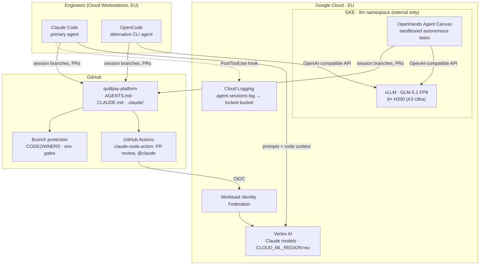
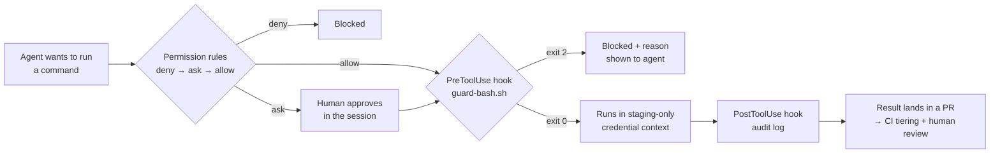
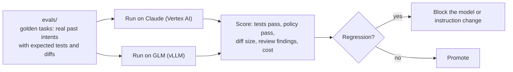

# 13 · Agent Platform Setup: Claude Code, with OpenCode and OpenHands on Self-hosted GLM

> ⚖️ Not legal or compliance advice. Regulations are paraphrased; organisations and people are fictional. [Disclaimer](../disclaimer.md)

> **Scenario:** Quillpay's DPO asks two questions before approving coding agents: *"Where does our source code go when an engineer prompts a model?"* and *"If that vendor disappears tomorrow, can we still ship?"* The platform below answers both. The primary agent is **Claude Code on Vertex AI in the EU**, and the **sovereign fallback** is OpenCode and OpenHands running against a **self-hosted GLM** model on GKE.

The complete reference configuration lives in [`agentic/quillpay/`](https://github.com/KshitijV97/gcp-fintech-architecture-playbook/tree/main/agentic/quillpay).

## 1. Platform architecture



| Concern | Answer |
|---|---|
| **Where does code go?** | Claude Code calls **Vertex AI** in Quillpay's own GCP project, pinned to the `eu` multi-region. Prompts stay inside Google Cloud's contractual and data-processing terms, with no separate vendor account. The GLM path never leaves Quillpay's VPC. |
| **What can agents touch?** | Repository files, staging, and approved MCP servers. Production, secrets and key destruction are blocked by permissions **and** hooks. |
| **Can we prove it?** | Every tool call is logged by a hook to Cloud Logging and routed to the locked audit bucket. Every change arrives as a reviewed PR. |
| **Vendor exit (DORA Art. 28)?** | `AGENTS.md` is tool-neutral, so the same rules drive OpenCode and OpenHands on self-hosted GLM. The eval suite is run against both models. |

## 2. Primary: Claude Code

### 2.1 Repository files

| File | Purpose |
|---|---|
| [`AGENTS.md`](https://github.com/KshitijV97/gcp-fintech-architecture-playbook/blob/main/agentic/quillpay/AGENTS.md) | Tool-neutral rules: session workflow, risk tiers, hard rules (no prod, no secrets, residency, crypto) |
| [`CLAUDE.md`](https://github.com/KshitijV97/gcp-fintech-architecture-playbook/blob/main/agentic/quillpay/CLAUDE.md) | Imports `@AGENTS.md` and adds Claude-specific notes, so there is one source of truth |
| [`.claude/settings.json`](https://github.com/KshitijV97/gcp-fintech-architecture-playbook/blob/main/agentic/quillpay/.claude/settings.json) | Vertex AI (`eu`), `allow` / `ask` / `deny` permission rules, hooks |
| [`.claude/hooks/guard-bash.sh`](https://github.com/KshitijV97/gcp-fintech-architecture-playbook/blob/main/agentic/quillpay/.claude/hooks/guard-bash.sh) | `PreToolUse` guard: blocks prod projects, `terraform apply/destroy`, KMS destruction, secrets, network exfiltration, force pushes (exit code 2) |
| [`.claude/hooks/audit-log.sh`](https://github.com/KshitijV97/gcp-fintech-architecture-playbook/blob/main/agentic/quillpay/.claude/hooks/audit-log.sh) | `PostToolUse` audit trail: JSON lines locally and in Cloud Logging |
| [`.claude/agents/`](https://github.com/KshitijV97/gcp-fintech-architecture-playbook/tree/main/agentic/quillpay/.claude/agents) | Subagents: `reviewer`, `compliance-checker` (tier 2), `test-writer` |
| [`.claude/skills/deliverable/SKILL.md`](https://github.com/KshitijV97/gcp-fintech-architecture-playbook/blob/main/agentic/quillpay/.claude/skills/deliverable/SKILL.md) | `/deliverable <intent>`: starts a session the same way every time |
| [`.mcp.json`](https://github.com/KshitijV97/gcp-fintech-architecture-playbook/blob/main/agentic/quillpay/.mcp.json) | Approved MCP servers (GitHub) |
| [`github/claude-pr-review.yml`](https://github.com/KshitijV97/gcp-fintech-architecture-playbook/blob/main/agentic/quillpay/github/claude-pr-review.yml) | CI reviewer via `anthropics/claude-code-action@v1` with `use_vertex: "true"` |

### 2.2 Defence in depth for agent actions



> **Why both permission rules and hooks?** Prefix deny rules match command prefixes. A rule like `Bash(curl *)` does not catch `sh -c 'curl …'` or `/usr/bin/curl`. The hook inspects the full command string. And even if both were bypassed, the agent's credentials only reach staging, and every change still needs a human-approved PR. Each layer assumes the one before it can fail.

### 2.3 Organisation-wide enforcement

Project settings can be edited by anyone with commit access, and that edit is itself a tier-2 change. For controls that must hold even on a misconfigured laptop, Quillpay deploys **managed settings** through MDM: `/Library/Application Support/ClaudeCode/managed-settings.json` (macOS) or `/etc/claude-code/managed-settings.json` (Linux). These pin the Vertex AI provider and region and the critical `deny` rules, so a project file cannot widen them.

### 2.4 Vertex AI setup (EU)

```bash
# Per engineer: put these in .claude/settings.local.json or the shell profile
export CLAUDE_CODE_USE_VERTEX=1
export CLOUD_ML_REGION=eu                       # EU multi-region
export ANTHROPIC_VERTEX_PROJECT_ID=qp-shared-ai # Quillpay's AI project (not prod)
gcloud auth application-default login           # user identity; no keys
```

- The AI project grants `roles/aiplatform.user` to the engineering group and the CI service account only.
- Check which Claude models are offered in `eu` in Model Garden. Some models are only offered on `global` or multi-region endpoints, so pick `eu`, not `global`, for residency.
- Track spend per engineer and per session with labels and budgets; cost per merged deliverable is a team metric ([Chapter 12](12-agentic-sdlc.md#6-metrics)).

## 3. Alternatives: OpenCode and OpenHands on self-hosted GLM

### 3.1 Why keep an alternative at all?

| Driver | Explanation |
|---|---|
| **DORA concentration risk** | Coding agents are now part of the delivery pipeline (an ICT service). A credible exit plan needs a second path that works. |
| **Sovereignty requests** | Some enterprise customers (banks) contractually forbid sending their integration code to any external model. |
| **Cost control at scale** | Long autonomous jobs (mass dependency upgrades, test backfills) can be cheaper on reserved GPUs than per-token pricing. |
| **Open weights** | GLM is released under an **MIT licence** with open weights, so there are no usage restrictions on self-hosting. |

### 3.2 Serving GLM on GKE

[`self-hosted-llm/glm-vllm.yaml`](https://github.com/KshitijV97/gcp-fintech-architecture-playbook/blob/main/agentic/quillpay/self-hosted-llm/glm-vllm.yaml) deploys **vLLM** with an OpenAI-compatible API:

- **Model:** GLM-5.2 in **FP8**, a large mixture-of-experts model. One 8-GPU **H200** (A3 Ultra) or B200 node is the common baseline. Confirm VRAM, minimum vLLM version and the tool-call parser on the model card before deploying.
- **Network:** internal load balancer + NetworkPolicy. Reachable from Cloud Workstations and the OpenHands namespace only, **never the internet**.
- **Secrets:** API key and HF token from Secret Manager.
- **Capacity:** GPU reservations or DWS flex-start; scale to zero outside working hours for cost.

> ⚖️ **Honest trade-off.** An 8×H200 node is a significant fixed cost for an eight-person team. Quillpay runs it **on a schedule**, for batch autonomous work and DR drills, and keeps Claude on Vertex AI as the interactive default. The point is a *tested* exit path, not to replace the primary tool.

### 3.3 OpenCode (interactive CLI)

[`opencode/opencode.jsonc`](https://github.com/KshitijV97/gcp-fintech-architecture-playbook/blob/main/agentic/quillpay/opencode/opencode.jsonc) defines a custom OpenAI-compatible provider (`providers.glm`, `settings.baseURL`) and ordered `permissions` rules that mirror the Claude Code policy. OpenCode reads **`AGENTS.md`** natively, so engineers switch tools without changing the rules.

### 3.4 OpenHands (sandboxed autonomous tasks)

[`openhands/README.md`](https://github.com/KshitijV97/gcp-fintech-architecture-playbook/blob/main/agentic/quillpay/openhands/README.md) runs **Agent Canvas** in a container, pointed at `openai/glm-5.2` through the internal base URL. It suits long-running, well-specified jobs that end in a PR, and it is treated as untrusted code execution: container sandbox, staging-only service account, and egress restricted to the GLM endpoint, package mirrors and GitHub.

## 4. Choosing the tool per session

| Session type | Default tool | Model |
|---|---|---|
| Interactive feature work (tier 0–2) | Claude Code | Claude on Vertex AI (`eu`) |
| PR review, `@claude` requests | claude-code-action | Claude on Vertex AI (`eu`) |
| Customer-sovereign code (contract forbids external models) | OpenCode | Self-hosted GLM |
| Long autonomous batch (upgrades, test backfill) | OpenHands | Self-hosted GLM |
| DR drill: "primary model unavailable" | OpenCode + OpenHands | Self-hosted GLM |

## 5. Evaluations: one suite, every model



Every change to a model version, `AGENTS.md`, a skill or a subagent runs the eval suite first, so instruction changes are tested like code changes.

## 6. Rollout plan

| Week | Step |
|---|---|
| 1 | AI project + Vertex AI (`eu`) access; managed settings via MDM; `AGENTS.md` + `CLAUDE.md`; hooks in **audit-only** mode |
| 2 | Enforce hooks; CI tiering; claude-code-action reviewer; PR template session record |
| 3 | Subagents and `/deliverable` skill; first eval suite from 20 past PRs |
| 4 | GLM on GKE (scheduled); OpenCode config; first DR drill ("Vertex AI unavailable for a day") |
| 5+ | OpenHands for batch work; quarterly eval review; DORA register entry for the agent platform |

➡️ Back to [Repository strategy](11-repository-strategy.md) · [Agentic SDLC](12-agentic-sdlc.md)
