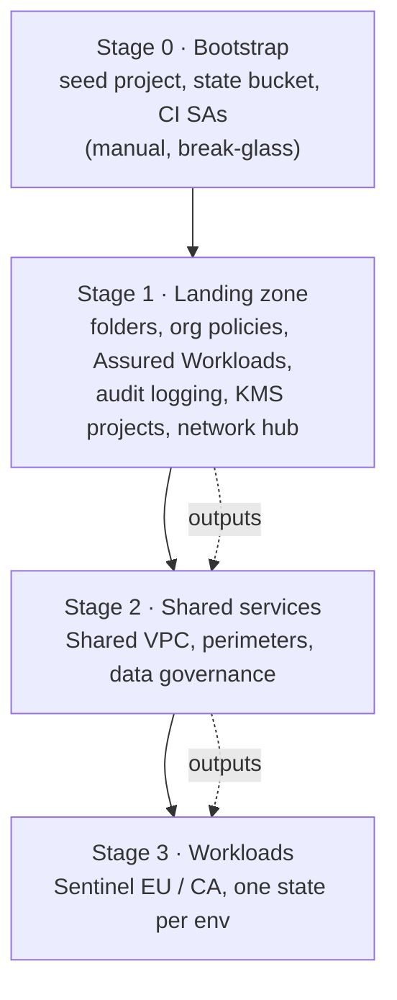
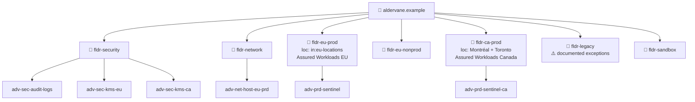
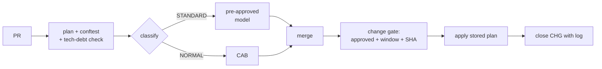
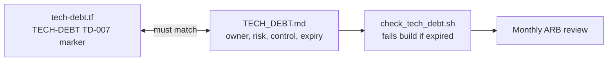

# 05 · IaC for the Enterprise: Aldervane Bank

> ⚖️ **Disclaimer:** educational material only. This is **not legal, regulatory, compliance or financial advice**. Regulations are paraphrased and simplified; organisations, people and incidents are fictional. Consult qualified counsel before you rely on any of it. [Full disclaimer](../../README.md#disclaimer)

> **Story hook:** Aldervane's first cloud attempt in 2023 was a "big bang" Terraform root module written by a consultancy: 4,000 lines, one state file, applied from a laptop. An internal audit finding read: *"Infrastructure changes are not subject to the bank's change management process."* This chapter describes the rebuild.

Code: [`iac/enterprise/`](../../iac/enterprise/)

## 1. What makes enterprise IaC different

| Concern | Startup answer | Enterprise answer |
|---|---|---|
| Who can change prod? | Two reviewers in GitHub | CODEOWNERS + CAB + change window + separation of duties |
| Why does this resource exist? | Slack thread | **Demand ID** label linked to a funded, approved demand |
| What's allowed? | A few org policies | Full guardrail set + **service allow-list** + jurisdiction cells |
| Legacy? | None | **Technical-debt register** enforced in CI; `moved`/`import` blocks |
| Proof? | CI logs | **Evidence packs**, CHG ↔ commit ↔ apply log traceability |

## 2. Layered architecture (stages)



Each stage has **its own state file, its own service account and its own CODEOWNERS**. A workload team can't change org policies, and the security team doesn't have to review node-pool sizes.

## 3. Resource hierarchy



## 4. Module catalogue

| Module | Purpose | Key compliance feature |
|---|---|---|
| [`org-policies`](../../iac/enterprise/modules/org-policies/main.tf) | Guardrails | EU/CA locations, no SA keys, CMEK required, service allow-list |
| [`project-factory`](../../iac/enterprise/modules/project-factory/main.tf) | The only way to create projects | Mandatory labels incl. `demand_id`, essential contacts, budgets, deletion protection |
| [`cmek`](../../iac/enterprise/modules/cmek/main.tf) | Key rings and keys in central KMS projects | HSM, rotation, `destroy_scheduled_duration` = crypto-shred delay |
| [`audit-logging`](../../iac/enterprise/modules/audit-logging/main.tf) | Org sinks → locked bucket + WORM archive | 5-year queryable, 10-year archive, data-access logs on |
| [`vpc-sc-perimeter`](../../iac/enterprise/modules/vpc-sc-perimeter/main.tf) | Exfiltration control | Dry-run first, then enforce via CAB |
| [`shared-vpc`](../../iac/enterprise/modules/shared-vpc/main.tf) | Network hub | No internet route, restricted VIP only, flow logs |
| [`data-governance`](../../iac/enterprise/modules/data-governance/main.tf) | Dataplex + SDP + policy tags | RoPA aspect, masking, PII discovery, data quality |

## 5. Change management

Full detail is in [`change-management/README.md`](../../iac/enterprise/change-management/README.md). In short:



**Key ideas:**
- The **risk class is computed** from the plan (deletes, sensitive types, blast radius), not chosen by the author.
- **The reviewed plan is the applied plan**: plans are stored by commit SHA.
- **GKE maintenance windows match CAB windows**, so Google's automatic upgrades only happen inside approved windows.
- **VPC-SC goes dry-run → enforce** as two separate changes, with violation logs reviewed in between.

## 6. Demand management

Full detail is in [`demand-management/README.md`](../../iac/enterprise/demand-management/README.md). The project factory **refuses** to create a project without a `demand_id` that matches `dmd-NNNN`, and the org-wide `gcp.restrictServiceUsage` allow-list is generated from `approved-services.yaml`, where every entry references a security assessment. Using a new Google service therefore requires a demand.

## 7. Technical debt: visible, owned, expiring



Patterns demonstrated in [`landing-zone/tech-debt.tf`](../../iac/enterprise/landing-zone/tech-debt.tf):

| Pattern | Example |
|---|---|
| **Scoped guardrail exception** | Public IP allowed for *one named VM* in `fldr-legacy` (TD-007) |
| **Exception with compensating controls** | SA keys allowed only in `fldr-legacy`, with rotation and IAM Deny (TD-011) |
| **Refactor without destroy** | `moved` blocks from flat resources to modules (TD-003); critical for KMS keys, since destroying a key shreds the data |
| **Adopt ClickOps resources** | `import` blocks (TD-014) |
| **Architectural debt** | AlloyDB → Spanner target (TD-019) |

## 8. Running it (sandbox org)

```bash
cd iac/enterprise/landing-zone
cp terraform.tfvars.example terraform.tfvars   # edit values
terraform init -backend-config="bucket=<your-state-bucket>"
terraform plan -out tfplan
terraform show -json tfplan > plan.json
conftest test plan.json --policy ../policies
```

> ⚠️ Keep `lock_audit_buckets = false` in a sandbox. Locking cannot be undone.

➡️ Next: [06 · IaC for the Startup](06-startup-iac.md)
