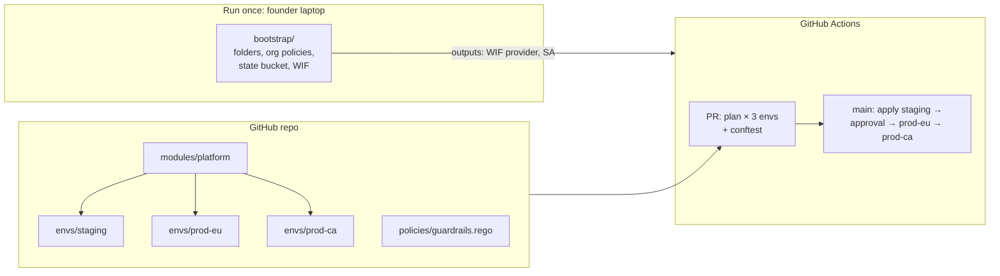
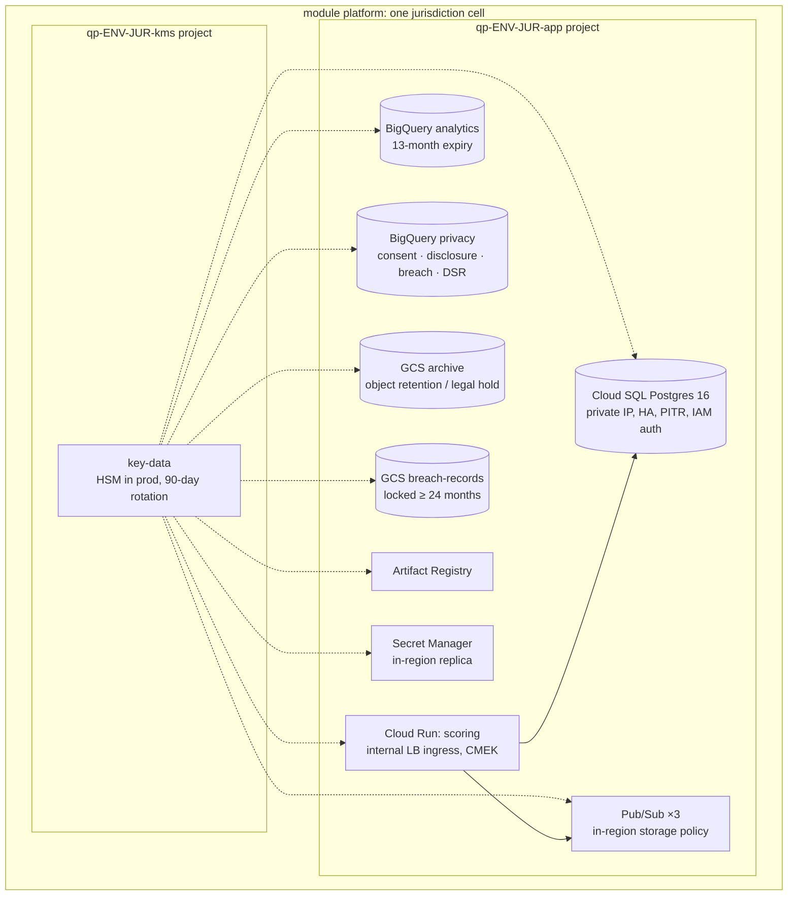
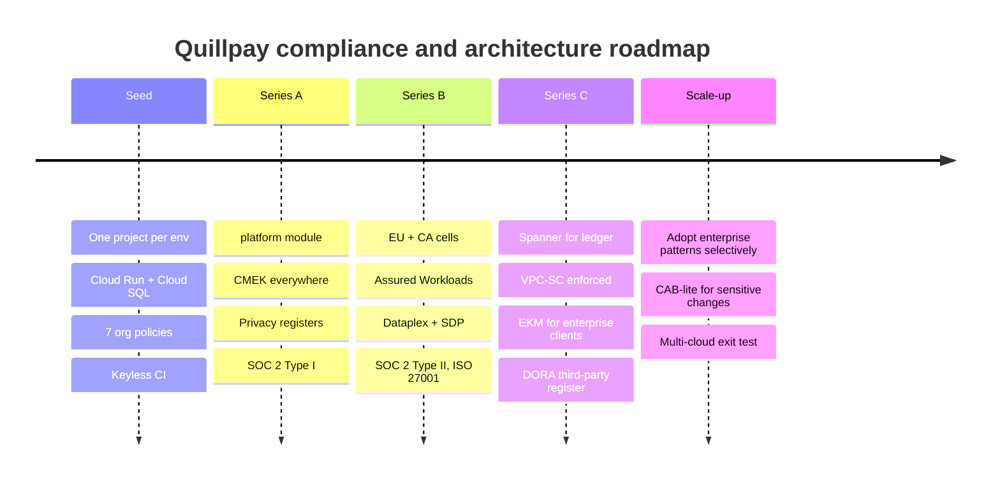

# 06 · IaC for the Startup: Quillpay

> ⚖️ **Disclaimer:** educational material only. This is **not legal, regulatory, compliance or financial advice**. Regulations are paraphrased and simplified; organisations, people and incidents are fictional. Consult qualified counsel before you rely on any of it. [Full disclaimer](../../README.md#disclaimer)

> **Story hook:** Daniel (Quillpay's CTO) has a rule: *"Compliance work we do once, in code, is an investment. Compliance work we do every quarter by hand is a tax."* Quillpay has no CAB and no ARB, just 60 engineers, GitHub, and a Series B due-diligence checklist that includes SOC 2 Type II, ISO 27001, GDPR and, now that it's expanding, PIPEDA.

Code: [`iac/startup/`](../../iac/startup/)

## 1. Principles

1. **Paved road, not gates.** One module (`platform`) produces a compliant jurisdiction cell. Engineers get compliance by using it.
2. **Keyless from day one.** GitHub → Workload Identity Federation → a short-lived token. There are no JSON keys to leak.
3. **Guardrails at the org, checks in the PR.** Seven org policies + one Rego file cover most of the risk.
4. **Cells, not conditionals.** EU and Canada are two instances of the same module with different parameters.
5. **Evidence by default.** Privacy registers are created with the platform, not added later.

## 2. Layout and flow

## 3. What one `platform` cell contains

## 4. Growth path: compliance that scales with the company

### Cloud SQL → Spanner (when?)

| Signal | Threshold |
|---|---|
| Write throughput on the ledger | > ~5–10k writes/s sustained |
| Availability target | 99.99%+ with RPO = 0 across regions |
| Operational pain | Manual sharding discussions start |

Migration: Spanner's **PostgreSQL dialect** keeps most SQL and drivers. Database Migration Service or Datastream + Dataflow handle the backfill, followed by a dual-write cutover.

## 5. Mapping startup controls to certifications

| Startup control | SOC 2 | ISO 27001:2022 Annex A | GDPR | PIPEDA |
|---|---|---|---|---|
| Keyless CI (WIF) | CC6.1 | 5.17, 8.5 | 32 | 4.7 |
| GitHub environment approvals | CC8.1 | 8.32 | 32 | 4.7 |
| Org policies: residency | CC6.1 | 5.34 | 44 | 4.1.3 |
| CMEK + HSM | CC6.1, CC6.7 | 8.24 | 32 | 4.7 |
| Privacy registers | P-series | 5.34 | 7, 12, 15, 33(5) | 4.3, 4.9, 4.10, s.10.3 |
| Budgets + alerts | (A1) | 5.9 | n/a | n/a |
| Locked breach records | CC7.4 | 5.25–5.27 | 33(5) | s.10.3 |

## 6. What Quillpay deliberately does *not* do (yet)

| Enterprise feature | Why not yet | Trigger to adopt |
|---|---|---|
| CAB + ServiceNow | Two-reviewer PRs + environment approvals give SOC 2-grade change evidence | First bank or enterprise client that contractually requires ITIL change records |
| Shared VPC hub | One VPC per cell is simpler | > 5 workloads per cell |
| Demand management | The founders *are* the portfolio board | > 150 engineers or multiple business lines |
| `gcp.restrictServiceUsage` allow-list | Slows experimentation | First regulator inspection |
| VPC-SC enforced | Adds friction to dev tooling | Series C / handling card data (PCI DSS) |

➡️ Next: [08 · Data Governance](../08-data-governance.md)
