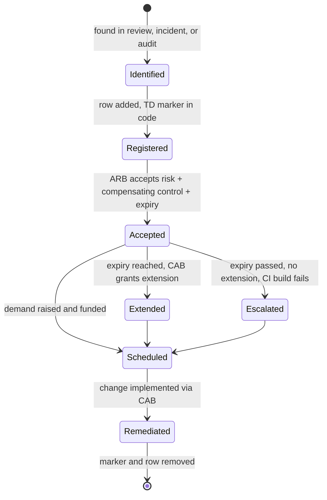

# Technical Debt Register: Cloud Platform

> Maintained by the Cloud Platform team and reviewed monthly in the Architecture Review Board. Every `TECH-DEBT TD-xxx` marker in Terraform **must** have a row here; `change-management/scripts/check_tech_debt.sh` enforces this in CI and fails the build when an expiry date has passed.

| ID | Title | Category | Risk | Compensating control | Owner | Expiry | Code |
|---|---|---|---|---|---|---|---|
| TD-003 | Flat KMS resources from the 2023 root module, being refactored into modules | Structural | Low | `moved` blocks; `prevent_destroy` on keys | platform-eng | 2027-03-31 | `landing-zone/tech-debt.tf` |
| TD-007 | Legacy SFTP gateway needs a public IP | Guardrail exception | High | Cloud Armor allow-list, Cloud IDS, quarterly pen test | payments-integration | 2027-06-30 | `landing-zone/tech-debt.tf` |
| TD-011 | Vendor tool authenticates with an SA key | Guardrail exception | High | 30-day key rotation, IAM Deny, usage alerts | finance-it | 2027-03-31 | `landing-zone/tech-debt.tf` |
| TD-014 | ClickOps bucket from 2024 incident, not yet in Terraform | Drift | Medium | Bucket inside VPC-SC perimeter, UBLA enforced by org policy | data-platform | 2027-01-31 | `landing-zone/tech-debt.tf` |
| TD-019 | Sentinel EU on AlloyDB; ARB target is Spanner for 99.999% | Architectural | Medium | Cross-region secondary cluster, DR drill quarterly | fraud-platform | 2027-12-31 | `workloads/sentinel` |

## Lifecycle

