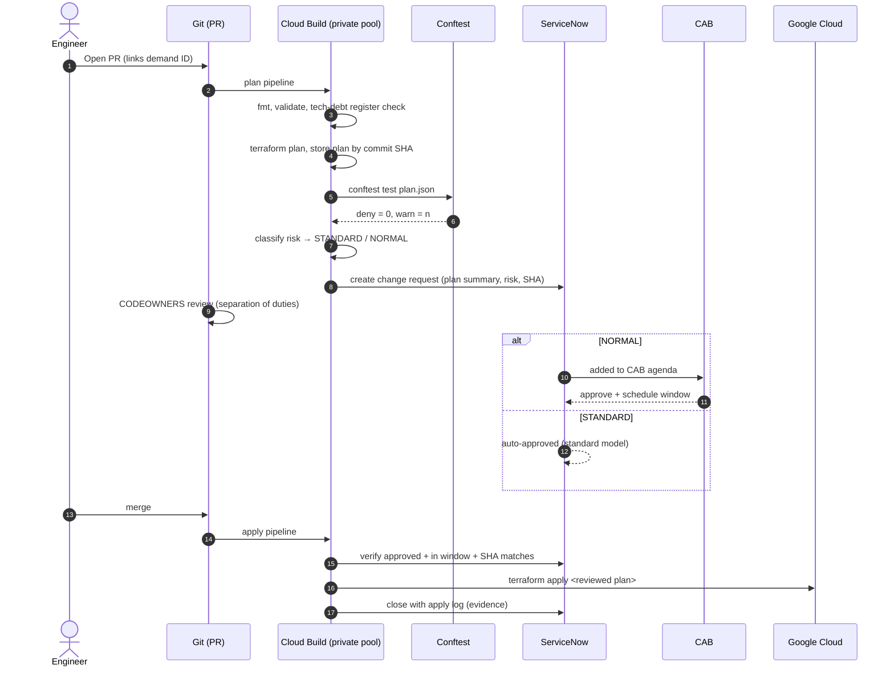

# Change Management: Infrastructure as Code, the ITIL Way

Aldervane's ITIL process predates the cloud. Instead of bypassing it, the pipeline **automates the evidence the CAB already asks for**: what changes, risk, rollback, test results, approvals.

## Change types

| Type | Criteria (computed by `scripts/classify_change.sh`) | Approval | Window |
|---|---|---|---|
| **Standard** | Only creates/updates, no sensitive resource types, ≤ 20 resources | Pre-approved model; 2 peer reviewers in the PR | Any standard window |
| **Normal** | Any delete/replace, any sensitive type (KMS, perimeters, org policies, log sinks, databases), or > 20 resources | CAB (weekly) | Planned window, e.g. Saturday 01:00–05:00 UTC |
| **Emergency** | Production incident (Sev-1/2) | ECAB (on-call manager + security), retrospective CAB within 5 days | Immediate |

## End-to-end flow

## Why apply the *stored* plan?

Auditors ask: *"How do you know what was applied is what was approved?"* The apply pipeline downloads the plan file stored under the **approved commit SHA** and runs `terraform apply tfplan`. Terraform refuses to apply a stale plan if the state has changed since, so the plan that gets applied is exactly the plan that was approved.

## Drift detection

A nightly scheduled build runs `terraform plan -detailed-exitcode` on every root module. Exit code `2` (drift) opens an **incident** in ServiceNow. Unauthorised ClickOps changes count as security events, and the Cloud Audit Logs entry shows who made them.

## Rollback

- **Code rollback:** revert the PR, which goes through the same pipeline (usually a Standard change).
- **Data-bearing resources** (KMS keys, databases, log buckets) are protected by `prevent_destroy`, `deletion_protection` and `deletion_policy = "PREVENT"`. Rollback never destroys data.

## Files

| File | Purpose |
|---|---|
| `cloudbuild-plan.yaml` | PR pipeline |
| `cloudbuild-apply.yaml` | Merge pipeline with change gate |
| `scripts/classify_change.sh` | Plan → Standard/Normal |
| `scripts/servicenow_change.sh` | Draft / verify / close change requests |
| `scripts/check_tech_debt.sh` | Enforces the tech-debt register |
| `CODEOWNERS.example` | Separation of duties |
