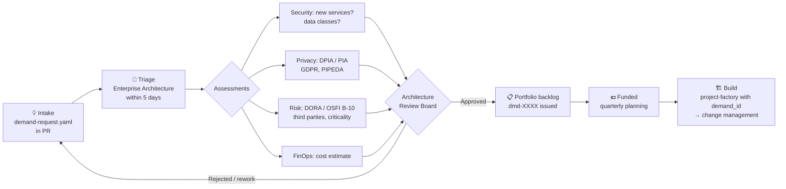

# Demand Management: From Idea to Funded Infrastructure

**Demand management** decides *what* gets built and *whether* it's worth it. **Change management** controls *how* it reaches production. At Aldervane, no cloud project exists without an approved demand, and the project factory enforces this with the `demand_id` label.

## Lifecycle

## How demand management shows up in the code

| Mechanism | Where |
|---|---|
| Projects need a valid `demand_id` label (`dmd-NNNN`) | `modules/project-factory/variables.tf` validation, `policies/security_baseline.rego` |
| New Google Cloud services need a security assessment before they reach the org allow-list | `approved-services.yaml` → `gcp.restrictServiceUsage` |
| Budgets come from the demand's cost estimate | `monthly_budget_eur` in the project factory |
| Jurisdiction (EU / CA) decided at intake | `jurisdiction` label, residency policy |

## Files

| File | Purpose |
|---|---|
| [`demand-request.template.yaml`](demand-request.template.yaml) | Intake form, as code |
| [`demands/dmd-0042-sentinel.yaml`](demands/dmd-0042-sentinel.yaml) | Worked example: Project Sentinel (EU) |
| [`demands/dmd-0057-sentinel-canada.yaml`](demands/dmd-0057-sentinel-canada.yaml) | Worked example: Sentinel Canada (Case 5) |
| [`approved-services.yaml`](approved-services.yaml) | Service allow-list with assessment references |
